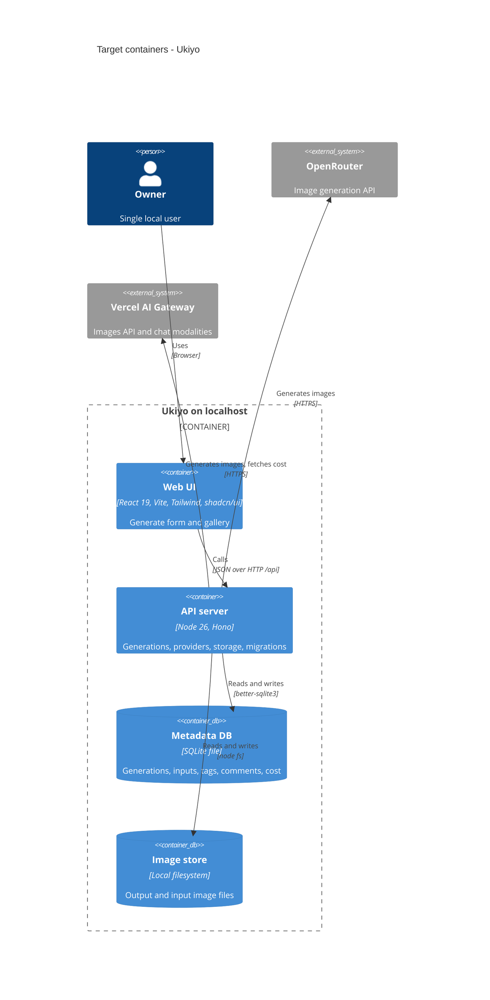

# Architecture map — Ukiyo

> **Greenfield foundation** (`mode: greenfield-bootstrap`): this describes the **target baseline**
> fixed by `survey` on 2026-10-18 — what `/sdd:scaffold` materializes and what every feature builds
> into. Paths below marked *(target)* do not exist yet; scaffold creates them (task id in brackets).
> Intent source: [`docs/idea-brief.md`](./idea-brief.md). Foundational decisions:
> [ADR-0001](./adr/0001-use-typescript-node-hono-react-stack.md),
> [ADR-0002](./adr/0002-organize-as-modular-monolith-with-provider-port.md),
> [ADR-0003](./adr/0003-store-metadata-in-sqlite-and-images-on-disk.md).

**What it is:** a local-first web app for one user on one machine. A Node server bound to
`127.0.0.1` calls OpenRouter and Vercel AI Gateway to generate images (text→img, img→img,
img+text→img), stores every generation locally (image files + inputs + full metadata) and serves a
browser UI with a gallery to inspect, comment, tag, delete, re-run (same or another model) and reuse
an output as the next input. No auth, no sync, no multi-user. Native desktop wrapper: later, not v1.

## Stack

- Language / runtime: TypeScript 5 (strict) on **Node 26** (current stable line; pinned via
  `.nvmrc` + `package.json#engines`) — *(target)* [S1]
- Package manager: **pnpm** (single package, no monorepo)
- Server: **Hono** + `@hono/node-server`, listens on `127.0.0.1:8787` only
- Frontend: **React 19 + Vite**, **Tailwind CSS v4**, **shadcn/ui** (Radix-based components copied
  into the repo), **TanStack Query** for server state
- Validation / shared types: **zod** schemas in `src/shared/` used by both server and web
- Persistence: **SQLite** via `better-sqlite3` (hand-written SQL) + image files on the local
  filesystem under `data/` — see ADR-0003
- Provider HTTP: plain `fetch` (no vendor SDK) so raw request/response can be persisted
- Build / test / lint:
  - `pnpm dev` — server (`tsx watch`) + Vite dev server (`:5173`, proxies `/api` → `:8787`)
  - `pnpm build` — `tsc --noEmit` + `vite build` (SPA into `dist/web/`)
  - `pnpm start` — one process: API + built SPA on `127.0.0.1:8787`
  - `pnpm test` — Vitest (unit + integration) · `pnpm typecheck` — `tsc --noEmit` (the "vet" gate)
  - `pnpm lint` — Biome (lint + format check) · `pnpm format` — Biome write
  - `pnpm db:migrate` / `pnpm db:rollback` — migration runner
- CI: **none** (owner decision 2026-10-18) — the local gate is `pnpm typecheck && pnpm lint && pnpm test`.

## C4 — system as it is

Target baseline (greenfield) — what the scaffold + v1 features produce.

## Module inventory

Server modules live in `src/server/modules/<module>/`. "Status" = what exists after `/sdd:scaffold`.

| Module | Path | Layers | Wired at | Responsibility | Status |
|---|---|---|---|---|---|
| system | `src/server/modules/system/` | routes | `src/server/app.ts` (`createApp`) | `GET /api/health` — baseline module & smoke-test target | scaffold [S1] |
| generations | `src/server/modules/generations/` | domain / service / repo / routes | `src/server/app.ts` | create, list (newest first, optionally one provider + model or one prompt key), prompt groups, get, re-run, comment, tag, delete generations; per-model counts; parent→child lineage | planned (roadmap) |
| providers | `src/server/modules/providers/` | port (`ImageProvider`) + adapters | `src/server/app.ts` (adapter registry) | OpenRouter `/api/v1/images`; Vercel `/v1/images/generations` + `/v1/images/edits`; Vercel chat `modalities`; async Vercel cost lookup | planned (roadmap) |
| models | `src/server/modules/models/` | repo / routes | `src/server/app.ts` | the Owner's per-model preferences (favorite, hidden) per provider + model id; turning a flag on is checked against the provider catalog (ADR-0026, ADR-0029); read by the generate picker and the Models section (`src/web/features/models/`) | built (steps 9–10) |
| storage | `src/server/modules/storage/` | infra | injected into services | write/read image files under `data/generations/<id>/` | planned (roadmap) |
| db | `src/server/db/` | infra | `src/server/app.ts` | open SQLite, run pending migrations on boot | scaffold [S3] |
| lib | `src/server/lib/` | shared | imported | `AppError` + error middleware, ULID ids, config (env via zod) | scaffold [S1] |
| shared | `src/shared/` | contracts | imported by server + web | zod schemas / DTO types for the HTTP API | scaffold [S1] |
| web | `src/web/` | app / features / components | `src/web/main.tsx` | SPA: generate form, gallery, detail view | scaffold [S1] (shell only) |

## Conventions (cited — the rules a new feature must match)

All cited files are *(target)* — created by the scaffold task in brackets.

- **Module wiring / registration:** each server module exports `register<Module>Routes(app, deps)`;
  `createApp(deps)` in `src/server/app.ts` mounts them under `/api`. Dependencies (db, file store,
  provider registry, clock) are passed in explicitly — no global singletons — so tests build an app
  with fakes. — `src/server/app.ts` [S1]
- **Error handling:** throw `AppError(code, message, status, details?)`; one Hono `onError` handler
  renders `{ "error": { "code", "message", "details"? } }`. Upstream provider failures →
  `code: "PROVIDER_ERROR"` with `details.provider`, `details.upstreamStatus`. Validation failures →
  `VALIDATION_ERROR` (400). — `src/server/lib/errors.ts` [S1]
- **IDs:** ULID strings generated in the app (time-sortable → gallery order "newest first" without
  extra index). — `src/server/lib/ids.ts` [S1]
- **Persistence / DB access:** hand-written SQL in a per-module `repo.ts` using `better-sqlite3`
  prepared statements; every row read is parsed through a zod schema before leaving the repo. Images
  never go in the DB — only relative paths under the data dir. Timestamps: ISO-8601 UTC text. Money:
  integer **micro-USD** (`cost_micros`) + a status (`known | pending | unavailable`), because Vercel
  cost arrives asynchronously. Data dir: `GEN_IMG_DATA_DIR`, default `./data` (gitignored). —
  `src/server/db/client.ts` [S3]
- **Migrations:** paired `migrations/NNNN_snake_name.up.sql` + `.down.sql` (4-digit sequence);
  `scripts/migrate.ts` applies pending `up` files in a transaction and records them in
  `schema_migrations`; `pnpm db:rollback` runs the latest `down`. The server applies pending
  migrations on boot. This is the convention `data-model` detects and follows. —
  `migrations/0001_init.up.sql` [S3]
- **Config & secrets:** server-only env loaded from `.env.local` (gitignored) and validated with zod:
  `OPENROUTER_API_KEY`, `AI_GATEWAY_API_KEY`, `GEN_IMG_DATA_DIR`, `PORT`. Keys are never sent to the
  browser; the server binds `127.0.0.1` only. `.env.example` documents the keys. —
  `src/server/lib/config.ts` [S1]
- **Tests:** Vitest. Unit tests colocated as `*.test.ts`; integration tests as `*.int.test.ts` run
  against a real SQLite file + temp data dir (no Docker needed) and call the app via
  `app.request()`; provider HTTP is stubbed with recorded JSON fixtures in `tests/fixtures/`. Web
  component tests use Testing Library + jsdom. — `src/server/app.int.test.ts` [S2]
- **Lint / format / typecheck:** Biome (`biome.json`) for lint + format; `tsc --noEmit` in strict
  mode is the "vet" gate. — `biome.json` [S1]
- **Inter-module communication:** direct in-process function calls through injected services; no
  events/queues in v1. The async Vercel cost lookup is an in-process deferred retry that updates
  the generation row (`cost_status: pending → known|unavailable`).
- **HTTP API shape:** JSON under `/api/*`, resource-oriented (`/api/generations`, `/api/generations/:id`),
  request/response bodies defined once as zod schemas in `src/shared/`. Image bytes served from
  `/api/files/<relative path>` (path-traversal guarded). — `src/shared/` [S1]
- **UI / styling:** Tailwind v4 utility classes + shadcn/ui primitives in `src/web/components/ui/`;
  feature UI composes them — no second component library, no CSS-in-JS. — `src/web/components/ui/` [S1]

## Datastores

| Store | Engine | Accessed via | Notes |
|---|---|---|---|
| Metadata DB | SQLite 3 (`<data dir>/gen-img.db`, WAL mode) | `better-sqlite3` in `*/repo.ts` | generations, input images, outputs, tags, comments, cost, raw request/response JSON; single writer (one local process) |
| Image store | local filesystem (`<data dir>/generations/<ulid>/`) | `storage` module (`node:fs/promises`) | `output-N.<ext>`, `input-N.<ext>` copies; DB stores relative paths |

## Frontend / UI foundation

- **Component library / design system:** shadcn/ui components generated into
  `src/web/components/ui/` (Button, Input, Textarea, Card, Dialog, Badge, Select seeded by scaffold;
  Sidebar, Sheet, Tooltip, DropdownMenu, Separator, Skeleton, Breadcrumb from the `sidebar-08` block);
  run `/sdd:design-system` before the first UI feature to fix tokens + inventory.
- **Design tokens:** CSS variables in `src/web/index.css` (shadcn theme vars, light + dark) consumed
  by Tailwind v4 `@theme`. — `src/web/index.css` [S1]
- **Styling approach:** Tailwind CSS v4 utilities only. — `src/web/index.css` [S1]
- **Shared primitives:** see component library above. — `src/web/components/ui/` [S1]
- **State / data-fetching:** TanStack Query; a typed `api` client in `src/web/lib/api.ts` built on
  `fetch` + the `src/shared/` zod schemas. — `src/web/lib/api.ts` [S1]
- **Routing / app frame:** a hand-written History API router (`src/web/lib/router.tsx`) and one
  section registry (`src/web/sections.tsx`) drive the sidebar (shadcn block `sidebar-08`, inset:
  `src/web/components/app-sidebar.tsx`), each section's page and address, the breadcrumb, the
  document title and the not-found page; Generate stays mounted while other sections show.
  — ADR-0022, ADR-0023 (`docs/features/app-shell/adr/`)
- **Theme:** light / dark / system via `ThemeProvider` + `ModeToggle` (`src/web/components/`), `.dark`
  on `<html>`, pre-paint script in `index.html`. — ADR-0024
- **Closest UI precedent:** `src/web/features/gallery/` and `src/web/features/generate/` pages mounted
  through `SECTIONS`; the frame is `src/web/App.tsx` + `src/web/components/app-sidebar.tsx`.

## Where things live / closest precedents

- A new server capability → `src/server/modules/<module>/` with `routes.ts` (+ `service.ts`,
  `repo.ts`, `domain.ts` as needed), registered in `src/server/app.ts`, modelled on `system`.
- A new provider / call path → a new adapter implementing `ImageProvider` in
  `src/server/modules/providers/`, registered in the adapter registry; never branch on provider
  inside `generations`.
- A new table / column → a new `migrations/NNNN_*.up.sql` + `.down.sql` pair (via `/sdd:data-model`).
- A new HTTP contract → zod schema in `src/shared/`, consumed by both route and web client.
- A new screen / UI component → `src/web/features/<feature>/`, composed from `src/web/components/ui/`.
- A new top-level section (Models, Folders) → one entry in `SECTIONS` (`src/web/sections.tsx`) + its
  page under `src/web/features/<feature>/`; the navigation bar and the address follow (ADR-0022).

## Constraints & known tech-debt

- **Local-only, single user:** server binds `127.0.0.1`; no auth by design — exposing it on a
  network interface would expose the API keys' spending power.
- **Both providers from v1** (idea brief §5): ≥3 call paths with model-dependent support for input
  images, `seed`, `size`/`aspect_ratio`, `n`; the `ImageProvider` port must carry "what the model
  accepted" back into metadata.
- **Vercel cost is asynchronous** (`GET /v1/generation?id=`, may 404 for seconds; excludes BYOK
  request cost) → `cost_status: pending` is a first-class state.
- **"Reproduce" = resend the same inputs**, not pixel identity (idea brief §5/§7).
- **Native modules:** `better-sqlite3` needs a prebuilt binary for Node 26 (falls back to a local
  compile via node-gyp if missing).
- **No CI** — quality gate runs locally only.
- Provider endpoints/model names drift fast; facts in the idea brief are as of 2026-10-18.

## Reconciliation with the authored architecture doc

No authored architecture doc; this map is the current reference. Inputs reconciled:
`docs/idea-brief.md` (intent, scope, provider facts, open questions — the API-key storage question
is answered here by `.env.local`, server-only).
