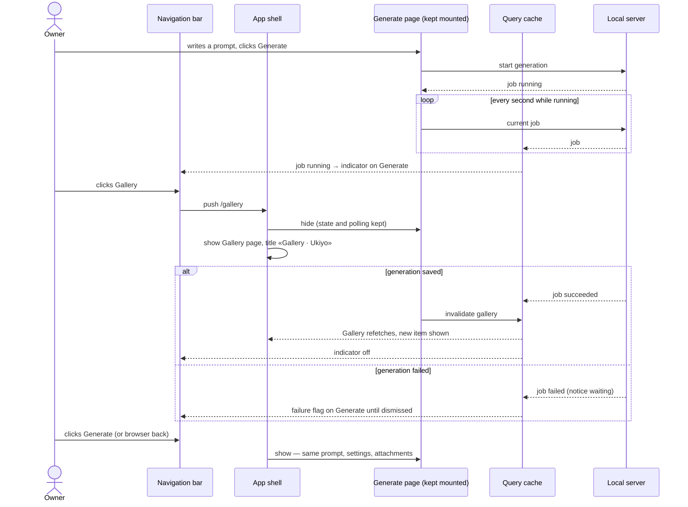

# Software Architecture Document — app-shell

## 1. Introduction and goals

**Intent.** Turn the single home page into an app frame with a left navigation bar and one page per section (Generate, Gallery), with real addresses, a not-found page, and a draft and a running generation that survive section switches (spec §2).

**Top-3 quality goals (1-liners; full scenarios in §10):**
1. **Continuity** — switching sections never loses the draft or hides the running generation (AC-05, AC-06).
2. **Addressability** — every section and generation works with reload, new tab, back/forward (AC-03).
3. **Extensibility** — a new section is one declaration (spec §6).

**Stakeholders.**

| Role | Interest | Sign-off owner? |
|---|---|---|
| Owner | one-click sections, nothing lost | Yes (solo project: also Tech Lead) |
| Tech Lead | SAD approval | Yes |

## 2. Constraints

**Technical.** React 19 SPA with the hand-written History API router (ADR-0009, extended by ADR-0022); TanStack Query cache shared by all pages; the one server-side job polled by the generate panel (ADR-0005); address-carried draft sources (ADR-0019, amended by ADR-0023). The server already serves `index.html` for every non-`/api` path when it serves the built SPA.
**Organisational.** Solo maintainer; local gate only.
**Conventions.** CLAUDE.md — Tailwind + shadcn/ui primitives, `lucide-react` icons, no second component library, no global singletons beyond the query client.
**Regulatory / external.** N/A.

## 3. Context and scope

Front-end only. No new server endpoint, no data change; the server's role is unchanged (it answers `/api` and falls back to the app page for any other path).

<!-- brownfield: steps 2–7 shipped; App.tsx renders home (panel + gallery) or detail via lib/router.tsx -->

**External systems (in / out):** none new — the Owner's browser and the local server.

## 4. Solution strategy

**Target surface:** `[web-frontend]`.

1. **One section registry drives the bar, the page switch, the title and not-found** — `src/web/sections.tsx`; the router parses `pathname` into a generation or a page path, the registry decides which section (if any) owns it → [ADR-0022](./adr/0022-declare-sections-in-one-registry-over-the-hand-written-router.md).
2. **Generate stays mounted, hidden while another section shows** — the panel keeps its draft and remains the one job poller; carried sources (`rerun`, `reuse`, new `focus=prompt`) are applied on every arrival at Generate → [ADR-0023](./adr/0023-keep-the-generate-page-mounted-and-apply-address-carried-drafts-on-every-arrival.md).
3. **The bar's job indicator is a cache reader** — it subscribes to the panel's job query without fetching (spec §6: no extra polling).
4. **Addresses:** Generate `/`, Gallery `/gallery`, a generation `/generations/:id` (owned by Gallery); anything else → not found. Existing links move: «← Gallery» and «deleted» → `/gallery`; re-run / reuse keep `/?rerun=` / `/?reuse=&output=`.

## 5. Building block view

```
src/web/
├── App.tsx                         AppShell: frame, NavBar, page switch, document title
├── sections.tsx (new)              SECTIONS registry + sectionFor(route)
├── components/NavBar.tsx (new)     section entries (aria-current), job indicator, server status
├── components/NotFound.tsx (new)   SCR-05
├── lib/router.tsx                  parseRoute → detail | page(pathname); + replace(); Link/navigate unchanged
├── features/generate/job.ts (new)  JOB_QUERY_KEY + jobQuery options shared by the panel and the bar
├── features/generate/GeneratePanel.tsx  applies carried sources on arrival (not only on mount); ?focus=prompt
└── features/gallery/               «Write a prompt» → /?focus=prompt; delete → /gallery?deleted=1; «← Gallery» → /gallery
```

**C4 Container (L2):** unchanged from step 2 (browser SPA ↔ local server ↔ SQLite + data dir ↔ providers); this feature lives inside the SPA container.

## 6. Runtime view

### Flow: switch sections while a generation runs (AC-01, AC-05, AC-06)



### Flow: arrive at Generate with a carried source (AC-07, AC-08)

```mermaid
sequenceDiagram
    actor Owner
    participant Detail as Detail page
    participant Shell as App shell
    participant Gen as Generate page (kept mounted)
    participant API as Local server
    Owner->>Detail: Re-run / Use as input
    Detail->>Shell: push /?rerun=<id> (or /?reuse=<id>&output=<n>)
    Shell->>Gen: show; address carries a source
    Gen->>API: load source generation
    alt source exists
        API-->>Gen: generation
        Gen->>Gen: fill the draft (step 6 rules)
    else source gone
        API-->>Gen: not found
        Gen->>Gen: «source no longer exists» notice
    end
    Gen->>Shell: replace address with / (router notified)
    Note over Gen,Shell: the same link works again later in the visit
    Owner->>Detail: Delete (confirmed)
    Detail->>API: delete generation
    API-->>Detail: deleted
    Detail->>Shell: push /gallery?deleted=1 → Gallery with «Generation deleted.»
```

AC-02, AC-03, AC-04 and AC-10 are static routing/layout rules (§8); AC-09 is the unchanged request guard plus the SPA fallback.

## 7. Deployment view

<!-- N/A: same single local process; no new configuration. -->

## 8. Crosscutting concepts

| Concept | Convention | Where defined |
|---|---|---|
| Section declaration | `{ id, path, label, icon, page, keepMounted?, owns? }`; order = bar order; `owns(route)` claims sub-pages (Gallery owns `/generations/:id`) | `src/web/sections.tsx` |
| Path matching | exact `path`, one trailing slash tolerated; no match → not found (no entry current) | `sectionFor()` |
| Document title | `<Section label> · Ukiyo`; not found → `Page not found · Ukiyo` | `App.tsx` |
| Current marker | `aria-current="page"` on the owning entry + accent background | `NavBar.tsx` |
| Hidden pages | `hidden` attribute (out of layout and the accessibility tree) | `App.tsx` |
| Carried flags | `rerun`, `reuse`+`output`, `focus=prompt`, `deleted` — applied once, then removed with `replace()` | ADR-0019, ADR-0023 |
| Layout | ≥ `md`: fixed-width left bar (`w-56`) + fluid content; < `md`: the bar becomes a top row, entries inline | `App.tsx`, `NavBar.tsx` |

## 9. Architecture decisions

| # | Title | Status | Section |
|---|---|---|---|
| 0022 | Declare sections in one registry over the hand-written router | Accepted | §4 |
| 0023 | Keep the Generate page mounted and apply address-carried drafts on every arrival | Accepted | §4 |

## 10. Quality requirements

**QG-1. Continuity**
- **When:** the Owner leaves Generate with a draft or a running generation.
- **Then:** «100 % of draft fields … intact after Generate → Gallery → Generate»; the indicator shows running / failed; a saved generation appears in the gallery without reload (AC-05, AC-06).
- **How verify:** component tests over the whole `App` with stubbed `fetch`.

**QG-2. Addressability**
- **When:** reload, new tab, back/forward on any page.
- **Then:** the same page (AC-03); unknown → not found (AC-04).
- **How verify:** router unit tests + `App` tests that render from a given address and dispatch `popstate`; server integration test that section addresses get the app page.

**QG-3. Extensibility**
- **When:** a section is added.
- **Then:** «one declaration in one place adds the entry, its address and its page» (spec §6).
- **How verify:** unit test that the bar and the page switch render whatever the registry holds; review.

## 11. Risks and technical debt

| Risk / debt | Severity | Mitigation | Owner |
|---|---|---|---|
| The hidden Generate page still renders on every app load (providers, model list, job reads) | Low | the same reads the old home page made; server caches the model list 10 min | dmytro.hopko |
| A carried source applied while the Owner already has a draft replaces it | Low | same as step 6 (starting a re-run replaces the draft) | dmytro.hopko |
| Gallery scroll position is not kept when returning from a detail page | Low | accepted: unchanged from today; the loaded pages stay cached | dmytro.hopko |

## 12. Glossary

| Term | Meaning |
|---|---|
| Section | see CONTEXT.md |
| App frame | the navigation bar + content area every page is shown in |
