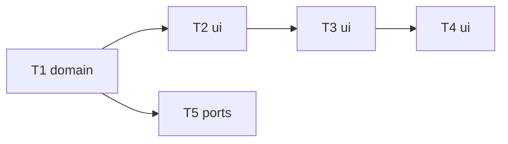

# Epic — app-shell

> **Spec:** [spec.md](../spec.md) · **Design:** [sad.md](../sad.md) · **Screens:** [screens.md](../screens.md) · **ADRs:** [adr/](../adr/)

## Goal

An app frame with a left navigation bar and one page per section (Generate, Gallery), real addresses and a not-found page; the draft and a running generation survive section switches (spec §2).

## Scope

- **In:** router page parsing + section registry; app frame, NavBar, NotFound, document title; kept-mounted Generate with arrival-applied carried flags and the bar's job indicator; gallery/detail link targets; SPA fallback proof.
- **Out:** Models and Folders sections, gallery grid, detail modal, phone layout (spec §3).

## Task map

## Tasks

See [tracker.md](./tracker.md). Machine contract: [tasks.json](../tasks.json).

| # | Task | Layer | Blocked by |
|---|---|---|---|
| T1 | [Parse addresses into pages and declare sections in one registry](./t1-section-registry-and-router.md) | domain | — |
| T2 | [Render the app frame, the navigation bar and the not-found page (SCR-04, SCR-05)](./t2-app-frame-and-navbar.md) | ui | T1 |
| T3 | [Keep the draft across sections and show the running generation in the bar](./t3-keep-generate-and-job-indicator.md) | ui | T2 |
| T4 | [Point gallery and detail navigation at the sections](./t4-gallery-and-detail-targets.md) | ui | T3 |
| T5 | [Prove section addresses get the app page and the API stays guarded](./t5-spa-fallback-for-sections.md) | ports | T1 |
