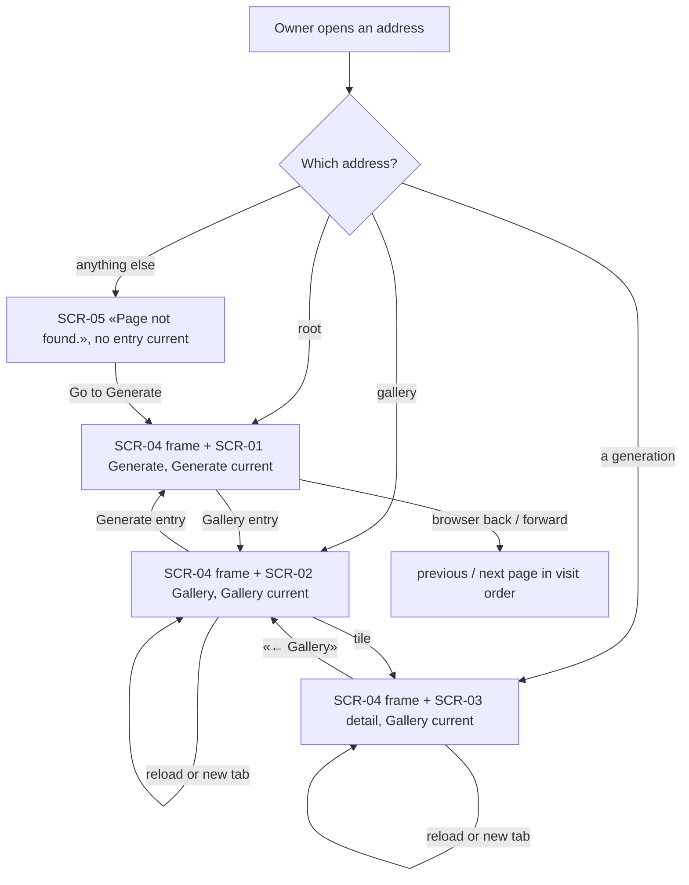
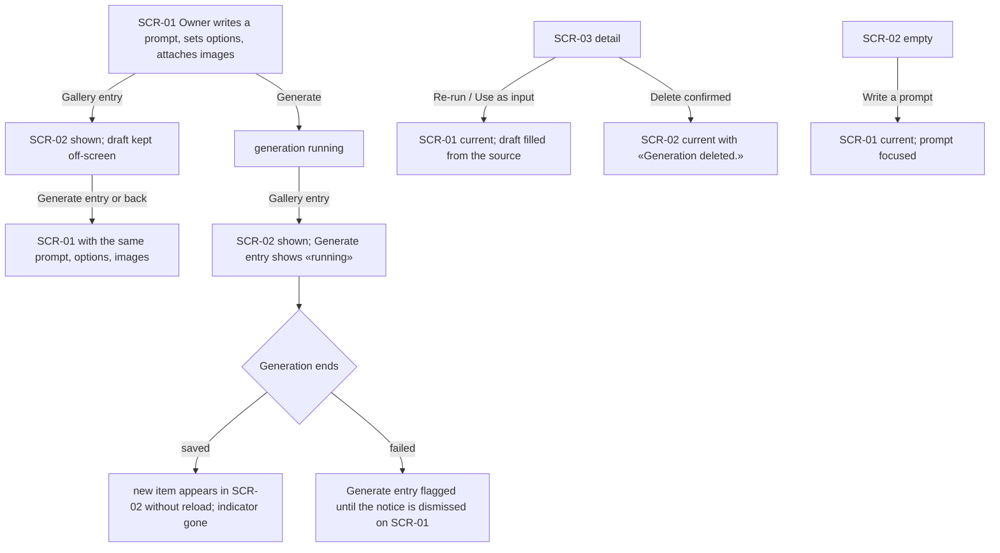

# UX flows — app-shell

> User flows for every UI-touching §4 user story, produced by `ux-flows` (after `clarify`, before
> `design`). **Always markdown + mermaid `flowchart`.** Screen ids continue the app-wide inventory
> started in [`text-to-image-openrouter/ux-flows.md`](../text-to-image-openrouter/ux-flows.md).

## Platform decisions

- **Posture:** desktop-first — per [`design-system.md`](../../design-system.md).
- **Navigation shape:** an app frame (SCR-04) with a left navigation bar and one content area. Sections: Generate (start page, root address) and Gallery (own address). The generation detail page (SCR-03) opens in the content area and counts as part of Gallery. Below `md` the bar turns into a compact row at the top.
- **What moves where:** SCR-01 (generate panel) becomes the whole Generate page; SCR-02 (gallery) becomes the whole Gallery page. Neither changes its own states.
- **Draft and job are app-wide:** the Generate page keeps its draft while another section is shown; the Generate entry in the bar reflects the one generation in progress (and an undismissed failure) from every page.
- **Not-found:** an unknown address inside the app shows a not-found page (SCR-05) inside the frame.
- **Amendment 2026-10-19:** the frame is the kit's inset sidebar (collapsible to an icon rail; a sheet below `md`); a Light / Dark / System toggle sits in its footer; the Generate page shows SCR-06 next to the form, each thumbnail opening SCR-03.
- **Future sections** (Models, Folders) are not shown until their steps ship.

## Screen inventory

| ID | Screen | Purpose | Entry | Exit |
|---|---|---|---|---|
| SCR-01 | Generate panel | unchanged states; now the whole Generate page | Generate entry; root address; re-run / reuse / «Write a prompt» | any section entry |
| SCR-02 | Gallery | unchanged states; now the whole Gallery page | Gallery entry; its address; after a delete | SCR-03 on a tile; Generate via «Write a prompt» |
| SCR-03 | Generation detail | unchanged; Gallery marked current | a tile, a latest-result thumbnail, a lineage link, a direct address | «← Gallery»; re-run / reuse → SCR-01; delete → SCR-02 |
| SCR-04 | App frame + navigation bar (new) | brand, section entries with current marker, running/failed indicator on Generate, server status | every page | a section entry |
| SCR-06 | Recent generations (new, amendment) | ten latest thumbnails next to the form | Generate page | SCR-03 on a thumbnail |
| SCR-05 | Page not found (new) | unknown in-app address | a mistyped or stale address | «Go to Generate» or any section entry |

## Flows

### Flow: US-01 / US-02 — Move between sections and use addresses

### Flow: US-03 — Keep the draft and the running generation while moving

## AC → flow map

| AC | Flow |
|---|---|
| AC-01, AC-02, AC-03, AC-04, AC-10 | Move between sections and use addresses |
| AC-05, AC-06, AC-07, AC-08 | Keep the draft and the running generation |
| AC-09 | N/A — no UI flow (server side of addresses) |
