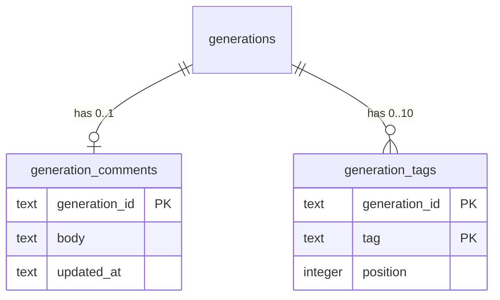

# Data model — curate-gallery

## ER diagram

## Entities

Aggregate: **Generation** (root `generations`, unchanged). The two new children cascade with it, so deletion (ADR-0014) is one `DELETE FROM generations` plus the directory move.

### `generation_comments`

| Column | Type | Constraints | Notes |
|---|---|---|---|
| `generation_id` | TEXT | PK, FK → `generations(id)` ON DELETE CASCADE | one comment per generation; absent row = no comment |
| `body` | TEXT | NOT NULL, non-blank, ≤ 2 000 characters | stored exactly as written (line breaks kept), spec AC-01/AC-06 |
| `updated_at` | TEXT | NOT NULL | ISO-8601 UTC of the last save |

**Access patterns:** read by detail (PK); «has comment» marker for a gallery page (`WHERE generation_id IN (…)`) → PK.

### `generation_tags`

| Column | Type | Constraints | Notes |
|---|---|---|---|
| `generation_id` | TEXT | NOT NULL, FK → `generations(id)` ON DELETE CASCADE, PK part | |
| `tag` | TEXT | NOT NULL, 1–32 chars, already trimmed + lower-case, PK part | PK enforces «each tag once» (AC-08). Note: SQLite `lower()` folds ASCII only, so the CHECK is a backstop; full Unicode normalization (`normalizeTag`) happens in the app |
| `position` | INTEGER | NOT NULL, ≥ 1 | insertion order (max + 1 at insert) |

**Access patterns:** tags of one generation ordered by position (detail); tags of a gallery page (`WHERE generation_id IN (…) ORDER BY generation_id, position`); count per generation for the 10-tag limit → all PK prefix.
**Constraints:** «at most 10 per generation» enforced by the service inside the insert transaction (ADR-0015).

## Indexes

| Index | Columns | Query it serves |
|---|---|---|
| PK `generation_comments` | `generation_id` | comment by generation; page «has comment» lookup |
| PK `generation_tags` | `generation_id, tag` | tags per generation / per page; dedup on insert; count for the limit; covers the FK |

No secondary indexes.

## Test fixtures

- `seedGeneration(db, dataDir, { comment?, tags? })` in `tests/helpers/generations.ts` — extended to insert a comment and tags (no PII; test text only).
