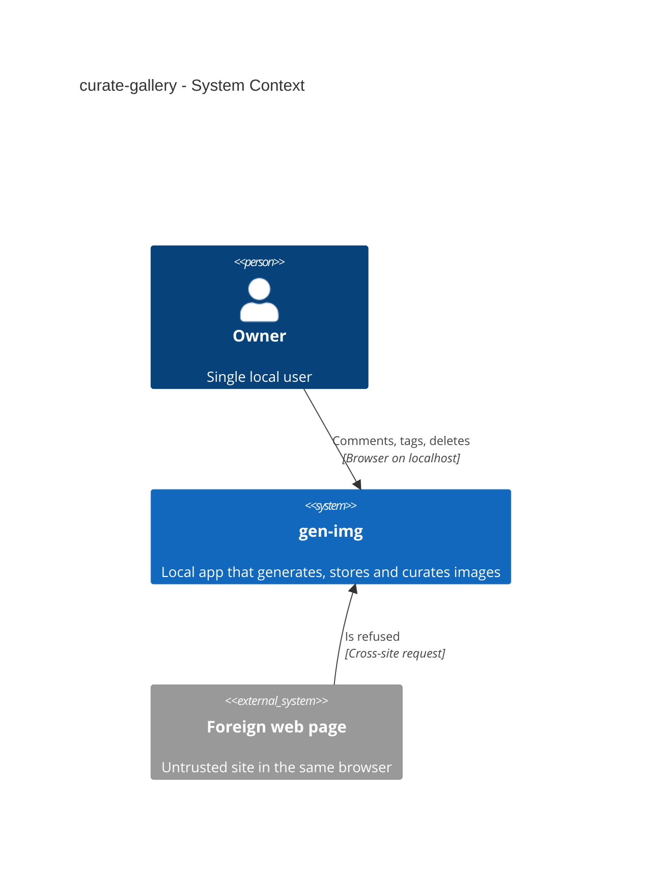
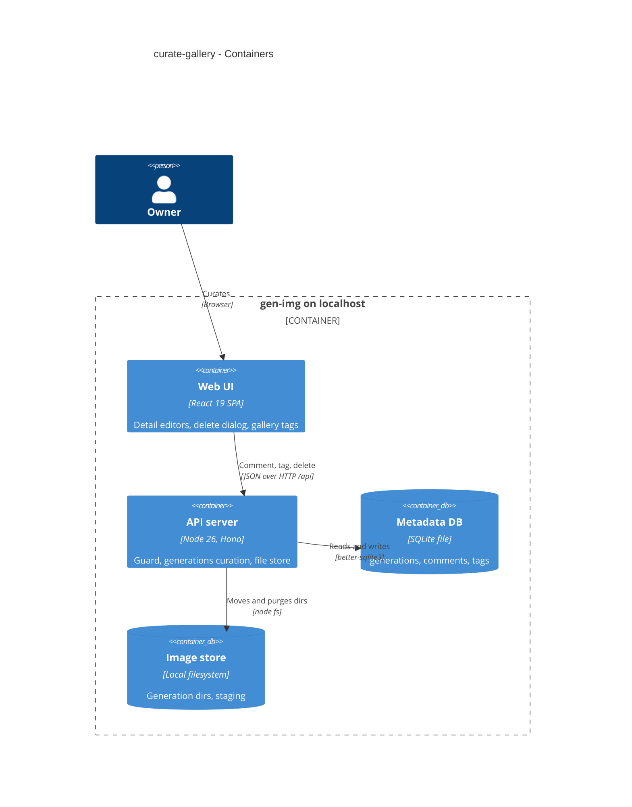
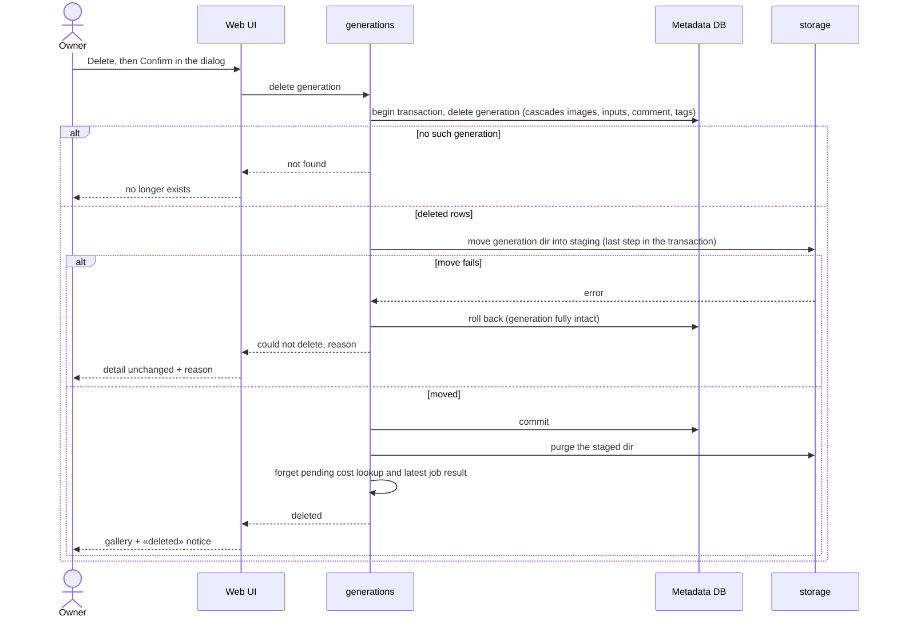

# Software Architecture Document — curate-gallery

## 1. Introduction and goals

**Intent.** Let the Owner curate the gallery: one editable comment and up to 10 tags per generation, and complete deletion of a generation after confirmation (spec §2). It extends the shipped generations module, file store and web gallery/detail; nothing about generating changes.

**Top-3 quality goals (1-liners; full scenarios in §10):**
1. **Deletion integrity** — a deletion is all-or-nothing, and survives crashes (spec AC-09, §6 Deletion durability).
2. **Non-interference** — curation never disturbs a running generation, a pending cost lookup or the generate panel (spec AC-10…AC-12).
3. **Safety of destructive actions** — only gen-img's own pages can change or delete, and only after confirmation (spec AC-04, AC-05, AC-13).

**Stakeholders.**

| Role | Interest | Sign-off owner? |
|---|---|---|
| Owner | curates the gallery | Yes (solo project: also Tech Lead) |
| Tech Lead | SAD approval | Yes |

<!-- Decision overrides (¶4): none. -->

## 2. Constraints

**Technical.**
- TypeScript 5 / Node 26, Hono 4, React 19 + Vite, Tailwind v4 + shadcn/ui, TanStack Query 5 — [ADR-0001](../../adr/0001-use-typescript-node-hono-react-stack.md).
- SQLite via `better-sqlite3` (hand-written SQL, foreign keys ON, synchronous transactions) + image files under `GEN_IMG_DATA_DIR` — [ADR-0003](../../adr/0003-store-metadata-in-sqlite-and-images-on-disk.md).
- Binding feature ADRs: single-slot job ([0005](../text-to-image-openrouter/adr/0005-run-generations-as-a-single-slot-server-job-polled-by-the-ui.md)), staging dir + boot sweep ([0006](../text-to-image-openrouter/adr/0006-commit-generations-atomically-via-staging-dir-and-boot-sweep.md)), request guard ([0007](../text-to-image-openrouter/adr/0007-guard-every-api-request-by-host-origin-and-fetch-metadata.md)), two-route router ([0009](../text-to-image-openrouter/adr/0009-use-a-two-route-history-api-router-in-the-spa.md)), input copies table ([0011](../image-inputs-openrouter/adr/0011-store-input-copies-in-a-separate-generation-inputs-table.md)), background cost lookup ([0013](../vercel-ai-gateway/adr/0013-resolve-deferred-costs-with-a-bounded-db-driven-background-lookup.md)).

**Organisational.** Solo maintainer, no deadline, no CI — local gate `pnpm typecheck && pnpm lint && pnpm test`.

**Conventions.** [`CLAUDE.md`](../../../CLAUDE.md): module layout, `AppError` envelope, zod-parsed repo rows, paired migrations, shared zod schemas in `src/shared/`, shadcn/ui only, no provider branching in `generations`.

**Regulatory / external.** N/A — personal local tool.

## 3. Context and scope

Curation is purely local: the Owner's browser talks to the local server, which changes the metadata DB and the image store. No provider is called; the only external actor is a foreign web page in the same browser, which must get nothing (spec AC-13).

<!-- brownfield: generations / providers / storage modules and the web gallery shipped in steps 2–4; read from code at main 9a1445c -->

**External systems (in / out):**

| Actor or system | Type | Interaction |
|---|---|---|
| Owner | Person | comments, tags and deletes generations in the browser |
| Foreign web page | System (external, untrusted) | tries to change or delete — refused |

**C4 Context (L1):**



## 4. Solution strategy

**Target surface:** `[backend-service, web-frontend]` — the Owner curates in the existing SPA (ux-flows SCR-01…SCR-04) backed by the local API. **UI architecture:** unchanged SPA + two-route router (ADR-0009); the delete confirmation uses the existing shadcn `Dialog` (no browser `confirm()`).

**Top strategic choices:**
1. **Deletion mirrors saving** — rows deleted and the generation directory moved into staging inside one SQLite transaction, then purged; the existing boot sweep finishes any interrupted purge → [ADR-0014](./adr/0014-delete-generations-atomically-by-moving-their-directory-to-staging-inside-the-delete-transaction.md).
2. **Tags as their own normalized rows** — one row per (generation, tag) with an insertion position, cascade-deleted with the generation → [ADR-0015](./adr/0015-store-tags-as-normalized-rows-in-a-generation-tags-table.md).
3. **Tags change one at a time** — add / remove a single tag per request, so two tabs never overwrite each other's tags; the comment is replaced whole (last save wins, spec AC-01) → [ADR-0016](./adr/0016-change-tags-one-at-a-time-and-replace-the-comment-whole.md).
4. **Deletion tells its neighbours** — the service cancels the generation's pending cost lookup (ADR-0013) and forgets it as the job slot's latest result; the UI invalidates the gallery and job queries. Inline decision (one module, cheap to change).

**Inline decisions (below the ADR gate):**
- The comment lives in its own `generation_comments` table (one row per generation, absent = no comment) rather than a column on `generations` — keeps `generations` untouched and the comment cascade-deleted; switching later is a one-file migration.
- Tag normalization (trim, collapse inner whitespace, lower-case, allowed characters) is one shared function in `src/shared/` used by the form and the server, like `checkInputFile`.

## 5. Building block view

Same modular monolith: all curation lives in the `generations` module (repo + service + routes) and the existing `storage` file store; the web side extends `features/gallery`.

**Internal decomposition:**

```
src/shared/curation.ts                     normalizeTag, checkComment, limits; Comment/Tags DTOs
src/server/modules/storage/file-store.ts   + trashSync(id) (rename generations/<id> → .staging/<id>.deleted), purge(id)
src/server/modules/generations/
├── repo.ts          + comment get/set, tags list/add/remove, deleteAtomic(id, moveFiles)
├── cost-sync.ts     + forget(id) — cancels a scheduled lookup
├── jobs.ts          + forgetGeneration(id) — drops a succeeded job pointing at it
├── service.ts       + setComment, addTag, removeTag, deleteGeneration
└── routes.ts        + PUT comment, POST/DELETE tags, DELETE generation; tags/comment in list + detail DTOs
src/web/features/gallery/
├── GenerationDetail.tsx   + CommentEditor, TagEditor, DeleteGeneration (Dialog)
├── Gallery.tsx            tile tags (first 3 + «+N»), comment marker, «deleted» notice
src/web/features/generate/GeneratePanel.tsx   latest result disappears when its generation is gone
migrations/0006_create_generation_curation.*  generation_comments + generation_tags
```

**C4 Container (L2):**



## 6. Runtime view

**Critical flow 1: delete a generation (all-or-nothing)**



Further flows (comment, tags, other tabs, boot after a crash) are added by `sequences`.

## 7. Deployment view

<!-- N/A: same single local process; adds migration 0006, applied on start. -->

## 8. Crosscutting concepts

| Concept | Convention | Where defined |
|---|---|---|
| Authentication | none; every new mutating route sits behind the request guard (Host / Origin / Sec-Fetch-Site) | ADR-0007 |
| Error handling | `AppError`: invalid comment/tag → `VALIDATION_ERROR` with `details.fields`; missing generation → `NOT_FOUND`; failed directory move → `STORAGE_ERROR` (generation intact) | `src/server/lib/errors.ts` |
| Validation | `normalizeTag` / `checkComment` in `src/shared/curation.ts`, used by form and server; DB CHECKs as the backstop | here |
| Concurrency | SQLite single writer serializes curation with saves; comment last-save-wins; tags per-item (no lost updates) | ADR-0016 |
| Deletion | transaction: delete rows → rename dir into `.staging/<id>.deleted` (last step) → commit → purge; boot sweep clears `.staging` | ADR-0014 |
| Output encoding | comment/tags rendered as React text only (no HTML injection) | spec AC-15 |
| Background work | `costSync.forget(id)` on delete; resolveCost is already a no-op for missing rows | ADR-0013 |

## 9. Architecture decisions

| # | Title | Status | Section |
|---|---|---|---|
| 0014 | Delete generations atomically by moving their directory to staging inside the delete transaction | Accepted | §4 |
| 0015 | Store tags as normalized rows in a generation_tags table | Accepted | §4 |
| 0016 | Change tags one at a time and replace the comment whole | Accepted | §4 |

Three ADRs (below the M «typical 5–12»): the feature extends an established design; the other choices are cheap to reverse and stay inline in §4.

## 10. Quality requirements

**QG-1. Deletion integrity**
- **When:** the directory move fails, or the process is killed between commit and purge.
- **Then:** «0 half-deleted generations after a crash/kill mid-delete — after restart a generation is either fully present or fully gone»; «100 % of a deleted generation's files removed by the time the deletion is confirmed to the Owner (or by the next start after a crash)» (spec §6).
- **How verify:** «integration test with a failing file step + restart test»; «integration test asserts the generation dir is gone» (spec §6).

**QG-2. Non-interference**
- **When:** the Owner curates or deletes while a generation runs or a cost is pending.
- **Then:** the running job completes and saves; a deleted generation's cost lookup is cancelled; the panel drops a deleted latest result (spec AC-10…AC-12).
- **How verify:** service integration tests with a held fake provider and a fake cost-sync clock.

**QG-3. Responsiveness**
- **Then:** comment/tag save «≤ 100 ms p95 server time»; delete «≤ 300 ms p95 server time»; gallery first page «≤ 300 ms p95 server time (unchanged from step 2)» with 1 000 generations each with 10 tags and a comment (spec §6).
- **How verify:** «integration test over a seeded data dir» / «NFR test over a seeded data dir» (spec §6), in the serial `nfr` Vitest project.

## 11. Risks and technical debt

| Risk / debt | Severity | Mitigation | Owner |
|---|---|---|---|
| Accidental deletion (no undo) | Medium | dialog names the prompt and says images go for good; no bulk delete | dmytro.hopko |
| Purge fails after commit (permissions) — files linger in `.staging` until next start | Low | logged; boot sweep removes them; files unreachable (not recorded) | dmytro.hopko |
| Gallery query cost grows with tags (24 tiles × tags lookup) | Low | one `IN (…)` query per page on the tags PK; NFR test with 10 tags each | dmytro.hopko |
| Step 6 lineage vs deleted parents | Open question | Resolve in step 6 specify (spec §8) | dmytro.hopko |

**Accepted debt:** no undo/trash; tags not filterable (idea-brief §5).

## 12. Glossary

| Term | Meaning |
|---|---|
| Comment | the Owner's one free-text note on a generation (CONTEXT.md) |
| Tag | normalized short label, ≤ 10 per generation, kept in insertion order (CONTEXT.md) |
| Deletion | removing a generation's record and all its files together (CONTEXT.md) |
| Trash dir | `.staging/<id>.deleted` — where a deleted generation's directory waits for its purge |
