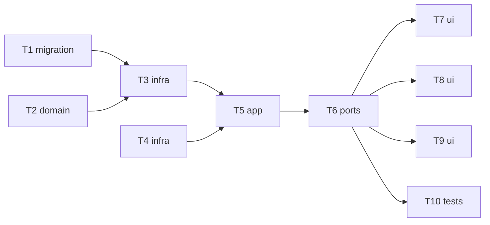

# Epic — curate-gallery

> **Spec:** [spec.md](../spec.md) · **Design:** [sad.md](../sad.md) · **Data model:** [data-model.md](../data-model.md) · **API:** [openapi.yaml](../contracts/openapi.yaml) · **Screens:** [screens.md](../screens.md) · **ADRs:** [adr/](../adr/)

## Goal

Let the Owner curate the gallery: one comment and up to 10 tags per generation, shown on tiles and the detail view, and all-or-nothing deletion of a generation with its files after confirmation (spec §2).

## Scope

- **In:** migration `0006_create_generation_curation`; shared tag/comment rules; repo curation + atomic delete; file-store trash/purge; service curation + delete (cost lookup + latest result forgotten); routes + DTOs; Notes card, delete dialog, gallery tags/marker; NFR tests.
- **Out:** tag filtering/search, undo/trash, bulk actions, rich comments, lineage (spec §3).

## Task map

## Tasks

See [tracker.md](./tracker.md) for status. Machine contract: [tasks.json](../tasks.json).

| # | Task | Layer | Blocked by | DoD (short) |
|---|---|---|---|---|
| T1 | [Promote the curation migration](./t1-promote-curation-migration.md) | migration | — | migration 0006_create_generation_curation applies and reverts cleanly; CHECKs and cascades… |
| T2 | [Implement the shared tag and comment rules](./t2-shared-curation-rules.md) | domain | — | unit tests: normalizeTag trims, collapses spaces, lower-cases (incl. Cyrillic), accepts le… |
| T3 | [Add comment, tag and atomic-delete queries to the generations repo](./t3-repo-curation-and-delete.md) | infra | T1, T2 | integration tests: set/replace/remove comment; add tags in order, dedup, refuse the 11th i… |
| T4 | [Let the file store move a generation into staging and purge it](./t4-file-store-trash.md) | infra | — | integration tests: trashSync moves generations/<id> to .staging/<id>.deleted (sync), is a … |
| T5 | [Curate and delete generations in the service without disturbing running work](./t5-service-curation-delete.md) | app | T3, T4 | service integration tests: comment/tag rules map to VALIDATION_ERROR fields and NOT_FOUND;… |
| T6 | [Expose the curation and delete routes and add tags/comment to the DTOs](./t6-routes-and-dtos.md) | ports | T5 | integration tests via app.request(): each operation's happy + 400 + 404 paths; summary/det… |
| T7 | [Build the Notes card: comment editor and tag editor (SCR-02)](./t7-notes-card-ui.md) | ui | T6 | web tests (mocked api): add/edit/cancel/save/remove comment; counter; >2000 refused client… |
| T8 | [Build the delete confirmation and its after-effects (SCR-03, SCR-01 notice, SCR-04)](./t8-delete-dialog-ui.md) | ui | T6 | web tests (mocked api): dialog names the prompt excerpt; Cancel/Esc sends nothing; Confirm… |
| T9 | [Show tags and a comment marker on gallery tiles (SCR-01)](./t9-gallery-tile-curation-ui.md) | ui | T6 | web tests: first 3 tags + «+N»; comment marker with aria-label only when hasComment; tag t… |
| T10 | [Verify the curation and deletion NFRs](./t10-curation-nfr-tests.md) | tests | T6 | NFR tests in the serial nfr project (files named `nfr.int.test.ts`): comment/tag save ≤ 10… |

## Risks / Hard rules

- Deletion is all-or-nothing (CONTEXT invariant, ADR-0014): never a record without files, never files of a deleted generation reachable.
- Every new mutating route sits behind the request guard (ADR-0007); comment/tag text is rendered as plain text only.
- Never branch on provider inside `generations`; deletion must not disturb the running job (ADR-0005) or leave a cost lookup running (ADR-0013).
