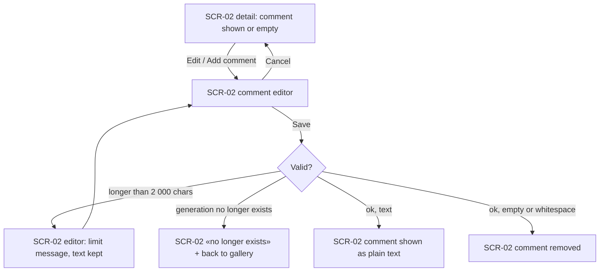
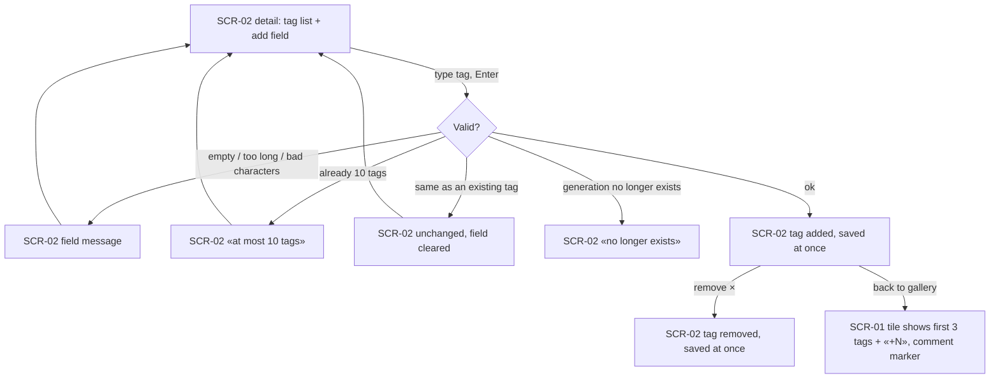
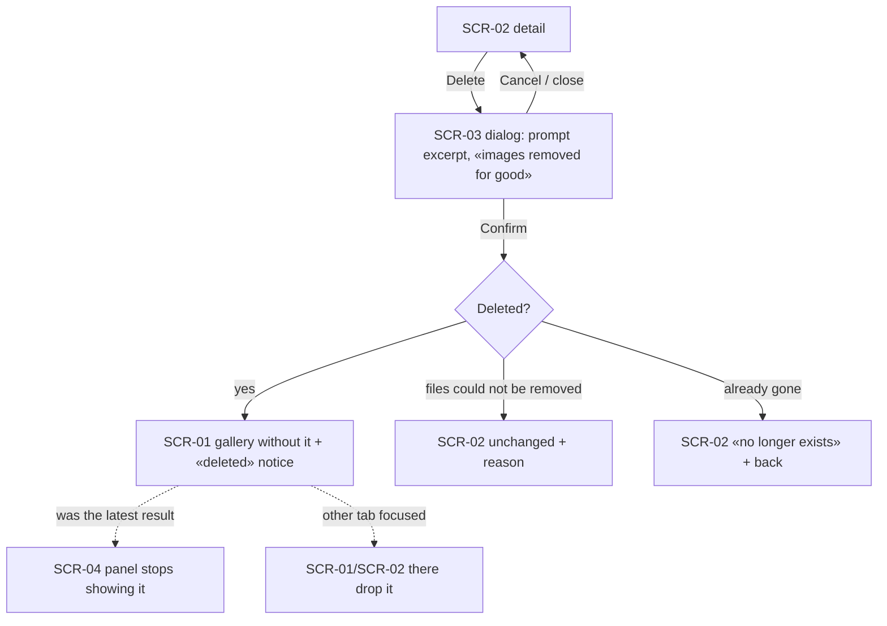

# UX flows — curate-gallery

> User flows for every UI-touching §4 user story, produced by `ux-flows` (after `clarify`, before
> `design`) and read by `design` (evidence for the target-surface + UI-architecture decisions),
> `sequences` (UI-driven flows align on SCR ids), `screens` (details every inventory row) and
> `plan-tests` (the e2e-through-UI paths). **Always markdown + mermaid `flowchart`**, whatever the
> design tool — this artifact is flow-altitude, not visual design.

## Platform decisions

- **Posture:** desktop-first — per [`design-system.md`](../../design-system.md).
- **Where curation lives:** comment, tags and delete are all on the generation detail view; the gallery only *shows* tags and a comment marker (no inline editing on tiles, no delete from tiles — spec AC-04).
- **Save model:** tags save on each add/remove; the comment has an explicit Save / Cancel (spec AC-01/AC-02).
- **Modality:** deletion asks in a modal dialog over the detail view; everything else is inline on the page.
- **Other tabs:** they catch up when focused (gallery refetch, detail shows «no longer exists») — no live push.

## Screen inventory

| ID | Screen | Purpose | Entry | Exit |
|---|---|---|---|---|
| SCR-01 | Gallery (existing, extended) | Tiles now show up to 3 tags + «+N» and a comment marker; a one-off «deleted» notice after a deletion | app home; after a deletion | SCR-02 on a tile |
| SCR-02 | Generation detail (existing, extended) | Comment editor, tag editor, delete action, «no longer exists» state | a tile; a direct address | SCR-01 (back / after delete); SCR-03 (delete) |
| SCR-03 | Delete confirmation dialog (new) | Names the generation by prompt excerpt, warns the images go for good, Confirm / Cancel | SCR-02 delete action | SCR-01 (confirmed) · SCR-02 (cancelled / failed) |
| SCR-04 | Generate panel latest result (existing) | Stops showing a latest result whose generation was deleted | home page | — |

## Flows

### Flow: US-01 — Comment on a generation

The detail view shows the comment (or an «Add comment» action). Editing opens an inline editor; Cancel drops the edit. Save checks the length: over 2 000 characters keeps the text and explains the limit. If the generation was deleted elsewhere, the page switches to «no longer exists». A valid text is shown as plain text with its line breaks; an empty or whitespace-only text removes the comment.

### Flow: US-02 / US-03 — Tag a generation and see tags

The Owner types a tag and presses Enter. Invalid text, an 11th tag, or a deleted generation each explain themselves; a duplicate (ignoring case/spaces) leaves the list unchanged. A valid tag is saved immediately and can be removed with its × button. Back in the gallery the tile shows the first 3 tags with «+N» and a marker when a comment exists.

### Flow: US-04 / US-05 — Delete a generation

Delete opens a dialog that names the generation by its prompt excerpt and warns that its images are removed for good. Cancel or closing changes nothing. Confirm either deletes it — the Owner lands on the gallery with a short notice, the generate panel stops showing it as the latest result, and other tabs drop it when focused — or, if the files could not be removed, leaves the generation fully intact and explains why, or reports it no longer exists.

### Out of scope (no UI)

- US-05 «a running generation keeps going» and «a pending cost lookup stops» (AC-10, AC-11) — server-side behaviour; the only UI trace is SCR-04 above.
- US-06 foreign pages refused (AC-13) — no screen.

## AC coverage

| AC | Shown by | Notes |
|---|---|---|
| AC-01 | Flow US-01 → E / F, Cancel | |
| AC-02 | Flow US-02 → F / H | |
| AC-03 | Flow US-02 → I; SCR-02 tag list + comment | |
| AC-04 | Flow US-04 → B → D (+ G, H) | |
| AC-05 | Flow US-04 → Cancel | |
| AC-06 | Flow US-01 → D | |
| AC-07 | Flow US-02 → C | |
| AC-08 | Flow US-02 → D / E | |
| AC-09 | Flow US-04 → E | crash half: no UI (boot) |
| AC-10 | N/A | server-side lookup cancellation |
| AC-11 | N/A | server-side; panel keeps showing progress (unchanged behaviour) |
| AC-12 | Flow US-04 → G | |
| AC-13 | N/A | no screen: a foreign page is refused |
| AC-14 | Flow US-01 → G; US-02 → G; US-04 → F | |
| AC-15 | SCR-01/SCR-02 text rendering | verified by tests, no flow node |
