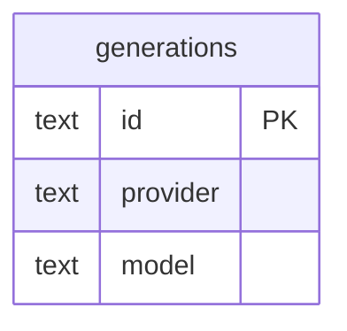

# Data model — gallery-by-model

## ER diagram

## Entities

Aggregate: **Generation** (root `generations`, unchanged). No new table or column — one index.

### `generations` (read paths added)

| Column | Type | Constraints | Notes |
|---|---|---|---|
| `provider` | TEXT | NOT NULL (existing) | filter + group key, exact match |
| `model` | TEXT | NOT NULL (existing) | filter + group key, exact match (same characters, same case) |
| `id` | TEXT | PK, ULID (existing) | newest first = `id DESC`; cursor |

**Access patterns:** one model's page `WHERE provider = ? AND model = ? [AND id < ?] ORDER BY id DESC LIMIT ?`; groups `SELECT provider, model, count(*), max(id) … GROUP BY provider, model ORDER BY max(id) DESC`.

## Indexes

| Index | Columns | Query it serves |
|---|---|---|
| `generations_by_model` (new) | `provider, model, id` | a model's page newest first; per-model count and latest id |

## Test fixtures

- `seedGeneration(db, dataDir, { provider, model, … })` (existing) — seeds generations across models; nfr seed: 1 000 generations across 30 models × 10 tags + comment.
