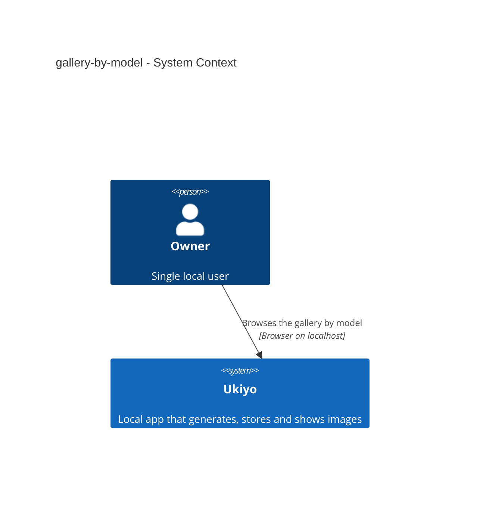
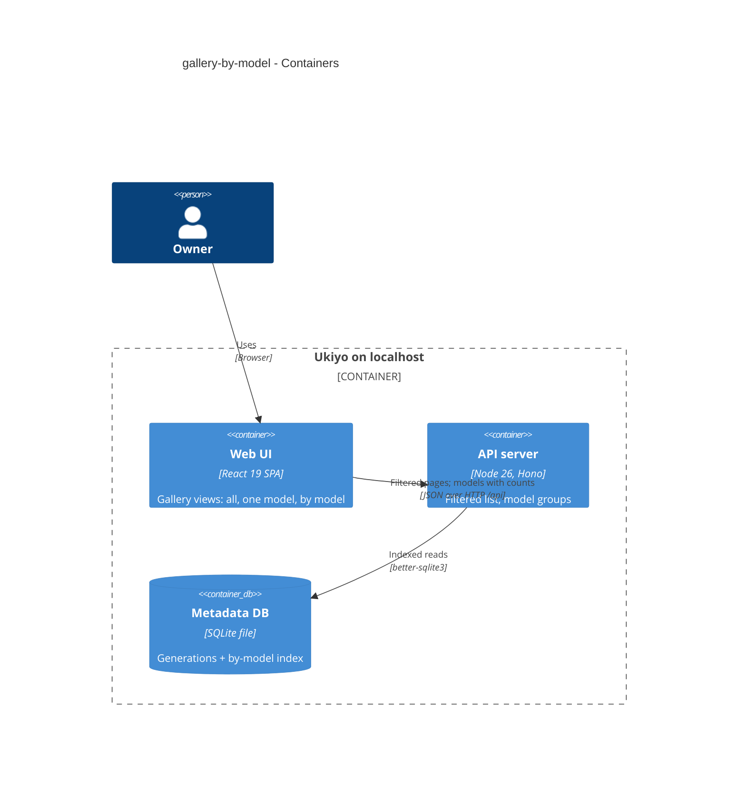
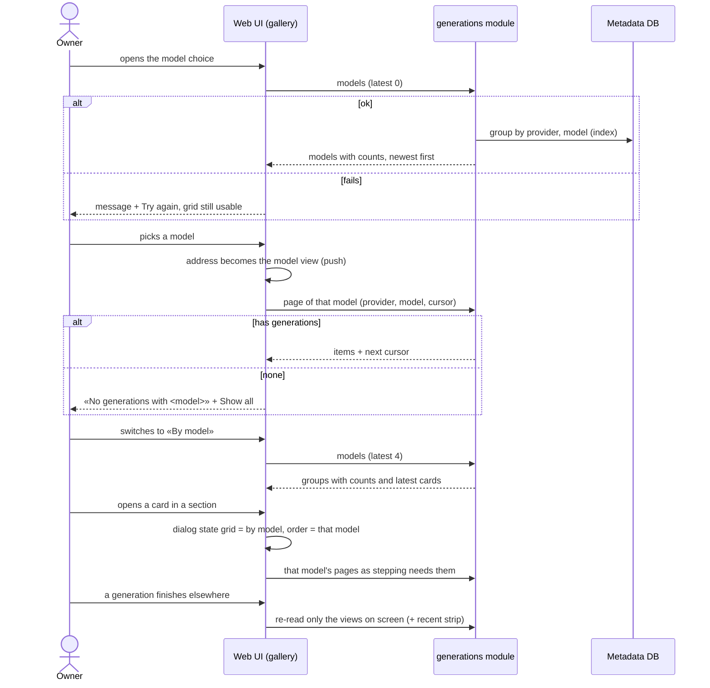

# Software Architecture Document — gallery-by-model

## 1. Introduction and goals

**Intent.** Let the Owner see the gallery filtered to one model, or grouped by model, as views that are addresses — with the grid's paging, badges and detail dialog working inside each view (spec §1 ¶3, §2).

**Top-3 quality goals (1-liners; full scenarios in §10):**
1. **Exact views** — each generation once, exact counts, exact model matching, updates in every view (AC-05, AC-06, AC-08).
2. **Views are addresses** — Back, reload, links, per-view scroll, dialog stepping within the view (AC-03, AC-04).
3. **Fast enough** — filtered page and model groups ≤ 300 ms p95 server time at 1 000 generations / 30 models (spec §6).

**Stakeholders.**

| Role | Interest | Sign-off owner? |
|---|---|---|
| Owner (also Tech Lead for SAD approval) | judges and compares models | Yes |

## 2. Constraints

**Technical.** Same stack. List = newest first by ULID id, cursor = last id, limit ≤ 100 (step 2, ADR-0032); the gallery's `["generations"]` key with the recent strip as child key `["generations","recent"]` (ADR-0025); per-card pending refresh (ADR-0031); in-place card patches (ADR-0034); the dialog visit in the history entry for this app load (ADR-0033); sections match exact paths (ADR-0022); hand-written SQL, rows through zod.
**Organisational.** Solo maintainer; local gate only.
**Conventions.** CLAUDE.md; new index = migration pair.
**Regulatory / external.** N/A.

## 3. Context and scope

The gallery reads one model's pages and the model groups from the local server; nothing new reaches a provider.

<!-- brownfield: gallery grid (11) and dialog (12) shipped on this branch chain. -->

**External systems (in / out):**

| Actor or system | Type | Interaction |
|---|---|---|
| Owner | Person | chooses a view, browses, opens cards |

**C4 Context (L1):**



## 4. Solution strategy

**Target surface:** `[web-frontend, backend-service]` — two gallery views in the SPA; a filtered list and a models read on the server.

1. **View in the address, one list cache per view** — `/gallery` (all), `/gallery?provider=…&model=…` (one model), `/gallery?view=models` (by model); keys `["generations"]`, `["generations","model",provider,model]`, `["generations","models"]`; scroll saved per view key; the dialog's history state gains `grid` (the view behind) and `order` (the view stepped through) → [ADR-0035](./adr/0035-keep-the-gallery-view-in-its-address-with-a-list-cache-per-view.md).
2. **Indexed filter + one models read** — index `generations (provider, model, id)`; the list read takes `provider` + `model`; `GET /generations/models?latest=0..4` returns every provider + model with `count`, `latestId` and, when asked, its latest summaries (the web always asks 4 — one cache) → [ADR-0036](./adr/0036-read-the-models-with-counts-and-their-latest-cards-in-one-request.md).
3. **Patches reach every view** (inline): one helper `patchSummaries(qc, id, patch | "remove")` walks every cached query under `["generations"]` whose data is infinite pages (all and filtered) or model groups, and leaves the recent strip (a different shape) to its own exact invalidation; used by cost resolution (ADR-0031), curation (ADR-0034) and dialog deletes.
4. **Stepping per view** (inline): from a filtered grid the dialog steps through that filter's list; from «By model» it steps through the card's model list (`order` = that model), loading it if needed, while the grid behind stays «By model»; close → place follows generation-detail-modal (scroll the last shown into view) only for grids — «By model» keeps its scroll; a dialog delete takes the neighbour from `order`, and the model's last delete closes onto the view (empty-model state or the section removed). One pending poll per generation id across views (the per-card watcher dedupes by `["generation", id]`).
5. **Empty and unknown model** (inline): a filtered view with no generations says «No generations with <model> (<provider>)» + «Show all generations»; the main empty state («No generations yet») only for «All».

## 5. Building block view

```
migrations/0009_index_generations_by_model.{up,down}.sql   generations_by_model (provider, model, id)
src/shared/generations.ts                   ListQuery + provider/model; ModelGroup / ModelGroupsResponse
src/server/modules/generations/
├── repo.ts                                 listPage({ cursor, limit, provider?, model? }); modelGroups({ latest })
└── routes.ts                               GET /generations?provider=&model=; GET /generations/models?latest=
src/web/lib/api.ts                          generations(cursor, limit, filter?); generationModels(latest)
src/web/features/gallery/
├── galleryView.ts                          parse/serialize the view ↔ query string; view keys
├── GalleryViews.tsx                        view switch («All» / model choice / «By model») above the grid
├── ByModel.tsx                             SCR-10: sections per model, latest four cards, «Show all N»
├── Gallery.tsx                             grid per view (key, filter, empty states, scroll per view)
├── GenerationDialog.tsx                    reads the `order` view's list; grid view kept behind
├── summaryPatch.ts                         patchSummaries across gallery-shaped caches (replaces cardPatch's single key)
└── *.test.tsx
```

**C4 Container (L2):**



## 6. Runtime view

**Critical flow: choose a model, open «By model», step from a section**



The flow covers AC-01, AC-02, AC-04, AC-06, AC-07 and the §6 refresh row; AC-03/AC-10 are the address rules (§4 item 1); AC-05 is §4 item 3 + server counts; AC-08 is the provider + model key; AC-09 is the request guard.

## 7. Deployment view

<!-- N/A: same single local process; one index migration applied on boot. -->

## 8. Crosscutting concepts

| Concept | Convention | Where defined |
|---|---|---|
| View ↔ address | `URLSearchParams`: `provider` + `model` (both or none) = one model; `view=models` = by model; anything else = all; serialization round-trips any id | `galleryView.ts` |
| View keys | all `["generations"]` (exact, unchanged); model `["generations","model",provider,model]`; groups `["generations","models"]` (one cache: the model choice and «By model» both read it with `latest=4`); recent `["generations","recent"]` | `galleryView.ts` |
| Matching | exact `provider = ? AND model = ?` (case and characters as stored) | `repo.ts` |
| Models read | `count(*)`, `max(id) AS latestId`, ordered `latestId DESC`; `latest` 0–4 summaries per model via the filtered page query | `repo.ts`, ADR-0036 |
| Patches | `patchSummaries` over `qc.getQueriesData({ queryKey: ["generations"] })` by data shape (infinite pages / groups), never the recent strip | `summaryPatch.ts` |
| Refresh | prefix invalidation (finish, delete) — TanStack refetches only active queries, marks inactive stale (they refetch when next mounted) | existing, ADR-0035 |
| Scroll per view | `savedScroll[viewKey]`; a view never shown starts at 0 | `Gallery.tsx` |
| Dialog state | `{ dialog: "gallery", load, grid: view, order: view }`; the grid behind renders `grid`, stepping uses `order` | `router.tsx`, `GenerationDialog.tsx` |
| Errors | the filter's `provider`/`model` are accepted as stored strings (1–200 chars, both or neither) — an unknown provider or model is an empty page, not 400/404 (AC-06); only a malformed query (one of the pair, bad cursor/limit/latest) → `VALIDATION_ERROR` (400) |  `routes.ts` |
| Route order | `GET /generations/models` registered before `GET /generations/:id` (like `cost-history`) | `routes.ts` |

## 9. Architecture decisions

| # | Title | Status | Section |
|---|---|---|---|
| 0035 | Keep the gallery view in its address, with a list cache per view | Accepted | §4 |
| 0036 | Read the models with counts and their latest cards in one request | Accepted | §4 |

## 10. Quality requirements

**QG-1. Exact views**
- **When:** generations added/deleted, a cost resolves, tags change while views are cached; two providers share a model id; a model id with `/`, `:`, `+`.
- **Then:** each generation once; «Show all N» shows N; updates in every view; exact matching; ids round-trip (AC-05, AC-06, AC-08).
- **How verify:** repo + route integration tests; `summaryPatch` unit tests; component tests per view.

**QG-2. Views are addresses**
- **When:** reload, Back, new tab, sidebar entry; opening a card from a filter and from «By model»; switching views.
- **Then:** same view; sidebar = «All»; per-view scroll; dialog steps within the view with the grid view behind kept (AC-03, AC-04, AC-10); «a finished generation or a deletion costs ≤ 1 request per loaded page of each view on screen + 1 for the recent strip (+ 1 models read when a one-model view's heading shows its count), and 0 for views not on screen (they re-read when next shown); a pending cost is refreshed once across all views, ≤ every 10 s, asking only for the pending generation»; «each view is read on its first visit; a revisit costs 0 reads unless a change happened since (then as «Refresh on a change»); a curation change still costs 0 list reads (ADR-0034)» (spec §6).
- **How verify:** component tests with popstate; «component test counting requests».

**QG-3. Fast enough**
- **When:** 1 000 generations across 30 models, each with 10 tags and a comment.
- **Then:** «any page (first or continued) of 24 items of one model, 1 000 generations across 30 models, each with 10 tags and a comment, ≤ 300 ms p95 server time»; «the model list with counts, and the groups with their latest four cards, ≤ 300 ms p95 server time with 1 000 generations across 30 models» (spec §6).
- **How verify:** «`nfr` test over a seeded data dir».

## 11. Risks and technical debt

| Risk / debt | Severity | Mitigation | Owner |
|---|---|---|---|
| A patch helper misses a new cache shape added by steps 14–15 | Low | shape-checked helper with tests; steps 14–15 extend it | dmytro.hopko |
| «By model» with very many models | Low | one read; sections lazy-load images | dmytro.hopko |

**Accepted debt:** none new.

## 12. Glossary

| Term | Meaning |
|---|---|
| Gallery · Generation · Image model · Provider | see CONTEXT.md |
| Gallery view | how the gallery is shown — all, one model, by model — carried in its address |
