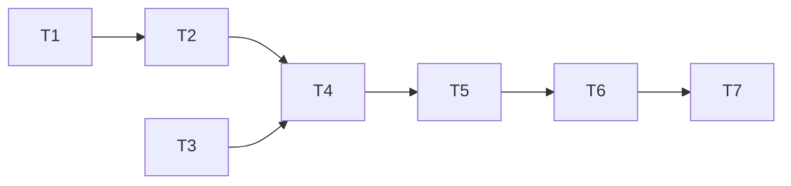

# Epic — gallery-by-model

> **Spec:** [spec.md](../spec.md) · **Design:** [sad.md](../sad.md) · **Data model:** [data-model.md](../data-model.md) · **API:** [openapi.yaml](../contracts/openapi.yaml) · **Screens:** [screens.md](../screens.md) · **ADRs:** [adr/](../adr/)

## Goal

The Owner filters the gallery to one model or sees it grouped by model, as views that are addresses, with paging, badges and the detail dialog working inside each view (spec §2).

## Scope

- **In:** index migration 0009; filtered list + models read in `src/server/modules/generations/`; view parsing, per-view caches, patches across views, view switch, «By model», dialog per view in `src/web/features/gallery/`.
- **Out:** other filters (free text out; tags open in curate-gallery §8); several models at once; catalog models; reordering (spec §3).

## Task map

## Tasks

See [tracker.md](./tracker.md) for status. Machine contract: [tasks.json](../tasks.json).

| # | Task | Layer | Blocked by | DoD (short) |
|---|---|---|---|---|
| T1 | Promote the by-model index migration | migration | — | 0009 index applies/reverts |
| T2 | Filter the list by model and read the models with counts and latest cards | ports | T1 | filtered list + models read, int + nfr |
| T3 | Parse gallery views from the address and patch summaries in every view | app | — | view model + cross-view patches |
| T4 | Add the view switch, the model choice and the filtered grid | ui | T2, T3 | view switch + filtered grid |
| T5 | Show the gallery grouped by model | ui | T4 | SCR-10 by model |
| T6 | Step, close and delete in the dialog within the view it was opened from | ui | T5 | dialog within the view |
| T7 | Prove that changes re-read only the views on screen | tests | T6 | refresh scope measured |

## Risks / Hard rules

- Exact matching; unknown provider/model = empty page, never an error page (AC-06).
- Each generation once; «Show all N» shows N; updates in every view (AC-05).
- Sidebar «Gallery» = «All»; views are addresses (AC-03, AC-10).
- A change re-reads only views on screen; one pending poll per generation (spec §6).
