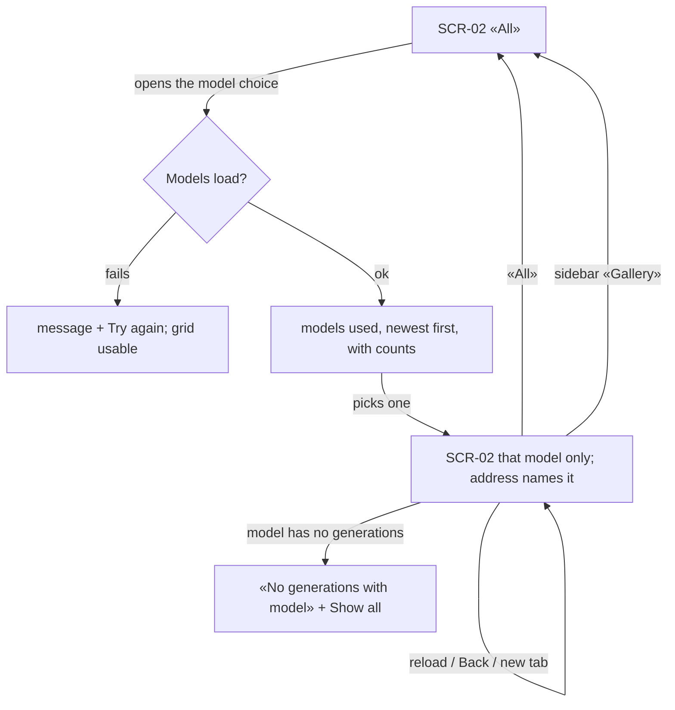
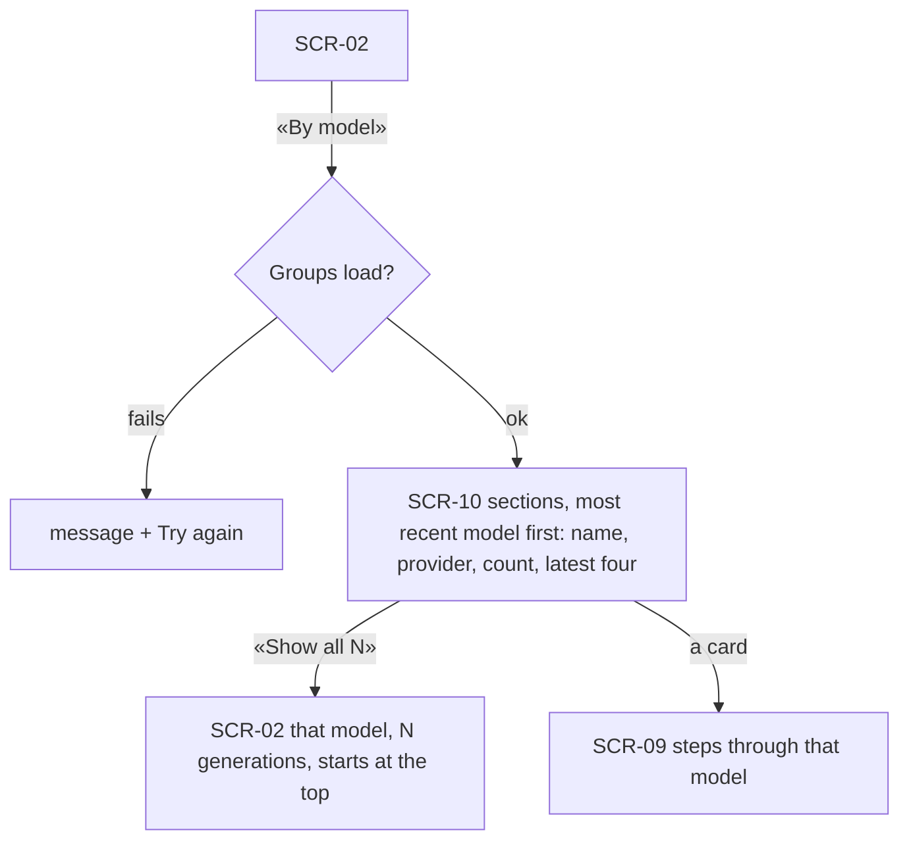
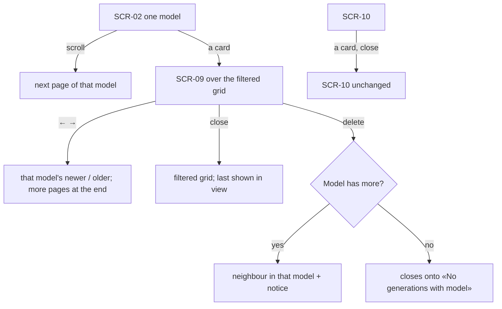

# UX flows — gallery-by-model

> User flows for every UI-touching §4 user story, produced by `ux-flows` (after `clarify`, before
> `design`). **Always markdown + mermaid `flowchart`.** Screen ids continue the app-wide inventory
> (SCR-02 Gallery, SCR-09 Detail dialog …); this feature adds SCR-10.

## Platform decisions

- **Posture:** desktop-first — per [`design-system.md`](../../design-system.md).
- **Where:** a view switch at the top of the Gallery section (SCR-02): «All», a model choice, «By model». Same section and sidebar entry; the view lives in the gallery's address.
- **SCR-10 «By model»** is a page state of the Gallery section, not a new section.
- **Dialog:** the detail dialog (SCR-09) opens from any view; the view behind it is kept.

## Screen inventory

| ID | Screen | Purpose | Entry | Exit |
|---|---|---|---|---|
| SCR-02 | Gallery (extended) | The grid, now for «All» or one model, with the view switch | sidebar «Gallery» (always «All»), an address with a model, «Show all N» | a card → SCR-09, «By model» → SCR-10 |
| SCR-10 | Gallery by model (new) | One section per provider + model: name, provider, count, latest four cards, «Show all N» | the view switch, its address | «Show all N» → SCR-02 filtered; a card → SCR-09 |
| SCR-09 | Detail dialog | Unchanged; steps within the view it was opened from | a card | close → the view |

## Flows

### Flow: US-01 / US-03 — Filter to one model

The Owner opens the model choice above the grid: it lists every provider + model they generated with, most recent first, with a count (or a message with Try again if it can't load). Picking one shows only that model's generations, newest first, and the address names it, so reload, Back and new tabs keep it. A model with no generations says so and offers to show all. «All» and the sidebar entry return to the full grid.

### Flow: US-02 — Group by model

«By model» shows one section per provider + model, most recently used first, each with its count and its latest four cards. «Show all N» opens that model's grid at the top; a card opens the dialog stepping through that model.

### Flow: US-04 — Browse a view like the gallery

A filtered grid pages and shows badges like the main grid; its cards open the dialog over it, stepping through that model and loading more at the end. Closing brings the last shown into view; from «By model» the sections return unchanged. Deleting moves to the next generation of that model, or — if it was the last — closes onto the empty-model state.

## AC coverage

| AC | Shown by | Notes |
|---|---|---|
| AC-01 | Flow US-01 → L → F | counts, newest first |
| AC-02 | Flow US-02 → S, F | four cards, Show all |
| AC-03 | Flow US-01 → F (reload/Back) | per-view scroll |
| AC-04 | Flow US-04 → D, D2, F2, D3, E; S2 | stepping within the view |
| AC-05 | Flow US-04 → D3, E | counts and membership exact |
| AC-06 | Flow US-01 → E | empty-model state |
| AC-07 | Flow US-01 → CE; Flow US-02 → GE | grid usable |
| AC-08 | Flow US-01 → L | provider + model entries |
| AC-09 | N/A | request guard |
| AC-10 | Flow US-01 → sidebar → A | sidebar = «All» |
