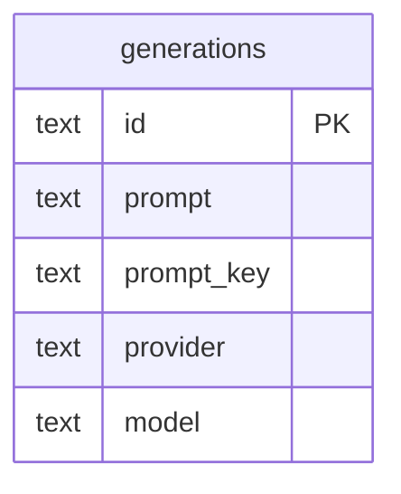

# Data model — gallery-by-prompt

## ER diagram

## Entities

Aggregate: **Generation** (root `generations`). One new column and one index; a prompt group is derived, nothing stored about it.

### `generations` (changed)

| Column | Type | Constraints | Notes |
|---|---|---|---|
| `prompt_key` | TEXT | nullable, exactly 32 chars when set (new) | first 32 hex of SHA-256 over the exact prompt (UTF-8, no normalisation); written on save; NULL only before the boot backfill (ADR-0037) |
| `prompt` | TEXT | NOT NULL, non-blank (existing) | the group's text |
| `id` | TEXT | PK, ULID (existing) | newest first; groups ordered by `max(id)` |

**Access patterns:** a prompt's page `WHERE prompt_key = ? [AND id < ?] ORDER BY id DESC LIMIT ?`; groups `GROUP BY prompt_key HAVING … ORDER BY max(id) DESC` paged by `max(id) < ?`; backfill `WHERE prompt_key IS NULL`.

## Indexes

| Index | Columns | Query it serves |
|---|---|---|
| `generations_by_prompt` (new) | `prompt_key, id` | a prompt's page; grouping with count / max(id); backfill scan of NULL keys |

## Test fixtures

- `seedGeneration` already inserts through the repo, so it gets the key; `clearPromptKey(db, id)` (direct UPDATE to NULL) builds the pre-feature rows the backfill test needs. Seed for nfr: 1 000 generations across 200 prompts × 10 tags + comment.
