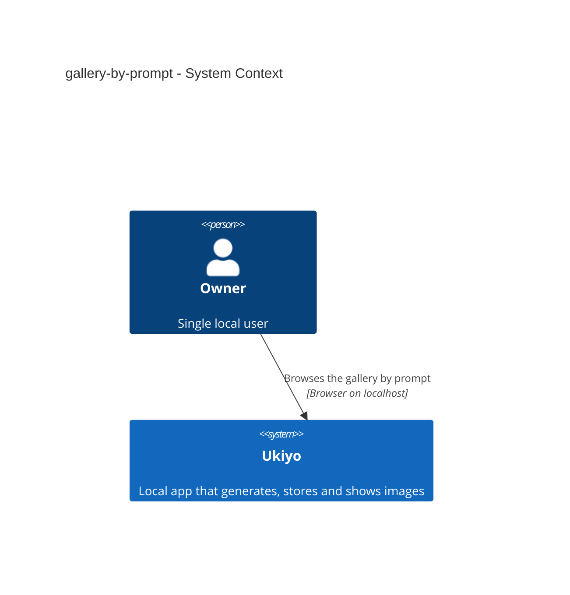
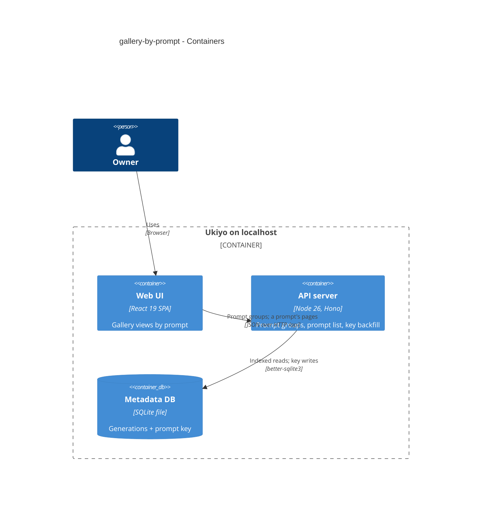
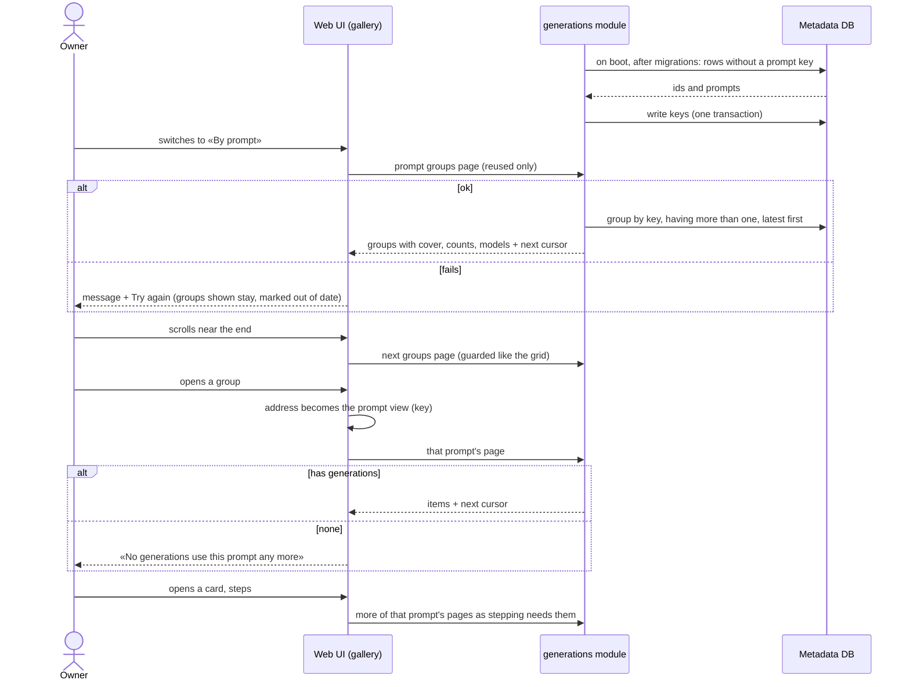

# Software Architecture Document — gallery-by-prompt

## 1. Introduction and goals

**Intent.** Add «By prompt» (one card per identical prompt, reused prompts by default) and a prompt's grid (every generation of that exact text) as gallery views — addresses keyed by a short hash, never the text — with the grid's paging, badges and dialog working inside them (spec §1 ¶3, §2).

**Top-3 quality goals (1-liners; full scenarios in §10):**
1. **Exact, complete groups** — literal text identity; every generation keyed, old ones too; counts match (AC-05, AC-06, AC-10).
2. **Private, stable addresses** — fixed-length key, no prompt text in addresses or history (AC-04, §6.1).
3. **Scales with the gallery** — paged groups ≤ 300 ms p95 at 1 000 generations / 200 prompts (spec §6).

**Stakeholders.**

| Role | Interest | Sign-off owner? |
|---|---|---|
| Owner (also Tech Lead for SAD approval) | sees everything a prompt produced | Yes |

## 2. Constraints

**Technical.** Same stack. Views in the gallery address with a cache per view, patches across views, dialog `grid`/`order` views (ADR-0035); models read precedent (ADR-0036); sentinel paging and scroll memory (ADR-0032, `scrollMemory.ts`); SQL-only migrations applied on boot (step 1) with boot-time work after them (ADR-0006, ADR-0013); prompt stored exactly as sent, non-blank, ≤ 10 000 characters (step 2).
**Organisational.** Solo maintainer; local gate only.
**Conventions.** CLAUDE.md; new column = migration pair; rows through zod.
**Regulatory / external.** N/A.

## 3. Context and scope

The gallery reads prompt groups and a prompt's pages from the local server; the server keys every prompt with a hash at save time and fills the keys of older generations at start. Nothing new reaches a provider.

<!-- brownfield: gallery views (13), grid (11), dialog (12) shipped on this branch chain. -->

**External systems (in / out):**

| Actor or system | Type | Interaction |
|---|---|---|
| Owner | Person | opens «By prompt», a prompt's grid, cards |

**C4 Context (L1):**



## 4. Solution strategy

**Target surface:** `[web-frontend, backend-service]` — two new gallery views; a column, a backfill and two reads on the server.

1. **Prompt key** — `prompt_key` = first 32 hex of SHA-256 over the exact prompt, written on every insert; migration adds the nullable column + index `(prompt_key, id)`; a boot step fills missing keys in one transaction → [ADR-0037](./adr/0037-key-each-prompt-by-a-hash-stored-with-the-generation-and-backfilled-on-boot.md).
2. **Paged groups, reused by default** — `GET /generations/prompts?cursor=&limit=24&single=0|1` grouped by key, `HAVING count(*) > 1` unless `single=1`, ordered/paged by `max(id)`; per group: key, prompt, count, images, the 3 most recently used models (+ how many more), latest id, cover image; one group by key `GET /generations/prompts/:key` (404 when unknown) feeds the prompt grid's heading; the list read gains `prompt=<key>` → [ADR-0038](./adr/0038-page-the-prompt-groups-by-their-latest-generation-showing-reused-prompts-by-default.md).
3. **Views** (inline, per ADR-0035): `/gallery?view=prompts[&single=1]` and `/gallery?prompt=<key>`; keys `["generations","prompts",single]` (infinite) and `["generations","prompt",key]` (infinite list); the dialog state's `order` can be a prompt view (stepping loads more of it; a dialog delete takes the neighbour from it and the prompt's last delete closes onto the unknown-key state); `useOrderView` maps the groups overview (like «By model») to All only if no card view is given.
4. **Patches** (inline): group cards carry no tags/comment, so curation patches skip the prompts-groups shape; deletions and new generations refresh groups through the existing prefix invalidation (the dialog's non-order invalidation, gallery-by-model R3); a prompt's grid is an infinite list and gets every summary patch.
5. **Heading + empty states** (inline): «By prompt» with no reused prompt → «No prompt is used more than once yet.» + the single-use switch; a prompt's grid shows the full prompt (pre-wrapped, collapsible beyond 6 lines) and «N generations» from the one-group read; an unknown key (404, or a malformed value) → «No generations use this prompt any more.» + «Back to prompts» / «Show all generations».

## 5. Building block view

```
migrations/0010_add_generation_prompt_key.{up,down}.sql   prompt_key + generations_by_prompt (prompt_key, id)
src/server/modules/generations/
├── promptKey.ts                            promptKey(text) = sha256(utf8).hex.slice(0, 32)
├── repo.ts                                 insert writes prompt_key; listPage({ …, promptKey? }); promptGroups({ cursor, limit, single }); promptGroup(key); backfillPromptKeys()
├── service.ts                              backfill on boot (after migrations, before serving)
└── routes.ts                               GET /generations?prompt=; GET /generations/prompts and /generations/prompts/:key (before /generations/:id)
src/shared/generations.ts                   PromptGroup / PromptGroupPage; list query + prompt
src/web/lib/api.ts                          generations(…, filter: { prompt }); promptGroups(cursor, single)
src/web/features/gallery/
├── galleryView.ts                          + { kind: "prompts", single } and { kind: "prompt", key }
├── ByPrompt.tsx                            SCR-11: paged group cards + single-use switch
├── GalleryViews.tsx                        + «By prompt»
├── Gallery.tsx                             prompt grid heading + empty state
├── summaryPatch.ts                         skip the prompt-groups shape
└── *.test.tsx
tests/helpers/generations.ts                seedGeneration already inserts through the repo (gets the key); + clearPromptKey(db, id) for the backfill test
```

**C4 Container (L2):**



## 6. Runtime view

**Critical flow: boot backfill, open «By prompt», open a group, step**



The flow covers AC-01, AC-02, AC-03, AC-07, AC-08 and AC-10; AC-04 is the address rule (§4 item 3); AC-05 is the literal hash; AC-06 is §4 item 4 + server counts; AC-09 is the request guard.

## 7. Deployment view

<!-- N/A: same single local process; one migration + a boot backfill. -->

## 8. Crosscutting concepts

| Concept | Convention | Where defined |
|---|---|---|
| Prompt key | `createHash("sha256").update(prompt, "utf8").digest("hex").slice(0, 32)`; no trim, no case fold, no Unicode normalisation | `promptKey.ts`, ADR-0037 |
| Backfill | on boot after `migrateUp`, `SELECT id, prompt … WHERE prompt_key IS NULL` → update in one transaction; idempotent | `service.ts` |
| Groups read | `count(*)`, `sum(images_received)`, `max(id)`; `HAVING count(*) > 1` unless `single=1`; cursor = the last group's `latestId` (`HAVING max(id) < ?`; ids are unique, so no ties); response `{ groups, nextCursor }`; models: `SELECT provider, model … GROUP BY provider, model ORDER BY max(id) DESC LIMIT 3` + the total distinct count | `repo.ts`, ADR-0038 |
| One group | `GET /generations/prompts/:key` → the same `PromptGroup` or `NOT_FOUND`; key `["generations","prompt",key,"group"]`, refreshed by the prefix invalidation | `routes.ts`, `Gallery.tsx` |
| View ↔ address | `view=prompts` (+ `single=1`), `prompt=<value>`: a valid key (32 lowercase hex) opens the prompt view; any other `prompt=` value opens the prompt view's unknown-key state with no request (never a fallback to All); anything else as gallery-by-model | `galleryView.ts` |
| Validation | `prompt` must be 32 lowercase hex → else 400; an unknown key → empty page | `routes.ts` |
| Patches | `patchSummaries` skips keys with `key[1] === "prompts"` (and the one-group key) before any shape check — their pages hold `groups`, not `items`; prefix invalidation refreshes them | `summaryPatch.ts` |
| Route order | `/generations/prompts` before `/generations/:id` | `routes.ts` |
| Errors with data | groups/prompt grid keep data and show «These may be out of date.» + Try again (gallery-by-model R5) | `ByPrompt.tsx`, `Gallery.tsx` |

## 9. Architecture decisions

| # | Title | Status | Section |
|---|---|---|---|
| 0037 | Key each prompt by a hash stored with the generation and backfilled on boot | Accepted | §4 |
| 0038 | Page the prompt groups by their latest generation, showing reused prompts by default | Accepted | §4 |

## 10. Quality requirements

**QG-1. Exact, complete groups**
- **When:** prompts differing by a space, a line break, case; a re-run of a prompt; deleting a group's latest; generations stored before the feature.
- **Then:** separate groups for any difference; the re-run joins and moves its group up; the cover is the latest existing image; every older generation keyed (AC-05, AC-06, AC-10); «every generation stored before the feature has its prompt key after the first start, in ≤ 2 s for 1 000 generations» (spec §6).
- **How verify:** repo/route integration tests; «integration test over a seeded data dir».

**QG-2. Private, stable addresses**
- **When:** opening a 10 000-character prompt's view, reloading it, stepping in its dialog.
- **Then:** a 32-character key in the address, no text; reload restores the view and dialog stepping; «a finished generation or a deletion costs ≤ 1 request per loaded page of each view on screen + 1 for the recent strip, and 0 for views not on screen (they re-read when next shown); a revisit costs 0 reads unless a change happened since (gallery-by-model §6)» (spec §6).
- **How verify:** component tests (address contents, popstate); «component test counting requests».

**QG-3. Scales with the gallery**
- **When:** 1 000 generations across 200 prompts, each with 10 tags and a comment.
- **Then:** «a page of 24 groups (latest image, counts, models) ≤ 300 ms p95 server time with 1 000 generations across 200 prompts, each with 10 tags and a comment»; «any page of 24 generations of one prompt ≤ 300 ms p95 server time with the same seed» (spec §6).
- **How verify:** «`nfr` test over a seeded data dir».

## 11. Risks and technical debt

| Risk / debt | Severity | Mitigation | Owner |
|---|---|---|---|
| An insert path forgets to write the key | Low | one repo insert; the boot backfill also catches any NULL on the next start; a test compares keys with an independent hash | dmytro.hopko |
| Look-alike prompts split into groups | Low | accepted (spec §1 decision); the full text is shown in the prompt view | dmytro.hopko |

**Accepted debt:** none new.

## 12. Glossary

| Term | Meaning |
|---|---|
| Prompt group · Gallery view · Generation | see CONTEXT.md |
| Prompt key | the 32-character hash naming a prompt group in addresses and reads |
