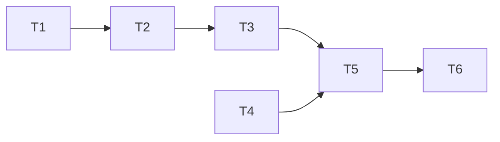

# Epic — gallery-by-prompt

> **Spec:** [spec.md](../spec.md) · **Design:** [sad.md](../sad.md) · **Data model:** [data-model.md](../data-model.md) · **API:** [openapi.yaml](../contracts/openapi.yaml) · **Screens:** [screens.md](../screens.md) · **ADRs:** [adr/](../adr/)

## Goal

The Owner sees the gallery grouped by identical prompt and opens everything a prompt produced, as views keyed by a short hash, with paging, badges and the dialog working inside them (spec §2).

## Scope

- **In:** migration 0010 (`prompt_key` + index), key on save + boot backfill, prompt reads in `src/server/modules/generations/`; prompt views, «By prompt», prompt grid, dialog within a prompt in `src/web/features/gallery/`.
- **Out:** similar-prompt grouping; editing groups; prompt search; combining prompt and model views (spec §3).

## Task map

## Tasks

See [tracker.md](./tracker.md) for status. Machine contract: [tasks.json](../tasks.json).

| # | Task | Layer | Blocked by | DoD (short) |
|---|---|---|---|---|
| T1 | Promote the prompt key migration | migration | — | 0010 applies/reverts |
| T2 | Write the prompt key on save and backfill older generations on boot | infra | T1 | key on save + boot backfill |
| T3 | Read prompt groups, one group and a prompt's pages | ports | T2 | prompt groups + prompt pages |
| T4 | Add the prompt views to the address and the caches | app | — | prompt views + patch safety |
| T5 | Show the gallery grouped by prompt | ui | T3, T4 | SCR-11 by prompt |
| T6 | Show a prompt's grid and step within it in the dialog | ui | T5 | prompt grid + dialog within it |

## Risks / Hard rules

- Literal identity: SHA-256 over the exact text, no normalisation (ADR-0037).
- No prompt text in addresses; malformed keys open the unknown-key state, never All.
- Every generation keyed, including pre-feature rows (boot backfill).
- Patches skip prompt-group caches (`key[1] === "prompts"`) — their pages hold `groups`.
- A change re-reads only views on screen (gallery-by-model §6).
