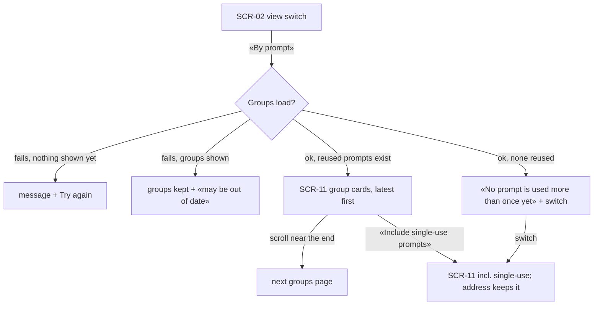
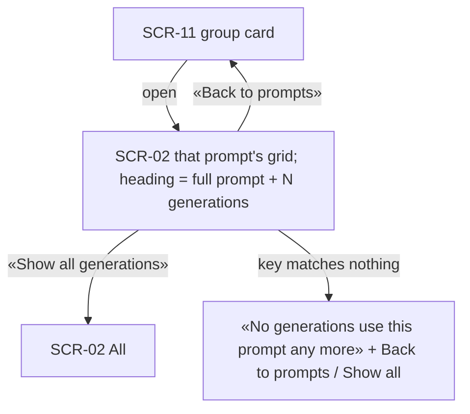
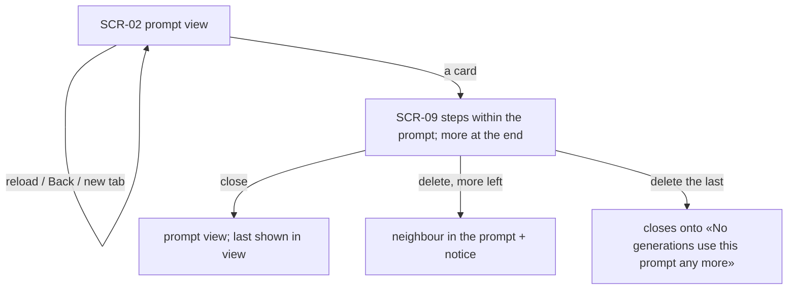

# UX flows — gallery-by-prompt

> User flows for every UI-touching §4 user story, produced by `ux-flows` (after `clarify`, before
> `design`). **Always markdown + mermaid `flowchart`.** Screen ids continue the app-wide inventory
> (SCR-02 Gallery, SCR-09 Detail dialog, SCR-10 By model); this feature adds SCR-11.

## Platform decisions

- **Posture:** desktop-first — per [`design-system.md`](../../design-system.md).
- **Where:** «By prompt» joins the gallery's view switch (step 13); a prompt's grid is the SCR-02 grid in a prompt view.
- **Address:** `view=prompts` (+ the single-use switch) and a prompt key — never the prompt text.
- **Dialog:** opened from a prompt's grid, it steps within the prompt.

## Screen inventory

| ID | Screen | Purpose | Entry | Exit |
|---|---|---|---|---|
| SCR-02 | Gallery (prompt view) | Every generation of one prompt, under a heading with the full prompt | a group card, its address | a card → SCR-09, «Back to prompts» → SCR-11 |
| SCR-11 | Gallery by prompt (new) | Paged group cards: latest image, prompt start, counts, models; single-use switch | the view switch, its address | a group → SCR-02 prompt view |
| SCR-09 | Detail dialog | Unchanged; steps within the prompt | a card | close → the prompt view |

## Flows

### Flow: US-01 — See the gallery grouped by prompt

«By prompt» shows one card per prompt used more than once, the most recent first — latest image, the prompt's first two lines, «N generations · M images», up to three models then «+K» — and loads more as the Owner scrolls. A switch adds single-use prompts and stays in the address. With no reused prompt it says so and offers the switch; failures keep what is shown with a note, or show a message with Try again.

### Flow: US-02 — Open everything one prompt produced

Opening a group shows every generation of exactly that prompt, newest first, under the full prompt text, with «Back to prompts» and «Show all generations». A key that no longer matches says so with the same two ways out.

### Flow: US-03 — Keep prompt views like the other views

Prompt views survive reload, Back and new tabs with their own scroll, naming the prompt only by its key. The dialog opened from a prompt's grid steps within the prompt and loads more at the end; deleting moves within the prompt, or closes onto the «no longer used» state after its last generation.

## AC coverage

| AC | Shown by | Notes |
|---|---|---|
| AC-01 | Flow US-01 → L, L2, L3, Z | reused by default; switch; empty state |
| AC-02 | Flow US-02 → P | full prompt heading |
| AC-03 | Flow US-03 → D, P2, D2, U | stepping, delete within the prompt |
| AC-04 | Flow US-03 → reload | key only, own scroll |
| AC-05 | N/A | grouping rule (server), no flow branch |
| AC-06 | Flow US-03 → D2, U | counts and membership |
| AC-07 | Flow US-02 → U | unknown key |
| AC-08 | Flow US-01 → E, E2 | errors with/without data |
| AC-09 | N/A | request guard |
| AC-10 | N/A | boot backfill (server) |
