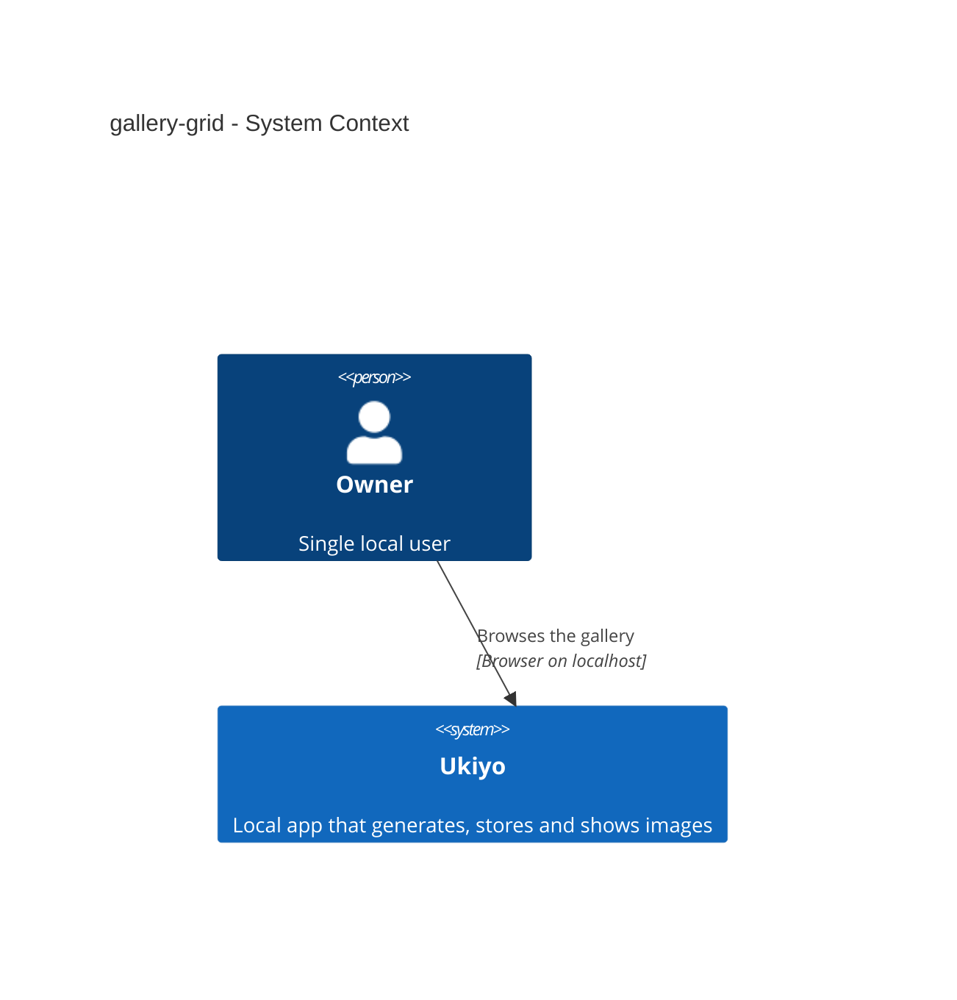
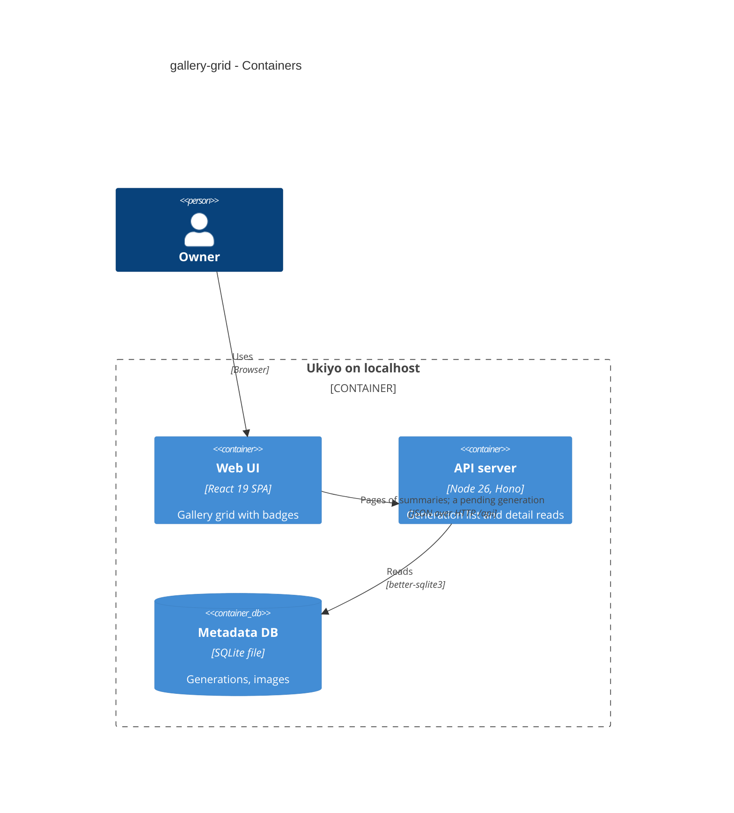
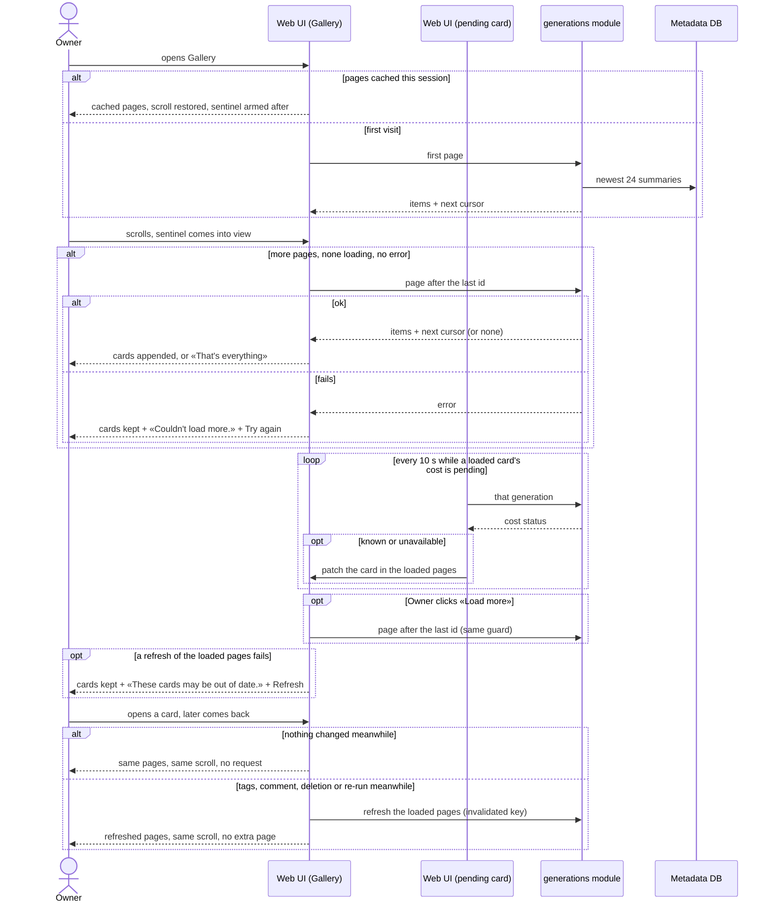

# Software Architecture Document — gallery-grid

## 1. Introduction and goals

**Intent.** Make the gallery a scrolling, newest-first grid whose cards show cost, duration, image size and image count over the preview, with an order and paging that the detail modal (step 12) and the model / prompt views (steps 13–14) can build on (spec §1 ¶3, §2).

**Top-3 quality goals (1-liners; full scenarios in §10):**
1. **Honest badges** — the recorded cost with its status, never $0; size of the image shown; partial counts named (AC-01…AC-03).
2. **Exactly-once paging** — every generation once, newest first; one request per page; no runaway loading (AC-04…AC-06).
3. **Cheap to keep current** — refresh cost doesn't grow with scroll depth (spec §6).

**Stakeholders.**

| Role | Interest | Sign-off owner? |
|---|---|---|
| Owner (also Tech Lead for SAD approval) | compares generations at a glance, browses by scrolling | Yes |

## 2. Constraints

**Technical.** Same stack (TypeScript 5 / Node 26 / Hono 4 / React 19 / TanStack Query 5 / SQLite). Cursor = generation id, newest first via `ORDER BY id DESC` (ULIDs, CLAUDE.md); list page size 24 (max 100); recent generations is the child key `["generations", "recent"]` of the gallery's `["generations"]` (ADR-0025): a prefix invalidation reaches both, an exact `setQueryData` on `["generations"]` reaches only the gallery; a pending cost resolves within its deadline (ADR-0013); only Generate stays mounted (ADR-0023).
**Organisational.** Solo maintainer; local gate only.
**Conventions.** CLAUDE.md: shared zod schemas; repo rows parsed through zod; shadcn/ui only; theme tokens (design-system.md).
**Regulatory / external.** N/A.

## 3. Context and scope

The gallery reads pages of generation summaries from the local server; a pending card re-reads its own generation until the cost is known. Nothing new talks to a provider.

<!-- brownfield: the gallery, list endpoint and recent strip shipped in steps 2–8; architecture-map.md is the reference. -->

**External systems (in / out):**

| Actor or system | Type | Interaction |
|---|---|---|
| Owner | Person | scrolls the gallery, opens cards |

**C4 Context (L1):**



## 4. Solution strategy

**Target surface:** `[web-frontend, backend-service]` — the grid in the SPA; one field added to the list summary. No new UI-architecture decision.

1. **Pending costs refresh per card** — a pending card polls `["generation", id]` every 10 s and patches itself into the loaded pages when the cost resolves; the list query no longer polls → [ADR-0031](./adr/0031-refresh-pending-costs-per-generation-instead-of-refetching-every-loaded-page.md).
2. **Auto-paging from a sentinel, scroll restored per visit** — an IntersectionObserver on an end-of-grid sentinel requests the next page only when `hasNextPage && !isFetchingNextPage && !isFetchNextPageError`; the existing «Load more» button stays (disabled while `isFetchingNextPage`, hidden when `!hasNextPage`); `scrollY` saved on unmount and restored in a layout effect once the cached pages render, before the sentinel is armed → [ADR-0032](./adr/0032-load-the-next-gallery-page-from-an-end-of-grid-sentinel-and-restore-the-scroll-position-per-visit.md).
3. **The summary carries `durationMs`** (inline — additive field): the list read adds `g.duration_ms`; the thumbnail already carries the first output's `width`/`height`; `imagesRequested` / `imagesReceived` give the count badge.
4. **Errors with data keep the data** (inline): `isError && data` renders the loaded cards plus an inline message — «Couldn't load more.» + Try again after a failed next page (`isFetchNextPageError`), «These cards may be out of date.» after a failed refresh; only `isError && !data` shows the full-page error.
5. **Badge strip** (inline): one `CardBadges` row absolutely positioned along the bottom of the preview, opaque `bg-background` + `text-foreground`, `Badge` primitives, single line with overflow hidden; the footer's duplicate «cost pending» badge is removed.

## 5. Building block view

```
src/shared/generations.ts                    GenerationSummary + durationMs
src/server/modules/generations/repo.ts       summary columns + g.duration_ms
src/web/lib/format.ts                        + formatCostBadge (known → «$0.04», «cost pending», «cost unavailable»), formatSize, formatCount
src/web/features/gallery/
├── Gallery.tsx                              sentinel paging, scroll restore, inline errors, no list polling
├── CardBadges.tsx                           SCR-02 badge strip over the preview
├── usePendingCost.ts                        per-card pending poll + cache patch (ADR-0031)
└── *.test.tsx
```

**C4 Container (L2):**



## 6. Runtime view

**Critical flow: scroll the grid, keep a pending card current, come back from a detail page**



The flow covers AC-02 (pending refresh), AC-04, AC-05 and AC-08; AC-01 and AC-03 are rendering rules (§8 badges, QG-1); AC-06/AC-07 are the existing prefix invalidations re-reading the loaded pages and the strip (ADR-0025); AC-09 is the request guard; AC-10 is the card's image fallback.

## 7. Deployment view

<!-- N/A: same single local process; no migration, no configuration. -->

## 8. Crosscutting concepts

| Concept | Convention | Where defined |
|---|---|---|
| Cost badge | known → `formatCost` («$0.04»); pending → «cost pending»; unavailable → «cost unavailable»; never `$0` for an unknown cost | `src/web/lib/format.ts` |
| Size / count badges | first output `width×height` (× = U+00D7); count only when `imagesReceived > 1` → «N images», or when `imagesReceived < imagesRequested` → «R of Q images» | `CardBadges.tsx` |
| Duration | `formatDuration(durationMs)` — the stored provider round trip | `src/web/lib/format.ts` |
| Paging guard | sentinel → `fetchNextPage()` only if `hasNextPage && !isFetchingNextPage && !isFetchNextPageError`; rootMargin 600px; «Load more» calls the same function (disabled while fetching, hidden after the last page); «Try again» after a failed page is the only retry | `Gallery.tsx` |
| Scroll restore | module-level `{ y }` saved on unmount; restored in a layout effect after pages render; reset on reload | `Gallery.tsx` |
| Pending refresh | `useQuery(["generation", id], { refetchInterval: pending ? 10 s : false, staleTime: ∞, refetchOnWindowFocus: false })` per pending card (one read when the card mounts, then every 10 s; none on focus); on resolve `setQueryData` patches the card in the gallery's pages (exact key) — no invalidation, so the recent strip makes no request (app-shell §6) | `usePendingCost.ts` |
| Errors | `!data` → full-page error (unchanged); with data → inline «Couldn't load more.» / «These cards may be out of date.» | `Gallery.tsx` |

## 9. Architecture decisions

| # | Title | Status | Section |
|---|---|---|---|
| 0031 | Refresh pending costs per generation instead of refetching every loaded page | Accepted | §4 |
| 0032 | Load the next gallery page from an end-of-grid sentinel and restore the scroll position per visit | Accepted | §4 |

## 10. Quality requirements

**QG-1. Honest badges**
- **When:** cards of known, pending and unavailable costs; mixed sizes; fewer outputs than asked; a broken preview; light and dark themes.
- **Then:** the wording of §8; never $0; badges kept with «Image unavailable» (AC-01…AC-03, AC-10); «text contrast ≥ 4.5:1 against the badge background in light and dark themes» (spec §6).
- **How verify:** component tests per badge state; format unit tests; «contrast of the badge foreground/background tokens computed in a unit test for both themes (like `theme-tokens.test.ts`), plus a manual check at ship».

**QG-2. Exactly-once, fast paging**
- **When:** the Owner scrolls fast, a page fails, the Owner generates/deletes with pages loaded, comes back from a detail page.
- **Then:** «≤ 1 request per page; none while one is in flight or after the last page» (spec §6); every generation once, newest first; same pages and scroll on return without a further page; pages stay «any page (first or continued) of 24 items, 1 000 generations, each with 10 tags and a comment ≤ 300 ms p95 server time (curate-gallery §6, unchanged)».
- **How verify:** «component test with a controllable scroll trigger»; a return-from-detail test asserting no list request; «existing `nfr` test, extended to a continued page and the new fields».

**QG-3. Cheap to keep current**
- **When:** 5 pages are loaded and one card's cost is pending.
- **Then:** «a pending cost is refreshed by asking only for the generations still pending — not every loaded page — at most every 10 s; other refreshes cost ≤ 1 request per loaded page» (spec §6); the recent strip makes no request for it.
- **How verify:** «component test counting list/detail requests with 5 pages loaded».

## 11. Risks and technical debt

| Risk / debt | Severity | Mitigation | Owner |
|---|---|---|---|
| A very long session loads hundreds of pages into memory | Low | images lazy-load; accepted for a single local user | dmytro.hopko |
| Focus refetch still re-reads every loaded page | Low | ≤ 1 request per page, staleTime ∞ otherwise (ADR-0025) | dmytro.hopko |

**Accepted debt:** none new.

## 12. Glossary

| Term | Meaning |
|---|---|
| Gallery · Generation · Cost status · Output image · Recent generations | see CONTEXT.md |
| Badge strip | the one-line row of cost / duration / size / count over a card's preview |
