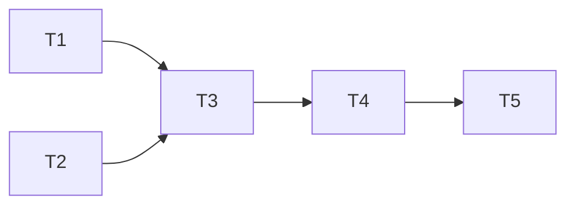

# Epic — gallery-grid

> **Spec:** [spec.md](../spec.md) · **Design:** [sad.md](../sad.md) · **Data model:** [data-model.md](../data-model.md) · **API:** [openapi.yaml](../contracts/openapi.yaml) · **Screens:** [screens.md](../screens.md) · **ADRs:** [adr/](../adr/)

## Goal

Each gallery card shows cost, duration, image size and count over its preview; the newest-first grid loads its pages as the Owner scrolls, keeps its place, and stays exact and cheap to keep current (spec §2).

## Scope

- **In:** `durationMs` in the list summary (`src/shared/generations.ts`, `src/server/modules/generations/repo.ts`); badge wording in `src/web/lib/format.ts`; `CardBadges`, sentinel paging, scroll restore, inline errors and per-card pending refresh in `src/web/features/gallery/`.
- **Out:** filtering / grouping (steps 13–14); the detail modal (step 12); recording changes; page-size or density choice (spec §3).

## Task map

## Tasks

See [tracker.md](./tracker.md) for status. Machine contract: [tasks.json](../tasks.json).

| # | Task | Layer | Blocked by | DoD (short) |
|---|---|---|---|---|
| T1 | Carry the duration in the gallery list summary | ports | — | durationMs in the summary; nfr continued page |
| T2 | Word the cost, size and count badges | domain | — | badge wording + contrast, unit-tested |
| T3 | Show the badge strip over each card's preview | ui | T1, T2 | badge strip on cards, component-tested |
| T4 | Load pages as the Owner scrolls and keep the place on return | ui | T3 | sentinel paging + restore + inline errors |
| T5 | Refresh a pending cost per card instead of the whole gallery | ui | T4 | per-card pending refresh, request-counted |

## Risks / Hard rules

- Never $0 for an unknown cost; size = the image the preview shows (AC-02, AC-03).
- ≤ 1 request per page, none in flight twice, none after the last page, no automatic retry (spec §6, ADR-0032).
- A pending cost refresh asks only for the pending generation; the recent strip makes no request for it (ADR-0031, app-shell §6).
- Errors with data keep the cards (AC-05).
