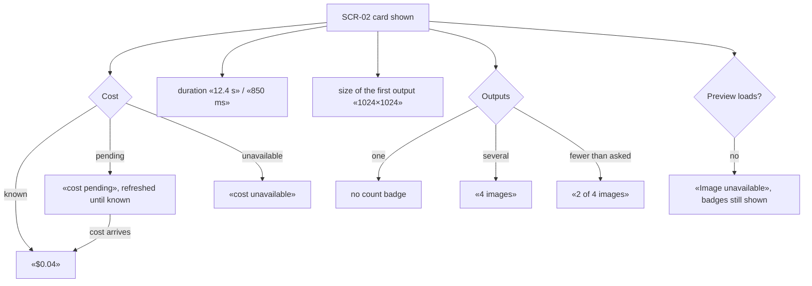
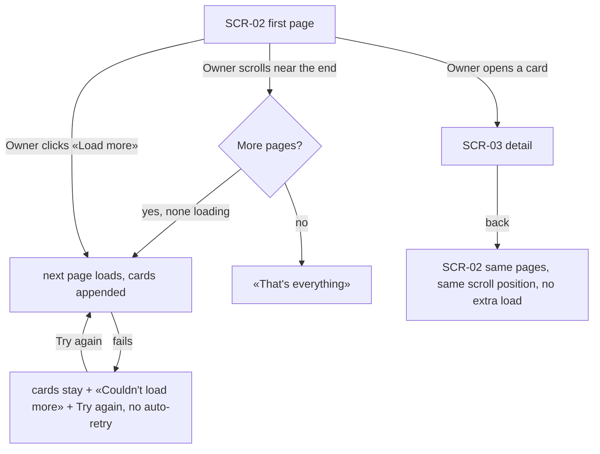
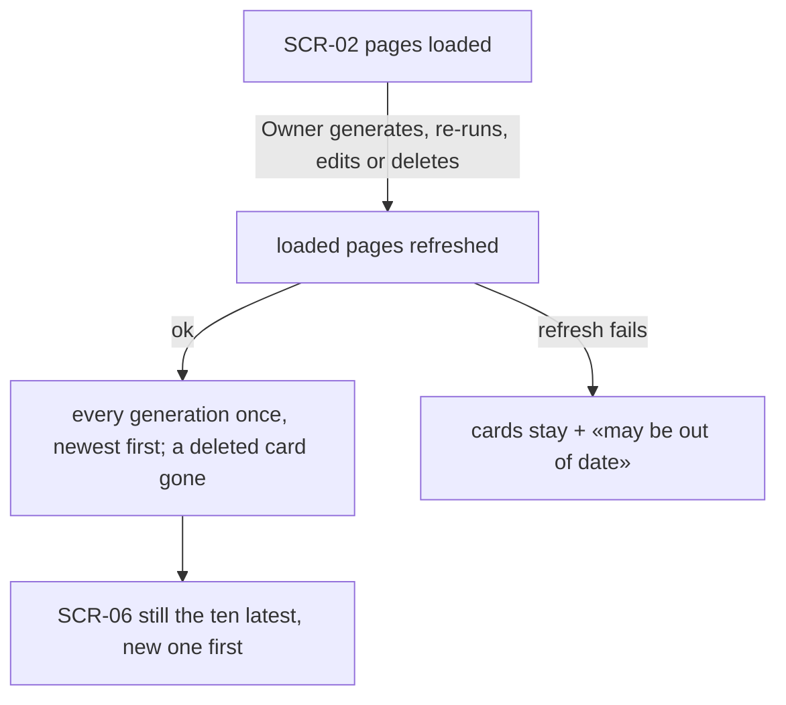

# UX flows — gallery-grid

> User flows for every UI-touching §4 user story, produced by `ux-flows` (after `clarify`, before
> `design`). **Always markdown + mermaid `flowchart`.** Screen ids continue the app-wide inventory
> (SCR-02 Gallery, SCR-03 Generation detail, SCR-06 Recent generations …); this feature changes SCR-02 only.

## Platform decisions

- **Posture:** desktop-first — per [`design-system.md`](../../design-system.md); 2 columns below `md`, 3 at `md`, 4 from `xl` (unchanged).
- **Paging:** newest first, a page after the last card shown; the next page loads when the end of the grid comes near; «Load more» stays as a button.
- **Badges:** one line along the bottom of each preview, opaque background, theme tokens.
- **Return to the grid:** the gallery remembers where the Owner was scrolled and the loaded pages for the rest of the session (until a reload).
- **The card still opens the detail page** (SCR-03) — the modal is step 12.

## Screen inventory

| ID | Screen | Purpose | Entry | Exit |
|---|---|---|---|---|
| SCR-02 | Gallery (extended) | The newest-first grid with cost / duration / size / count badges, auto-loading pages | sidebar «Gallery», back from a detail page | a card → SCR-03, another section |
| SCR-03 | Generation detail | Unchanged; the place the Owner comes back from | a card | back → SCR-02 |
| SCR-06 | Recent generations | Unchanged; must stay the ten latest | Generate section | a thumbnail → SCR-03 |

## Flows

### Flow: US-01 — See cost, duration and size on each card

Every card's preview carries, on one line along its bottom, the recorded cost (or «cost pending» / «cost unavailable» — never $0), the duration, and the size of the first output (the image the preview shows), plus a count when there are several outputs — «2 of 4 images» when fewer came back than were asked. A pending cost turns into its amount on the card once known, without a reload. If the preview can't be shown, the card says «Image unavailable» and keeps its badges.

### Flow: US-02 — Browse by scrolling

The first page shows; as the Owner scrolls near the end, the next page loads by itself and appends its cards — never twice at once, never after the last page, where «That's everything» shows. «Load more» does the same on click. If a page fails, the loaded cards stay with a message and «Try again», and nothing retries by itself. Opening a card goes to the detail page; coming back shows the same pages at the same scroll position, without loading anything.

### Flow: US-03 — Keep the grid trustworthy

When the Owner generates, re-runs, edits or deletes, the loaded pages are refreshed so every generation appears exactly once, newest first, and a deleted one disappears; the recent strip next to the generate form still shows exactly the ten latest. If such a refresh fails, the loaded cards stay with a short note that they may be out of date.

## AC coverage

| AC | Shown by | Notes |
|---|---|---|
| AC-01 | Flow US-01 → CK, D, S, N | one line, opaque, bottom quarter |
| AC-02 | Flow US-01 → CP, CU | pending refreshed until known |
| AC-03 | Flow US-01 → S | first output = the preview |
| AC-04 | Flow US-02 → L, E | auto-load + Load more + end |
| AC-05 | Flow US-02 → F; Flow US-03 → O | inline error, no auto-retry; failed refresh keeps cards |
| AC-06 | Flow US-03 → G | exactly once, newest first |
| AC-07 | Flow US-03 → R | recent strip still ten latest |
| AC-08 | Flow US-02 → D → R | same pages and scroll, no extra load |
| AC-09 | N/A | no UI path: a foreign page is refused by the request guard |
| AC-10 | Flow US-01 → IU | badges kept |
