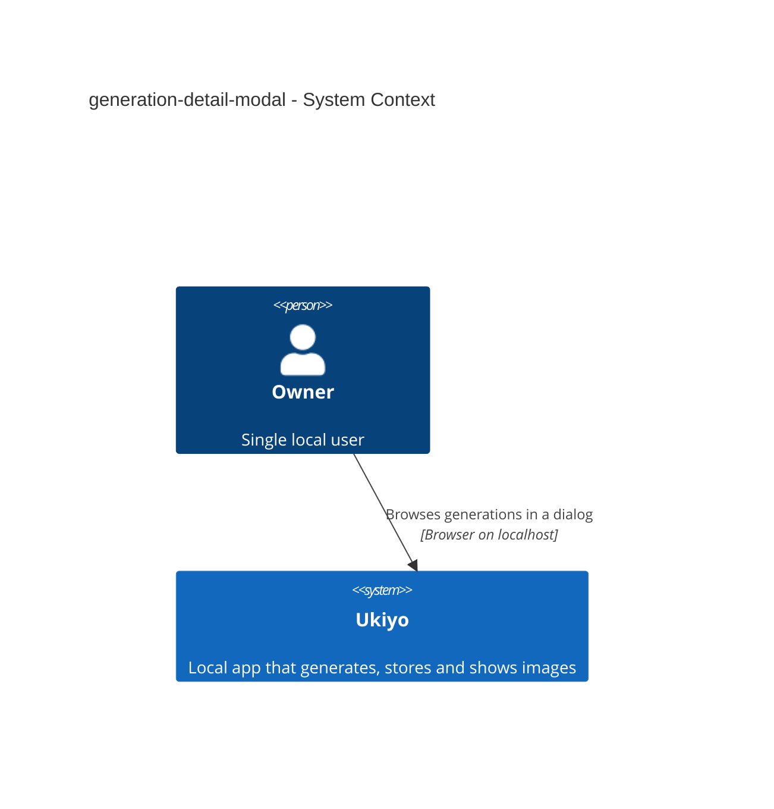
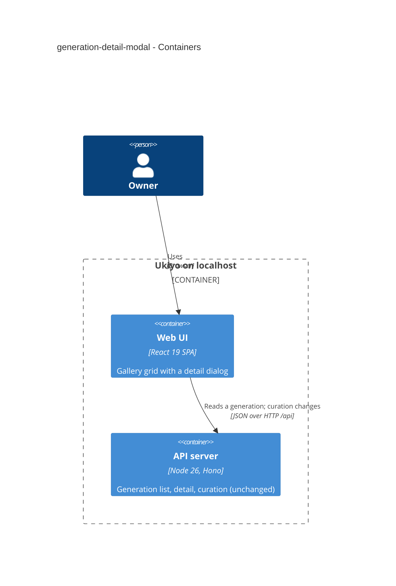

# Software Architecture Document — generation-detail-modal

## 1. Introduction and goals

**Intent.** Show a generation opened from the gallery grid in a dialog over the grid — images left, metadata and actions right — with ← → stepping through the grid's order, while every direct way to a generation keeps showing the full page (spec §1 ¶3, §2).

**Top-3 quality goals (1-liners; full scenarios in §10):**
1. **Predictable history** — one Back closes, Forward reopens, reload / direct access = full page (AC-04, AC-05).
2. **Safe stepping** — nothing typed or confirmed for one generation can apply to another; no skipped or repeated neighbour (AC-02, AC-09).
3. **Cheap browsing** — one detail read per generation, edits don't re-read the grid, neighbours preloaded (spec §6).

**Stakeholders.**

| Role | Interest | Sign-off owner? |
|---|---|---|
| Owner (also Tech Lead for SAD approval) | flips through results without leaving the grid | Yes |

## 2. Constraints

**Technical.** React 19 SPA, TanStack Query 5, shadcn/ui Dialog (Radix). History API router without state today (ADR-0009, extended by ADR-0033); the detail route belongs to Gallery (ADR-0022); only Generate stays mounted (ADR-0023); the grid's order, paging guards and scroll restore (ADR-0032); curation changes go one at a time (ADR-0016); the recent strip is the child key `["generations", "recent"]` (ADR-0025). No server change.
**Organisational.** Solo maintainer; local gate only.
**Conventions.** CLAUDE.md: shadcn/ui only; theme tokens.
**Regulatory / external.** N/A.

## 3. Context and scope

Only the browser changes: the grid opens a dialog at the generation's address and reads the same generation detail as the full page; nothing new reaches the server or a provider.

<!-- brownfield: gallery grid (step 11), detail page (steps 2–6), app frame (step 8) shipped on this branch chain. -->

**External systems (in / out):**

| Actor or system | Type | Interaction |
|---|---|---|
| Owner | Person | opens a card, steps, acts, closes |

**C4 Context (L1):**



## 4. Solution strategy

**Target surface:** `[web-frontend]` — browser only; the detail read is unchanged. No new UI-architecture decision beyond the router state (ADR-0033).

1. **History state marks a dialog visit** — the grid pushes `/generations/:id` with `{ dialog: "gallery", load }`; stepping and lineage hops `replace` with the same state; `App` renders the Gallery page plus `GenerationDialog` when the detail route's state matches this load, the full page otherwise; close = `history.back()`; re-run/reuse replace the dialog's entry with the generate address (so Back from Generate lands on the grid entry below it, no duplicate) → [ADR-0033](./adr/0033-mark-a-dialog-visit-in-the-history-entry-and-render-the-grid-under-it-only-for-this-app-load.md).
2. **Edits patch the card in place** — comment/tag success writes the new tags / comment flag into the card of the loaded gallery pages (exact key), refreshes `["generation", id]`, invalidates `["generations", "recent"]` only → [ADR-0034](./adr/0034-update-the-edited-card-in-place-instead-of-refetching-every-loaded-gallery-page.md).
3. **Neighbours from the loaded order** (inline): `neighbours(items, id)` over the flattened gallery pages → `{ newer, older, atEnd }`; stepping older from the last loaded item calls the grid's guarded `fetchNextPage` and steps to the first new item; a generation not in the order (lineage) has no neighbours; the grid's sentinel is paused while the dialog is open.
4. **One body, keyed per generation** (inline): `Detail` is rendered with `key={id}`, so a step remounts it — no draft, edit mode or confirmation survives a step; `Detail` reports «busy» (unsaved comment, tag text typed but not added, open delete confirmation) and the dialog disables stepping while busy; Esc goes to the innermost layer first (confirmation / comment edit), the dialog only when nothing inside is open; closing drops unsaved text, as leaving the full page does.
5. **Delete from the dialog** (inline): the neighbour (older, else newer) is computed before the delete; on success the dialog shows «Generation deleted.» and the address is replaced with the neighbour (dialog state), or — when there is none — the dialog closes with `history.back()` and the notice is handed to the mounted grid, so Back never returns to a deleted id; if the deleted one was the last loaded and more pages exist, the next page is loaded first — if it fails, the dialog closes onto the grid with the notice and the grid's «Couldn't load more»; the full detail page keeps landing on the grid as before.
6. **Layout + preload** (inline): preload only among loaded generations; `DialogContent` widened (`max-w-6xl`, `h-[90vh]`), two columns from `lg` (images | metadata, each scrolling), stacked below; after each step the newer/older neighbours' first output is preloaded (`new Image().src`); the large image's area is sized before load (no jump).

## 5. Building block view

```
src/web/lib/router.tsx                       navigate/replace(path, state?); useRoute() exposes state; APP_LOAD id
src/web/App.tsx                              Gallery rendered at one fixed place in the tree for both `/gallery` and a detail route with this load's dialog state (never remounts on open/step/close); GenerationDialog on top; any other detail route → full page
src/web/features/gallery/
├── GenerationDialog.tsx                     SCR-09: dialog, ← → (keys + buttons), close, busy guard, preload
├── neighbours.ts                            neighbours(items, id) (pure)
├── GenerationDetail.tsx                     Detail body shared by page and dialog (two-column layout in the dialog), key per id, busy reporting; inside the dialog re-run/reuse replace the entry with the generate address
├── Notes.tsx                                patch the gallery card + detail instead of invalidating the gallery (ADR-0034); busy reporting (comment draft, tag text); cancel-edit API for Esc
├── Lineage.tsx                              inside the dialog: links replace with the dialog state; on the full page: unchanged pushes
├── galleryNotice.ts                         a tiny store the mounted grid subscribes to («Generation deleted.»); the `?deleted` flag stays for the full page
├── DeleteGeneration.tsx                     dialog-aware success (neighbour or close + notice)
├── Gallery.tsx                              cards push the dialog state; sentinel paused while the dialog is open; exposes loaded order + fetchNextPage
└── *.test.tsx
```

**C4 Container (L2):**



## 6. Runtime view

**Critical flow: open from the grid, step, edit, close**

```mermaid
sequenceDiagram
    actor Owner
    participant Grid as Gallery grid
    participant Dlg as Detail dialog
    participant Hist as Browser history
    participant API as API server
    Owner->>Grid: opens a card
    Grid->>Hist: push generation address, dialog state of this load
    Grid->>Dlg: show generation (sentinel paused)
    Dlg->>API: generation detail (once, cached after)
    alt loaded
        API-->>Dlg: generation
        Dlg-->>Owner: images left, metadata right; neighbours preloaded
    else fails or gone
        Dlg-->>Owner: «Couldn't load…» + Try again, or «no longer exists»; stepping and closing still work
    end
    Owner->>Dlg: presses → (no text field focused, not busy)
    alt older neighbour loaded
        Dlg->>Hist: replace with the neighbour (same state)
    else last loaded, more pages
        Dlg->>Grid: next page (guarded)
        alt page ok
            Dlg->>Hist: replace with its first generation
        else page fails
            Dlg-->>Owner: stays, «Couldn't load the next one» + Try again
        end
    end
    Owner->>Dlg: adds a tag
    Dlg->>API: tag change
    API-->>Dlg: new tags
    Dlg->>Grid: patch that card (no page re-read)
    Owner->>Dlg: closes (Esc, ×, outside, Back)
    Dlg->>Hist: back
    Hist-->>Grid: gallery entry, same pages; last shown card scrolled into view
```

The flow covers AC-01…AC-04, AC-07 (edit half) and AC-10; AC-05 is the router choosing the full page when the state doesn't match this load; AC-06 is §4 item 5; AC-07 (re-run/reuse) and AC-08 (lineage) are §4 item 1; AC-09 is §4 item 4; AC-11 is the request guard.

## 7. Deployment view

<!-- N/A: browser-only change in the same single local process. -->

## 8. Crosscutting concepts

| Concept | Convention | Where defined |
|---|---|---|
| History state | `{ dialog: "gallery", load: APP_LOAD }`; `APP_LOAD` = a random id per app load; open = push, step / lineage / delete-to-neighbour = replace, close = back, re-run/reuse = replace(`/gallery`) then push | `router.tsx`, ADR-0033 |
| Stepping keys | `keydown` on the dialog: ← newer, → older; ignored when the target is an input, textarea, select or contenteditable, or while busy | `GenerationDialog.tsx` |
| Busy | `Detail` reports unsaved comment draft / tag text typed but not added / open delete confirmation via `onBusyChange`; dialog disables «Newer»/«Older» and keys |
| Esc | the delete confirmation is a nested Radix dialog (closes first by itself); while a comment edit is open the dialog's `onEscapeKeyDown` calls `preventDefault()` and cancels the edit; otherwise Esc closes the dialog (`history.back()`) | `GenerationDetail.tsx`, `Notes.tsx`, `DeleteGeneration.tsx` |
| Neighbours | relative to the shown id in the current flattened order; not in the order → none | `neighbours.ts` |
| Card patch | `setQueryData(["generations"], patch(id, { tags, hasComment }))` + `invalidateQueries(["generation", id])` + `invalidateQueries(["generations","recent"], exact)` | `Notes.tsx`, ADR-0034 |
| Close → place | on close the grid scrolls the last *grid* generation the dialog showed into view (`scrollIntoView({ block: "nearest" })`) only when it is outside the viewport, else keeps the scroll; the sentinel is re-armed only after the Owner's next scroll — scroll events within 500 ms of the close-time `scrollIntoView` are ignored, so this never loads a page | `Gallery.tsx` |
| Refresh while open | comment/tag → card patch only (ADR-0034); deletion and a finishing generation → the existing prefix invalidation re-reads loaded pages; pending cost → per card (ADR-0031); the sentinel stays paused, only stepping loads a page | `Gallery.tsx`, `Notes.tsx` |
| Layout | `DialogContent` `sm:max-w-6xl h-[90vh] p-0`; `lg:grid-cols-[minmax(0,3fr)_minmax(0,2fr)]`; each column `overflow-y-auto`; the dialog title is the prompt excerpt (sr-only heading kept) | `GenerationDialog.tsx` |

## 9. Architecture decisions

| # | Title | Status | Section |
|---|---|---|---|
| 0033 | Mark a dialog visit in the history entry and render the grid under it only for this app load | Accepted | §4 |
| 0034 | Update the edited card in place instead of refetching every loaded gallery page | Accepted | §4 |

## 10. Quality requirements

**QG-1. Predictable history**
- **When:** the Owner opens, steps five times, follows a lineage link, closes with Back, presses Forward; reloads inside the dialog; re-runs from the dialog and presses Back.
- **Then:** one Back closes; Forward reopens the dialog; reload shows the full page; Back from Generate lands on the grid (AC-04, AC-05, AC-07, AC-08).
- **How verify:** component tests driving `history.back/forward` (popstate) and a simulated new load id; after re-run, Back lands on the grid and a second Back leaves the gallery (no duplicate entry).

**QG-2. Safe stepping**
- **When:** a comment draft is unsaved, the delete confirmation is open, a text field has focus, a generation finishes meanwhile.
- **Then:** no step; nothing carries over; no skip/repeat (AC-02, AC-09).
- **How verify:** component tests per case, incl. a close-time scroll near the end of the grid that must not load a page.

**QG-3. Cheap browsing**
- **When:** stepping through 10 generations, editing tags on 3.
- **Then:** «≤ 100 ms p95 from open/step to the dialog rendering the large image element and the metadata, for an already read generation; a generation not read yet costs exactly one detail read, with «Loading…» in the metadata column meanwhile»; «≤ 1 detail read per generation shown, none for a generation already read this session; the grid's next page ≤ 1 request»; «a comment or tag change costs ≤ 1 detail read and 0 list-page reads»; «after a step, at most 2 images are preloaded — the first output of the newer and of the older neighbour — and only among loaded generations (never a page load for a preload)» (spec §6).
- **How verify:** «component timing test (serial `nfr-web`) + a manual check at ship (jsdom has no paint timing)»; «component test counting requests»; «component test (image preload)».

## 11. Risks and technical debt

| Risk / debt | Severity | Mitigation | Owner |
|---|---|---|---|
| Delete with no neighbour leaves the dialog via `history.back()` — if the Owner had reached the dialog by Forward, Back goes to the entry before the grid | Low | accepted; the notice still shows on the grid | dmytro.hopko |
| A future navigation inside the dialog forgets to pass the state | Low | `navigate`/`replace` helpers for the dialog in one place; history tests | dmytro.hopko |
| Very tall metadata (raw exchange) in a 90vh dialog | Low | the metadata column scrolls on its own | dmytro.hopko |

**Accepted debt:** none new.

## 12. Glossary

| Term | Meaning |
|---|---|
| Generation · Gallery · Lineage · Source generation | see CONTEXT.md |
| Detail dialog | the generation shown over the gallery grid at its own address; the full detail page is the same generation reached directly |
| Neighbour | the next newer / older generation in the grid's loaded newest-first order |
