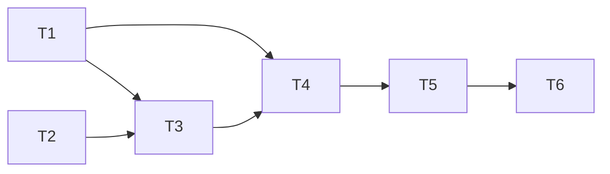

# Epic — generation-detail-modal

> **Spec:** [spec.md](../spec.md) · **Design:** [sad.md](../sad.md) · **Data model:** [data-model.md](../data-model.md) · **API:** [openapi.yaml](../contracts/openapi.yaml) · **Screens:** [screens.md](../screens.md) · **ADRs:** [adr/](../adr/)

## Goal

A generation opened from the gallery shows in a dialog over the grid — images left, metadata right — steps through neighbours with ← →, closes back to the grid, while direct access keeps the full page (spec §2).

## Scope

- **In:** router history state + one fixed Gallery instance in `src/web/App.tsx` / `src/web/lib/router.tsx`; `GenerationDialog`, `neighbours`, card patching, busy guard, dialog-aware lineage/re-run/delete in `src/web/features/gallery/`.
- **Out:** a dialog from the recent strip or the full page; zoom/full-screen; filtered stepping (steps 13–14); new editing (spec §3).

## Task map

## Tasks

See [tracker.md](./tracker.md) for status. Machine contract: [tasks.json](../tasks.json).

| # | Task | Layer | Blocked by | DoD (short) |
|---|---|---|---|---|
| T1 | Carry a dialog state in history and keep one Gallery instance under it | app | — | history state + fixed Gallery instance |
| T2 | Find a generation's newer and older neighbours in the loaded order | domain | — | neighbours, unit-tested |
| T3 | Show the generation in a dialog over the grid and step through neighbours | ui | T1, T2 | SCR-09 dialog + stepping + close |
| T4 | Make the detail body safe and dialog-aware: busy, lineage, re-run and in-place card edits | ui | T1, T3 | busy, edits, lineage, re-run in the dialog |
| T5 | Delete from the dialog and move to a neighbour | ui | T4 | delete → neighbour or grid + notice |
| T6 | Prove the dialog's timing, request counts and preloads | tests | T5 | dialog NFRs measured |

## Risks / Hard rules

- One Back closes the dialog; Forward reopens; reload / direct access = full page (ADR-0033).
- Gallery is one mounted instance across `/gallery` and the dialog (never remounts on open/close).
- Nothing typed or confirmed for one generation applies to another: Detail keyed per id; stepping disabled while busy (AC-09).
- Comment/tag edits patch the card, no page re-reads (ADR-0034).
- Closing never loads a page (sentinel re-armed after the Owner's next scroll).
