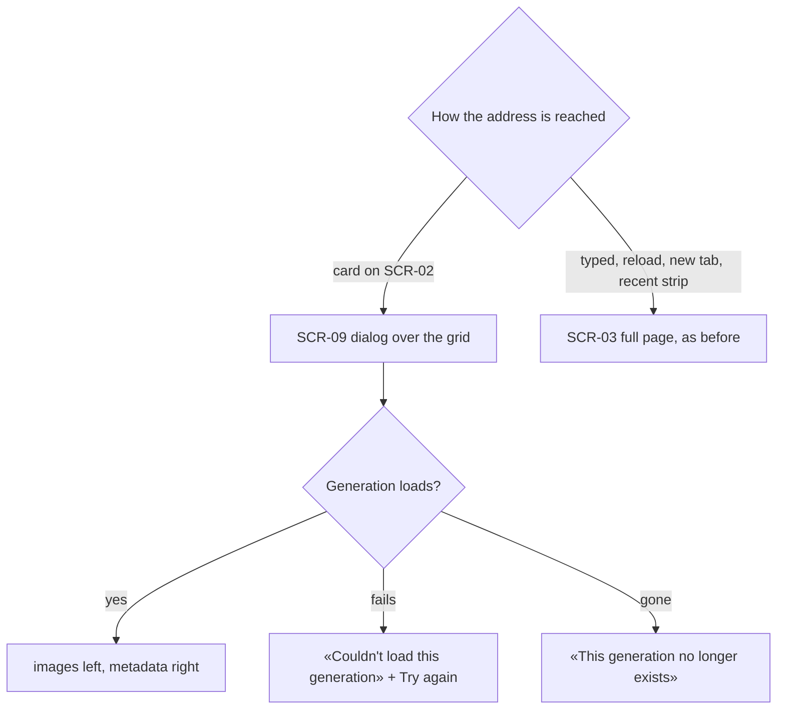
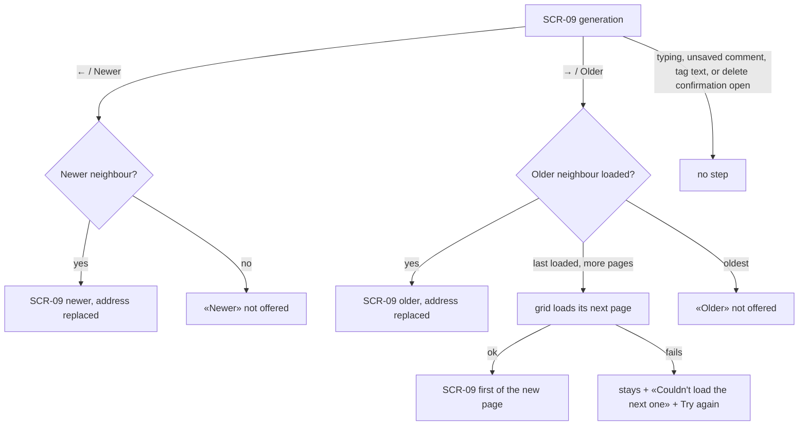
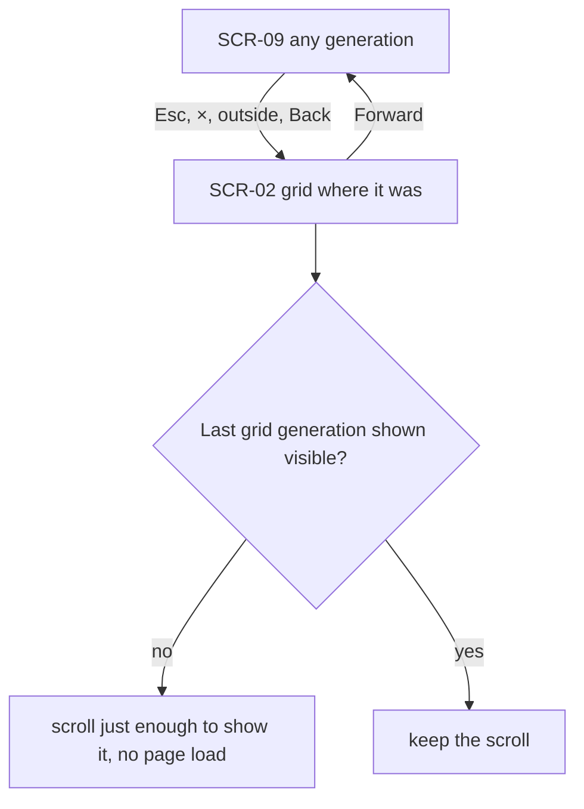
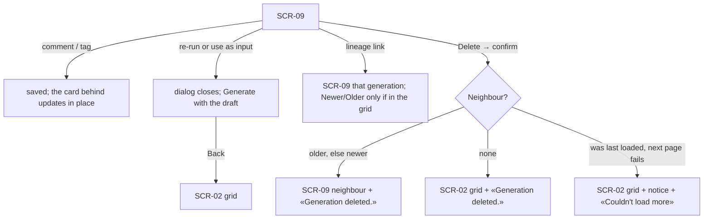

# UX flows — generation-detail-modal

> User flows for every UI-touching §4 user story, produced by `ux-flows` (after `clarify`, before
> `design`). **Always markdown + mermaid `flowchart`.** Screen ids continue the app-wide inventory
> (SCR-02 Gallery, SCR-03 Generation detail page …); this feature adds SCR-09.

## Platform decisions

- **Posture:** desktop-first — per [`design-system.md`](../../design-system.md); two columns from `lg`, stacked below.
- **Modality:** a dialog over the gallery grid (SCR-09) when opened from the grid; the full page (SCR-03) when reached directly. Same address in both cases.
- **History:** opening adds one entry; steps and lineage hops inside the dialog replace it; one Back closes.
- **Keyboard:** ← newer, → older, Esc closes the innermost layer; focus stays inside the dialog.

## Screen inventory

| ID | Screen | Purpose | Entry | Exit |
|---|---|---|---|---|
| SCR-02 | Gallery | Unchanged grid; behind the dialog; brings the last shown card into view on close | sidebar, Back | a card → SCR-09 |
| SCR-03 | Generation detail page | Unchanged full page for direct access | typed / reloaded / new tab / recent strip | Gallery link |
| SCR-09 | Detail dialog (new) | The generation over the grid: images left, metadata + actions right, Newer / Older | a card on SCR-02 | close → SCR-02; re-run / reuse → Generate |

## Flows

### Flow: US-01 / US-04 — Open a generation

Opening a card shows the dialog over the grid at the generation's address; reaching the same address any other way shows the full page exactly as before. In the dialog the images are on the left (the first output large, the others to pick) and the metadata and actions on the right; a failed or missing generation is said plainly inside the dialog, which can still step and close.

### Flow: US-02 — Step through neighbours

← and → (or the buttons) show the newer or older neighbour in the grid's order and replace the address; at the end of the loaded cards the grid's next page loads first, and a failure leaves the dialog where it was with a way to try again. Stepping is unavailable while the Owner is typing, has an unsaved comment or tag text, or has the delete confirmation open.

### Flow: US-03 — Close back to where I was

Closing in any way returns to the grid as it was; if the last grid generation the dialog showed is off screen, the grid scrolls just enough to show it, without loading another page. Forward reopens the same generation in the dialog.

### Flow: US-05 — Act from the dialog

Comments and tags save as on the full page and update the card behind the dialog in place. Re-run and «use as input» close the dialog and open Generate with the draft; Back from there returns to the grid. A lineage link shows that generation in the dialog, with stepping only if it belongs to the grid. Deleting (after the confirmation) shows «Generation deleted.» and moves to the older neighbour (or newer), or closes onto the grid when none is left or the next page can't load.

## AC coverage

| AC | Shown by | Notes |
|---|---|---|
| AC-01 | Flow US-01 → D → V | two columns, stacked when narrow |
| AC-02 | Flow US-02 → S2, S3, X1, X2 | relative to the shown generation |
| AC-03 | Flow US-02 → NP, F | next page on stepping |
| AC-04 | Flow US-03 → C, SC, Forward | one Back; no page load on close |
| AC-05 | Flow US-01 → P | direct access = full page |
| AC-06 | Flow US-05 → DN, DC, DF | notice, neighbour, failure |
| AC-07 | Flow US-05 → T, R → G | in-place card; Back to grid |
| AC-08 | Flow US-05 → LN | lineage stays in the dialog |
| AC-09 | Flow US-02 → B | no step while busy/typing |
| AC-10 | Flow US-01 → E, G | inside the dialog |
| AC-11 | N/A | no UI path: request guard |
