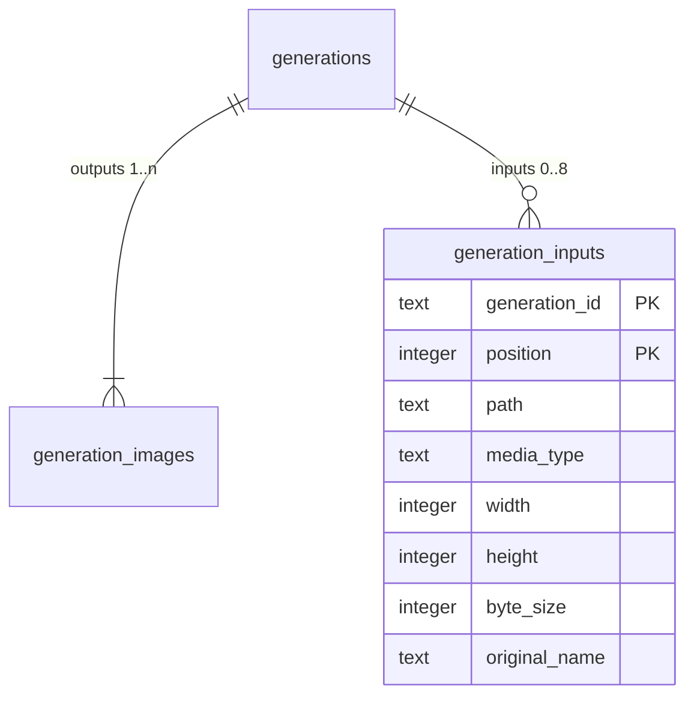

# Data model — image-inputs-openrouter

## ER diagram

`generations` and `generation_images` are unchanged — see [text-to-image-openrouter data-model](../text-to-image-openrouter/data-model.md).

## Entities

Aggregate: **Generation** (root `generations`; children `generation_images` = outputs, `generation_inputs` = input copies). All three are written in one transaction whose last step moves the staging dir into place (ADR-0006, ADR-0011).

### `generation_inputs`

| Column | Type | Constraints | Notes |
|---|---|---|---|
| `generation_id` | TEXT | NOT NULL, FK → `generations(id)` ON DELETE CASCADE, part of PK | |
| `position` | INTEGER | NOT NULL, ≥ 1, part of PK | attach order (AC-01) |
| `path` | TEXT | NOT NULL, UNIQUE | `generations/<id>/input-<position>.<ext>` |
| `media_type` | TEXT | NOT NULL, IN png/jpeg/webp/gif | supported formats (AC-03) |
| `width` / `height` | INTEGER | NOT NULL, > 0 | sniffed dimensions |
| `byte_size` | INTEGER | NOT NULL, 1 … 10 485 760 | 10 MiB limit (AC-03) |
| `original_name` | TEXT | NULL | the attached file's name, shown on the detail view |

**Aggregate root:** `generations`.
**Access patterns:** inputs of one generation in attach order → PK prefix; inputs count per gallery row (`SELECT count(*) … WHERE generation_id = ?`) → PK prefix; file route «is this exact path a recorded input?» → `generation_inputs_path`.
**Constraints:** CHECKs above; at most 8 rows per generation is enforced by the service (SQLite can't express a per-parent row cap).

## Indexes

| Index | Columns | Query it serves |
|---|---|---|
| PK `generation_inputs` | `generation_id, position` | detail inputs in order; gallery inputs count; covers the FK column |
| `generation_inputs_path` (UNIQUE) | `path` | file route lookup for input copies (AC-07) |

## Test fixtures

- `tests/helpers/generations.ts` `seedGeneration(db, dataDir, { inputs: N })` — additionally writes N tiny PNG input copies and their rows (prompt «A test prompt», no PII).
