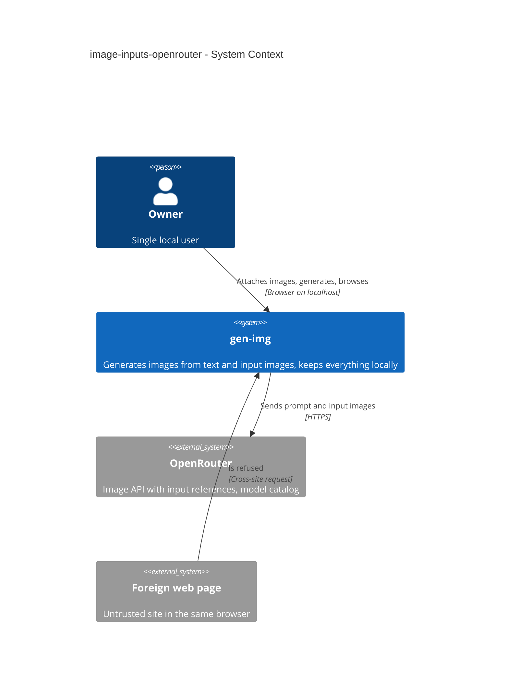
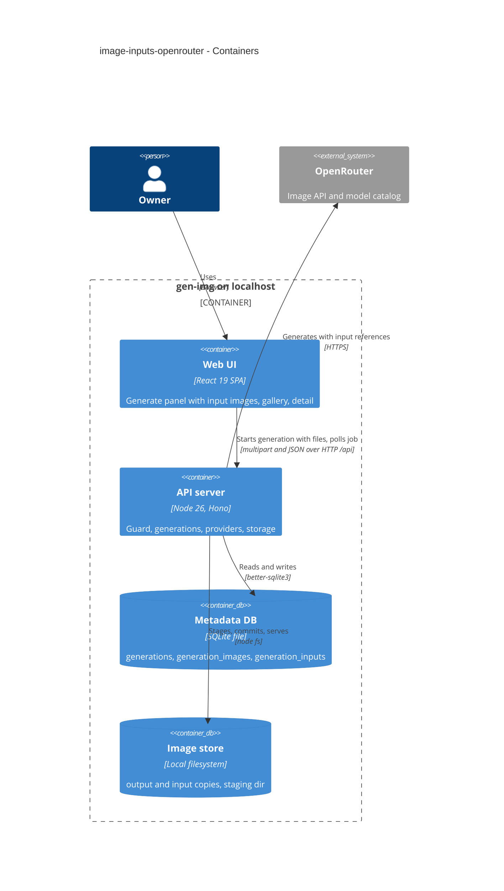
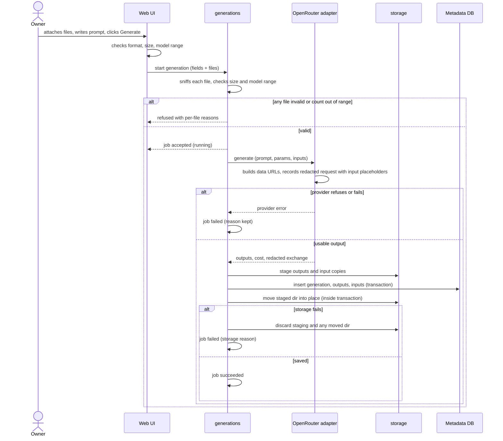
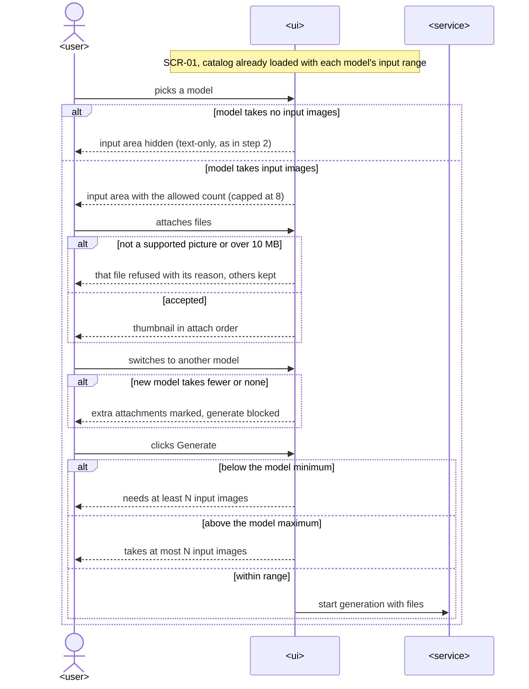
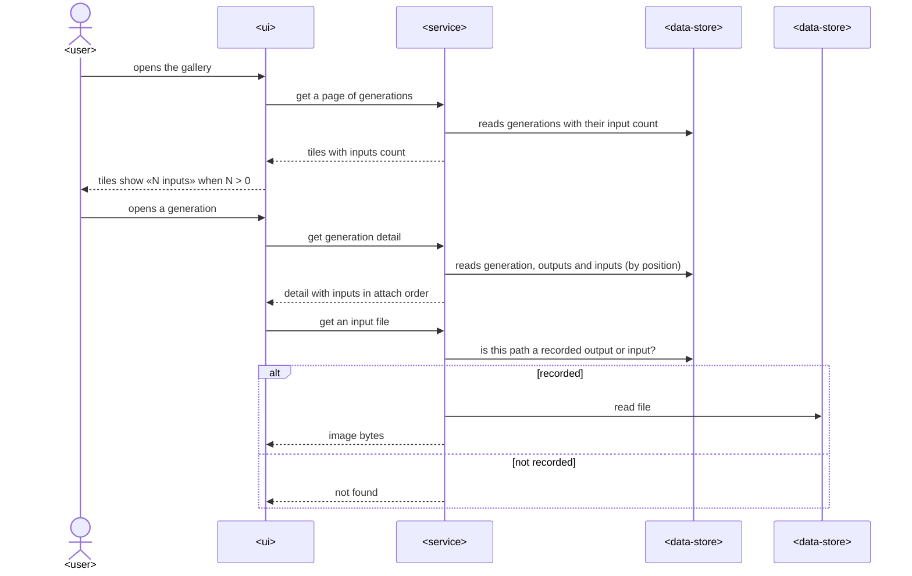
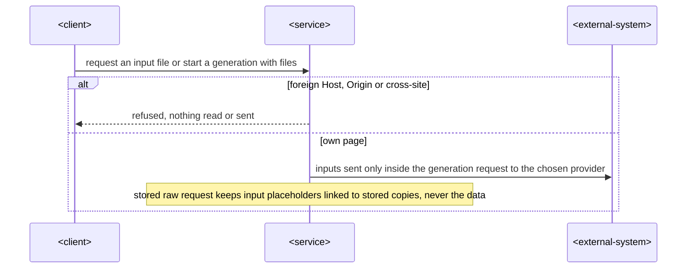

# Software Architecture Document — image-inputs-openrouter

## 1. Introduction and goals

**Intent.** Let the Owner attach input images to a generation (img→img, img+text→img) through OpenRouter, validated against the chosen model's input range, with copies kept alongside the generation and shown on its detail page (spec §2). It extends the step-2 slice ([text-to-image-openrouter SAD](../text-to-image-openrouter/sad.md)) without changing its architecture.

**Top-3 quality goals (1-liners; full scenarios in §10):**
1. **Integrity** — input copies are part of the all-or-nothing save (CONTEXT invariant, spec AC-06).
2. **Containment** — input data never lands in stored metadata or anywhere but the chosen provider (spec AC-07, §6).
3. **Fail early** — a request the model can't accept is refused locally before anything is sent (spec AC-03…AC-05, AC-08).

**Stakeholders.**

| Role | Interest | Sign-off owner? |
|---|---|---|
| Owner | attaches inputs, inspects them later | Yes (solo project: also Tech Lead) |
| Tech Lead | SAD approval | Yes |

## 2. Constraints

**Technical.**
- Everything from the step-2 SAD §2 (TypeScript 5 / Node 26, Hono 4, React 19 + Vite 8, SQLite via better-sqlite3 13, files under `GEN_IMG_DATA_DIR`) — [ADR-0001](../../adr/0001-use-typescript-node-hono-react-stack.md)…[ADR-0003](../../adr/0003-store-metadata-in-sqlite-and-images-on-disk.md).
- Step-2 decisions stay in force: normalized provider result ([ADR-0004](../text-to-image-openrouter/adr/0004-return-a-normalized-generation-result-from-the-image-provider-port.md)), single-slot job ([ADR-0005](../text-to-image-openrouter/adr/0005-run-generations-as-a-single-slot-server-job-polled-by-the-ui.md)), staging + atomic commit ([ADR-0006](../text-to-image-openrouter/adr/0006-commit-generations-atomically-via-staging-dir-and-boot-sweep.md)), request guard ([ADR-0007](../text-to-image-openrouter/adr/0007-guard-every-api-request-by-host-origin-and-fetch-metadata.md)), redacted raw exchange ([ADR-0008](../text-to-image-openrouter/adr/0008-redact-secrets-and-image-payloads-from-the-stored-raw-exchange.md)).
- OpenRouter Image API takes inputs as `input_references: [{type: "image_url", image_url: {url}}]` (URL or base64 data URL); the catalog lists `supported_parameters.input_references` as a `{min, max}` range per model (public catalog, 2026-10-18).

**Organisational.**
- Solo maintainer; local gate only. No authenticated provider calls during this pipeline run.

**Conventions.**
- [`CLAUDE.md`](../../../CLAUDE.md) + [`architecture-map.md`](../../architecture-map.md) conventions; never branch on provider inside `generations`.

**Regulatory / external.**
- N/A — personal local tool. Photos may carry location metadata; stored and sent byte-for-byte (spec §8).

## 3. Context and scope

Unchanged system boundary from step 2: the Owner's browser talks to the local server, which talks to OpenRouter. The new data flow is Owner files → server (validated, staged) → OpenRouter as part of the generation request.

<!-- brownfield: step-2 code read directly (providers/openrouter.ts, generations/service.ts, storage/file-store.ts, routes.ts, GeneratePanel.tsx); architecture-map is greenfield-era and does not list them yet -->

**External systems (in / out):**

| Actor or system | Type | Interaction |
|---|---|---|
| Owner | Person | attaches input images, generates, inspects |
| OpenRouter | System (external) | receives inputs as data URLs with the generation request; catalog lists each model's input range |
| Foreign web page | System (external, untrusted) | refused by the request guard |

**C4 Context (L1):**



## 4. Solution strategy

**Target surface:** `[backend-service, web-frontend]` — same as step 2 (ux-flows SCR-01..03 are changed, none added). UI architecture unchanged: the Vite SPA with the two-route router ([ADR-0009](../text-to-image-openrouter/adr/0009-use-a-two-route-history-api-router-in-the-spa.md)).

**Top strategic choices (the seeds for ADRs):**
1. **Upload inputs as multipart parts of the start-generation request** — one request carries the JSON fields and the files; nothing is stored before the job runs → [ADR-0010](./adr/0010-accept-input-images-as-multipart-parts-of-the-start-generation-request.md).
2. **Store input copies in their own table, written in the same transaction as outputs** — outputs queries and the gallery thumbnail stay untouched; the staging dir holds `input-N.<ext>` beside `output-N.<ext>` → [ADR-0011](./adr/0011-store-input-copies-in-a-separate-generation-inputs-table.md).
3. **The port carries inputs; the adapter redacts them** — `GenerateInput.inputs` (decoded, validated images); the OpenRouter adapter builds data URLs and records `{"$input": N}` placeholders in the raw request, which `generations` links to stored copies (extends ADR-0004/0008 — inline, no new ADR).
4. **The catalog exposes the input range** — `ImageModel.params.inputs = {min, max}` with `max` capped at 8; the shared `checkAgainstModel` enforces it on both sides (inline).

## 5. Building block view

Same modular monolith. Changes per module:

```
src/shared/
├── providers.ts         ImageModel.params.inputs {min, max≤8}
└── generations.ts       MAX_INPUT_IMAGES=8, MAX_INPUT_BYTES=10 MiB; checkAgainstModel(params, model, inputCount);
                         Generation.inputs[], GenerationSummary.inputsCount
src/server/modules/providers/
├── port.ts              GenerateInput.inputs: {bytes, mediaType}[]
└── openrouter.ts        catalog → params.inputs; input_references data URLs; raw request redaction {"$input": N}
src/server/modules/storage/
└── file-store.ts        stage(id, outputs, inputs) → output-N.* + input-N.* in one staging dir
src/server/modules/generations/
├── domain.ts            parseInputFile (sniff + size) → field errors per file
├── repo.ts              generation_inputs insert/read; recordedImage covers inputs; summary inputs_count
├── service.ts           passes inputs through; links {"$input": N} → {"$file": path}
└── routes.ts            POST /generations accepts multipart (fields JSON + files) or JSON (text-only, unchanged)
migrations/0004_create_generation_inputs.{up,down}.sql
src/web/
├── lib/api.ts           startGeneration(body, files) → multipart when files present
├── features/generate/   InputImages area (picker + drop, thumbnails, per-file errors, over-limit marks)
└── features/gallery/    tile «N inputs» hint; detail inputs section
```

**C4 Container (L2):**



## 6. Runtime view

**Critical flow 1: generate with input images**



### Attach inputs and switch models (US-02, UI-driven)



The form reads each model's input range from the catalog. Text-only models hide the input area. Every attached file is checked for format and size on the spot. A model switch marks the attachments beyond the new range and blocks Generate. On Generate, too few or too many inputs are refused before anything is sent. The server repeats the same checks (Critical flow 1).

### Browse and inspect inputs (US-03, UI-driven)



The gallery page carries each generation's input count. The detail view lists inputs in attach order. An input file is served only if its exact path is recorded as an input or output of a stored generation.

### Contain attachments (US-04)



Foreign pages are refused by the request guard before any module runs. Inputs leave the machine only inside the generation request to the chosen provider. The stored raw request references the copies, not the data.

### AC coverage (runtime view)

| US / AC | Shown by |
|---|---|
| US-01 | Critical flow 1 |
| US-02 | Attach inputs and switch models |
| US-03 | Browse and inspect inputs |
| US-04 | Contain attachments; Critical flow 1 (storage branch) |
| AC-01 | Critical flow 1 → saved; Browse → detail with inputs |
| AC-02 | Attach → model takes / takes no inputs |
| AC-03 | Attach → refused file; Critical flow 1 → server-side refusal |
| AC-04 | Attach → above maximum; Critical flow 1 → count out of range |
| AC-05 | Attach → below minimum; Critical flow 1 → count out of range |
| AC-06 | Critical flow 1 → storage fails |
| AC-07 | Browse → not recorded; Contain attachments |
| AC-08 | Attach → switch to a model with fewer |
| AC-09 | Critical flow 1 → provider refuses or fails |
| AC-10 | Browse → tiles with inputs count |
| AC-11 | Attach → model takes no inputs; Critical flow 1 with zero inputs = step-2 flow |

## 7. Deployment view

<!-- N/A: same single local process; adds migration 0004 (applied on start) and input-N.* files in each generation dir. -->

## 8. Crosscutting concepts

| Concept | Convention | Where defined |
|---|---|---|
| Upload limits | ≤ 8 files, ≤ 10 MiB each (10 × 1024 × 1024 bytes); the route's body limit is 8 × 10 MiB + 1 MiB for fields; over the limit → `VALIDATION_ERROR` | `shared/generations.ts`, `generations/routes.ts` |
| Validation | same rules client and server: format via the image sniffer, size, `checkAgainstModel(params, model, inputCount)` | `shared/generations.ts`, `providers/image-sniff.ts` |
| Raw exchange | input data URLs replaced by `{"$input": N}` in the adapter, linked to `{"$file": "generations/<id>/input-N.<ext>"}` on save | ADR-0008 (extended) |
| File serving | file route serves a path only if it is a recorded output **or input** path | ADR-0006 (extended) |
| Errors | per-file reasons in `VALIDATION_ERROR.details.fields` as `inputs.N` (1-based) | `generations/domain.ts` |

## 9. Architecture decisions

| # | Title | Status | Section |
|---|---|---|---|
| 0010 | Accept input images as multipart parts of the start-generation request | Accepted | §4 |
| 0011 | Store input copies in a separate generation_inputs table | Accepted | §4 |

ADR files live under `docs/features/image-inputs-openrouter/adr/` (numbering continues step 2's 0004–0009).

## 10. Quality requirements

**QG-1. Integrity**
- **When:** storing fails after some output or input files were staged.
- **Then:** «0 input copies without a generation and 0 generations missing an input copy after a failed save or a restart» (spec §6).
- **How verify:** «integration test (stage fails mid-way) + boot sweep test» (spec §6).

**QG-2. Containment**
- **When:** a generation with inputs is stored.
- **Then:** «0 bytes of embedded input image data in the stored raw request» (spec §6); input copies served only when recorded (AC-07).
- **How verify:** «integration test asserts no data-URL payload remains» (spec §6); file-route test for unrecorded input paths.

**QG-3. Fail early / overhead**
- **When:** the Owner sends 4 inputs of 10 MB with 4 outputs of 5 MB coming back.
- **Then:** «≤ 1 000 ms p95 for 4 input images of 10 MB + 4 output images of 5 MB» local overhead; detail «≤ 150 ms p95 server time» (spec §6).
- **How verify:** «integration test with a stubbed provider»; «integration test over a seeded data dir» (spec §6).

## 11. Risks and technical debt

| Risk / debt | Severity | Mitigation | Owner |
|---|---|---|---|
| Provider-side input limits (pixel size, total payload) undocumented — a large but valid file may still be refused | Low | refusal surfaces via AC-09 with the provider's reason | dmytro.hopko |
| Prompt may be optional for img→img — spec §8 OQ | Open question | keep it required; revisit on the first real call — due: first real call with a key | dmytro.hopko |
| Up to 80 MiB held in memory during a request | Low | single local user, one generation in flight (ADR-0005) | dmytro.hopko |

**Accepted debt (acceptable in v1, plan to fix later):**
- No metadata stripping of input photos (spec §8).

## 12. Glossary

| Term | Meaning |
|---|---|
| Input image | an image attached by the Owner and sent to the provider; a copy is kept with the generation (CONTEXT.md) |
| Input range | the model's catalog `input_references` min–max, capped at 8 by gen-img |
| Input copy | the stored `input-N.<ext>` file of a generation |
