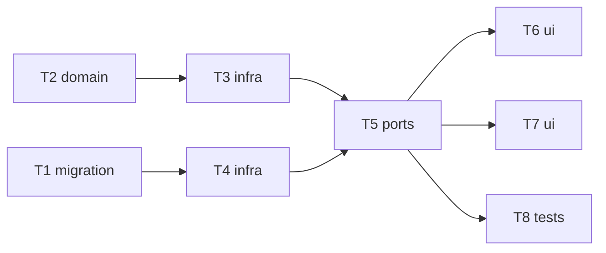

# Epic — image-inputs-openrouter

> **Spec:** [spec.md](../spec.md) · **Design:** [sad.md](../sad.md) · **Data model:** [data-model.md](../data-model.md) · **API:** [openapi.yaml](../contracts/openapi.yaml) · **Screens:** [screens.md](../screens.md) · **ADRs:** [adr/](../adr/)

## Goal

Let the Owner attach input images (img→img, img+text→img) to OpenRouter generations, validated against each model's input range, with copies stored all-or-nothing beside the generation and shown in the gallery and detail (spec §2).

## Scope

- **In:** migration `0004_create_generation_inputs`; shared validation (input range, file checks); OpenRouter adapter inputs + redaction; storage/repo inputs; multipart start route; generate panel input area; gallery hint + detail inputs.
- **Out:** use-output-as-input and re-run (step 6), local image editing, Vercel inputs (step 4), formats beyond PNG/JPEG/WebP/GIF (spec §3).

## Task map

## Tasks

See [tracker.md](./tracker.md) for status. Machine contract: [tasks.json](../tasks.json).

| # | Task | Layer | Blocked by | DoD (short) |
|---|---|---|---|---|
| T1 | [Promote the generation_inputs migration](./t1-promote-generation-inputs-migration.md) | migration | — | migration 0004_create_generation_inputs applies and reverts cleanly; CHECKs and the unique… |
| T2 | [Validate input images and model input ranges in shared code](./t2-shared-input-validation.md) | domain | — | unit tests: checkAgainstModel flags too few / too many inputs and inputs on a text-only mo… |
| T3 | [Send input images through the OpenRouter adapter](./t3-openrouter-inputs.md) | infra | T2 | adapter unit tests on fixtures: catalog maps input_references to params.inputs (max capped… |
| T4 | [Stage and record input copies with the generation](./t4-store-input-copies.md) | infra | T1 | integration tests: stage writes input-N.* beside output-N.*; insertAtomic writes inputs in… |
| T5 | [Accept multipart starts with input images and expose inputs in the API](./t5-multipart-start-and-dto.md) | ports | T3, T4 | integration tests via app.request(): multipart with 2 PNGs → saved with input copies, deta… |
| T6 | [Add the input-images area to the generate panel (SCR-01)](./t6-generate-panel-inputs.md) | ui | T5 | web tests (mocked api): area hidden for text-only models and shows the range otherwise; re… |
| T7 | [Show the inputs hint on tiles and the inputs section on the detail page](./t7-gallery-detail-inputs.md) | ui | T5 | web tests: tile shows «N inputs» only when inputsCount > 0; detail shows an Inputs card in… |
| T8 | [Verify the input-image NFRs](./t8-inputs-nfr-tests.md) | tests | T5 | NFR tests pass: local overhead ≤ 1 000 ms p95 for 4 × 10 MB inputs + 4 × 5 MB outputs (stu… |

## Risks / Hard rules

- No authenticated provider calls during development; adapter tested on fixtures only.
- All-or-nothing save now covers input copies (CONTEXT invariant, ADR-0006/0011); input data never in stored metadata (ADR-0008 extension).
- Never branch on provider inside `generations`.
