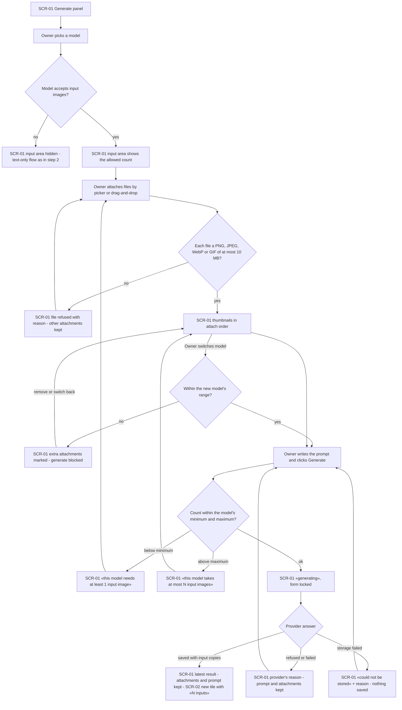
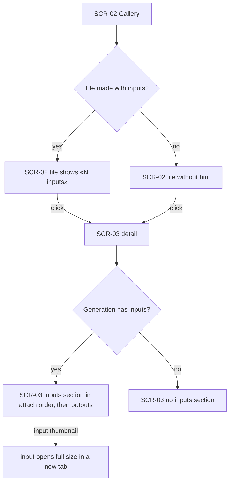

# UX flows — image-inputs-openrouter

> User flows for every UI-touching §4 user story, produced by `ux-flows` (after `clarify`, before
> `design`) and read by `design` (evidence for the target-surface + UI-architecture decisions),
> `sequences` (UI-driven flows align on SCR ids), `screens` (details every inventory row) and
> `plan-tests` (the e2e-through-UI paths). **Always markdown + mermaid `flowchart`**, whatever the
> design tool — this artifact is flow-altitude, not visual design.

## Platform decisions

- **Posture:** desktop-first — per [`design-system.md`](../../design-system.md).
- **Navigation shape:** unchanged from step 2 — the generate panel and gallery on the home page, the generation detail on its own page. No new screens: this slice adds an input-images area to the generate panel, an inputs section to the detail page and an inputs hint to gallery tiles.
- **Attaching:** a file picker plus drag-and-drop onto the input-images area, multi-select; attachments show as removable thumbnails in attach order.
- **Reuse:** the SCR ids below are the step-2 screens ([text-to-image-openrouter ux-flows](../text-to-image-openrouter/ux-flows.md)); this feature changes their states, not the set of screens.

## Screen inventory

| ID | Screen | Purpose | Entry | Exit |
|---|---|---|---|---|
| SCR-01 | Generate panel (+ input-images area) | Attach input images within the model's limits, prompt, generate | app home (left area) | SCR-02 gets the new item; SCR-03 via the latest result |
| SCR-02 | Gallery (+ «N inputs» hint on tiles) | Browse generations; see which used inputs | app home (right area) | SCR-03 on a tile click |
| SCR-03 | Generation detail (+ inputs section) | Show inputs in attach order next to the outputs | gallery tile / latest result / direct address | back to SCR-02 |

## Flows

### Flow: US-01 / US-02 — Generate from input images and a prompt

The Owner picks a model. For a text-only model the input area is hidden and step 2's flow applies unchanged. For a model that accepts images, the area states how many it takes, capped at 8. Files arrive via the picker or drag-and-drop. Each one is checked on the spot: a non-supported format (HEIC, PDF, broken file) or a file over 10 MB is refused with the reason, and the rest stay. Accepted files show as thumbnails in attach order. If the Owner switches to a model with a smaller range, the extra attachments are marked (the last-attached first) and Generate is blocked until they are removed or the model is switched back. On Generate, too few inputs for an edit-only model or too many for the model block the request with a plain message. A valid request locks the form. Success shows the result, keeps the attachments and prompt for iteration, and adds a gallery tile with an «N inputs» hint. A provider refusal or failure shows the reason and keeps everything in the form. A storage failure says nothing was saved and why.

### Flow: US-03 — See the inputs of a generation later

The gallery marks generations made with inputs with an «N inputs» hint and shows no hint otherwise. The detail page shows an inputs section, in attach order, before the outputs when inputs exist, and no inputs section otherwise. An input thumbnail opens the stored copy at full size.

US-04 (keep attachments contained) has no flow of its own: its outcomes (only the chosen provider receives inputs; only recorded copies are served; no stray files) are server-side and have no screens. They are covered by the request guard and the storage tests, not by UI paths.

## AC coverage

| AC | Shown by | Notes |
|---|---|---|
| AC-01 | Flow US-01 → G → OK; Flow US-03 → IS | |
| AC-02 | Flow US-01 → S → I / T | |
| AC-03 | Flow US-01 → V → VR | |
| AC-04 | Flow US-01 → Q → QX | |
| AC-05 | Flow US-01 → Q → QM | |
| AC-06 | Flow US-01 → R → SE | |
| AC-07 | N/A | server-side: only recorded input copies are served, foreign pages refused; no UI |
| AC-08 | Flow US-01 → C → CM | |
| AC-09 | Flow US-01 → R → ER | |
| AC-10 | Flow US-03 → H → HN / HX | |
| AC-11 | Flow US-01 → S → T | |
