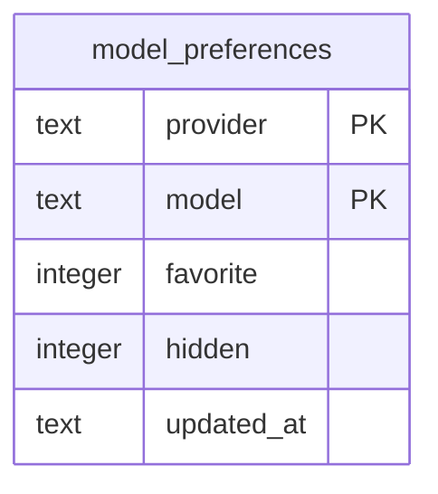

# Data model — model-picker-preferences

## ER diagram

## Entities

Aggregate: **Model preference** (root `model_preferences`, new, standalone). It references no other table: image models live in the providers' catalogs, not in the DB (ADR-0026).

### `model_preferences`

| Column | Type | Constraints | Notes |
|---|---|---|---|
| `provider` | TEXT | NOT NULL, one of `openrouter` / `vercel`, PK part | the same provider ids as `generations.provider` |
| `model` | TEXT | NOT NULL, 1–200 chars, PK part | the provider's model id, case-sensitive (AC-07); length limit as the price lookup's |
| `favorite` | INTEGER | NOT NULL, 0/1, default 0 | ★ in the picker (AC-03) |
| `hidden` | INTEGER | NOT NULL, 0/1, default 0 | left out of the picker (AC-09); set by step 10 |
| `updated_at` | TEXT | NOT NULL | ISO-8601 UTC of the last change |

**Row invariant:** at least one flag is on — a change that turns both off deletes the row (ADR-0026), so «toggling twice ends where it started» holds in storage too.
**Access patterns:** every row of one provider (picker, Models page) → PK prefix; upsert / delete of one (provider, model) → PK.
**Write rule (app):** a row is written only for a model the provider's catalog lists (AC-06) — checked in `models/routes.ts`, not in SQL.

## Indexes

| Index | Columns | Query it serves |
|---|---|---|
| PK `model_preferences` | `provider, model` | a provider's preferences; upsert/delete of one model |

No secondary indexes.

## Test fixtures

- `seedModelPreference(db, { provider, model, favorite?, hidden? })` in `tests/helpers/models.ts` — inserts a row directly (test model ids only, no PII).
