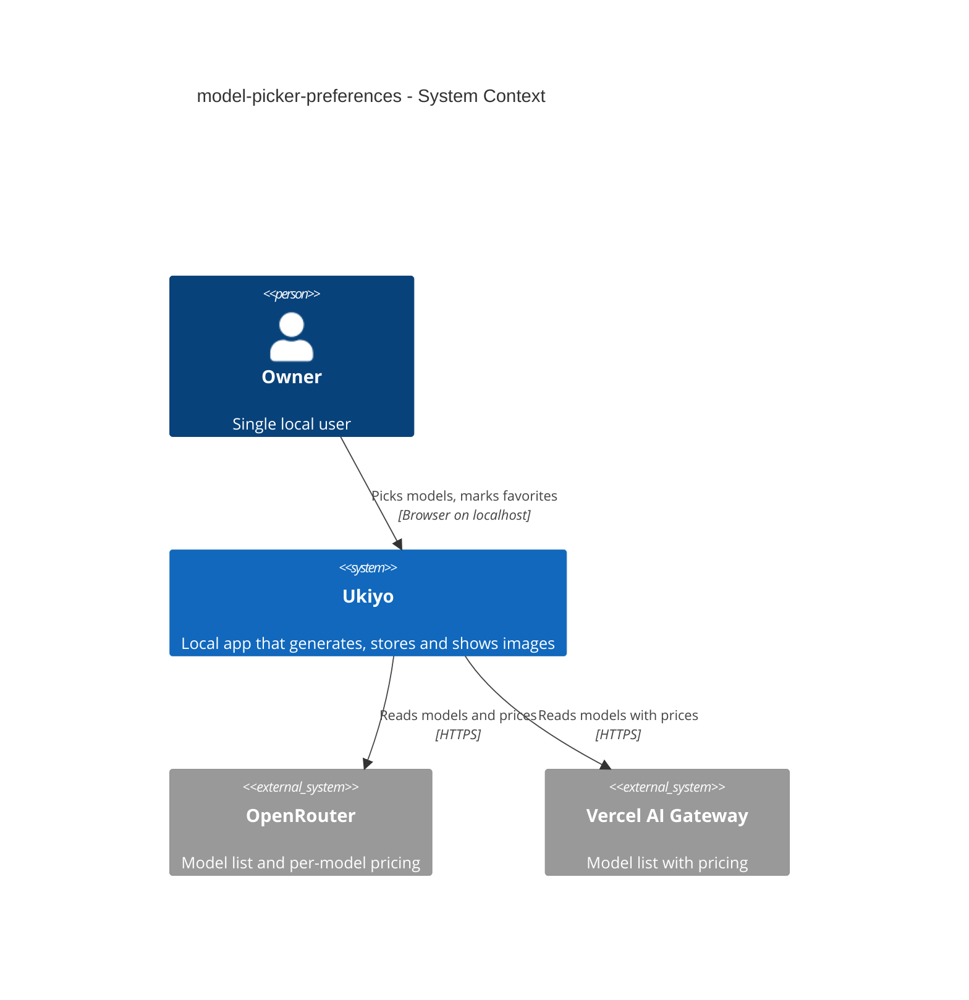
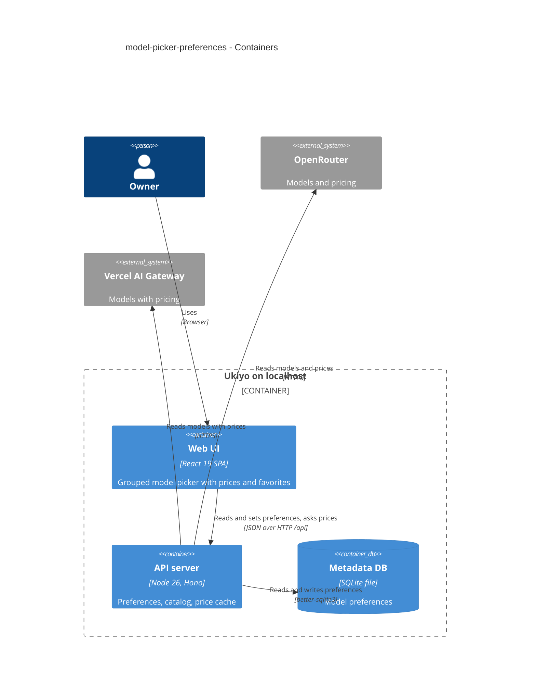
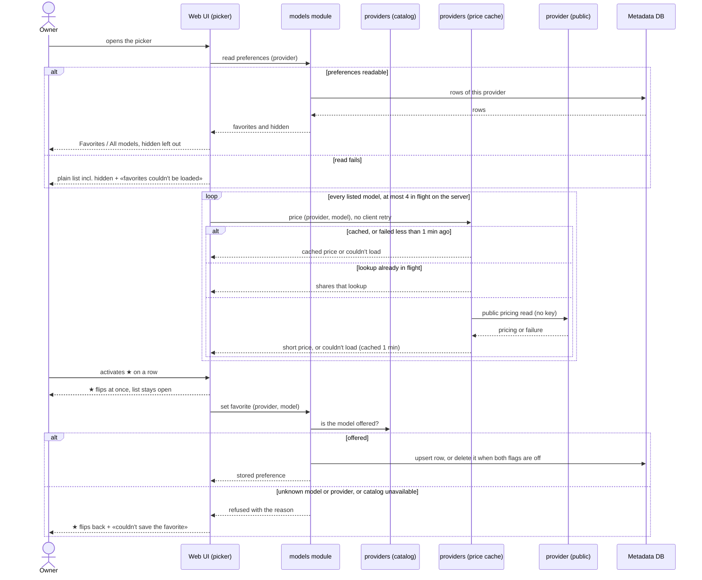

# Software Architecture Document — model-picker-preferences

## 1. Introduction and goals

**Intent.** Turn the model picker into the Owner's curated list: each entry shows its published price and a ★ favorite toggle, favorites come first, hidden models stay out — backed by a per-provider, per-model preference store that the Models page (step 10) reuses (spec §1 ¶3, §2).

**Top-3 quality goals (1-liners; full scenarios in §10):**
1. **Honest prices in the list** — every entry in step 7's wording, never $0, usable before prices arrive (AC-01, AC-02).
2. **Frugality toward providers** — ≤ 1 request per model per 10 minutes, ≤ 4 in flight (spec §6).
3. **Durable, non-intrusive preferences** — a ★ never selects a model; preferences survive restarts; nothing about them blocks generating (AC-03, AC-05, AC-13).

**Stakeholders.**

| Role | Interest | Sign-off owner? |
|---|---|---|
| Owner (also Tech Lead for SAD approval) | finds favorite models first, compares prices in the list | Yes |

## 2. Constraints

**Technical.** Same stack as steps 2–8 (TypeScript 5 / Node 26 / Hono 4 / React 19 / TanStack Query 5 / SQLite via better-sqlite3, hand-written SQL). Provider port + adapters (ADR-0002, ADR-0004); prices through the optional `priceOf` and the 10-minute price cache (ADR-0020, amended by ADR-0027); request guard on every `/api` route (ADR-0007); the Generate page stays mounted across sections (ADR-0023); draft carry-over rules of step 6 (ADR-0019).
**Organisational.** Solo maintainer; local gate only (`pnpm typecheck && pnpm lint && pnpm test`).
**Conventions.** CLAUDE.md: new table = migration pair; repo rows parsed through zod; shared schemas in `src/shared/`; shadcn/ui primitives only; never branch on provider outside the adapters.
**Regulatory / external.** N/A — the Owner's own choices about public model ids.

## 3. Context and scope

The generate panel reads the Owner's preferences for the current provider from the local server and joins them with the provider's model list to build the grouped picker; opening the picker asks the server for each listed model's price, which the server answers from its cache or the provider's public pricing (no key). Toggling ★ writes one preference; the server checks the model against the provider's cached catalog and stores it in the metadata DB.

<!-- brownfield: steps 2–8 shipped; providers module owns catalogs + prices, generate panel owns the picker; architecture-map.md is the reference (greenfield-bootstrap map, kept current by each feature). -->

**External systems (in / out):**

| Actor or system | Type | Interaction |
|---|---|---|
| Owner | Person | opens the picker, toggles ★, chooses a model |
| OpenRouter | System (external) | model list (with key) and per-model public pricing (no key) — unchanged sources |
| Vercel AI Gateway | System (external) | public model list with inline pricing — unchanged source |

**C4 Context (L1):**



## 4. Solution strategy

**Target surface:** `[backend-service, web-frontend]` — a picker change in the SPA backed by a small new read/write API and a table. No new UI-architecture decision (SPA + section router per ADR-0009 / ADR-0022).

1. **Preferences: one row per (provider, model) with `favorite` + `hidden`, in a new `models` module** — writes checked against the cached catalog, a row with both flags off is deleted, reads return every row of a provider → [ADR-0026](./adr/0026-keep-model-preferences-as-one-row-per-provider-and-model-in-a-models-module.md).
2. **Prices for every listed entry, looked up when the picker opens** — one query per entry through the existing price endpoint (shared with the price line), no client retries; the server dedupes in-flight lookups, caps them at 4 in flight across providers, caches failures 1 minute → [ADR-0027](./adr/0027-look-up-every-listed-models-price-when-the-picker-opens-deduplicated-and-capped-on-the-server.md).
3. **The picker becomes a popover list with two buttons per row** — «choose» and a ★ toggle; Up/Down between rows, Tab to the ★ → [ADR-0028](./adr/0028-render-the-model-picker-as-a-popover-list-with-a-separate-favorite-toggle-per-row.md).
4. **One pure function decides what the Owner sees and what Ukiyo may pick** (inline, below the ADR gate — one module, reversible): `arrangeModels(models, prefs, selectedId)` → `{ favorites, others, hiddenSelected? }`; `pickModel(arranged, suitable)` → first suitable favorite, else first suitable visible model, else none. Every automatic choice in the panel (first load, provider switch, re-run model not offered, reuse needs inputs) goes through `pickModel`, so the closed picker and the open list never disagree (AC-09…AC-11).
5. **Preferences in the browser: one query per provider, refetched when the picker opens** (inline): key `["model-preferences", provider]`, `staleTime: 0` + refetch on open and on window focus, so a change made on the Models page or another tab shows on the next opening without a reload (AC-14); the ★ is optimistic and rolls back on failure (AC-05); a failed read degrades to the plain list with a notice (AC-13).

## 5. Building block view

```
migrations/0008_create_model_preferences.{up,down}.sql   model_preferences (provider, model, favorite, hidden, updated_at)
src/shared/models.ts                       ModelPreference / PreferencesResponse / SetPreferenceRequest schemas
src/shared/model-groups.ts                 arrangeModels() + pickModel() (pure, unit-tested)
src/server/modules/models/
├── repo.ts                                list(provider), set(provider, model, flags) — upsert or delete
└── routes.ts                              registerModelsRoutes: read a provider's preferences, set one
src/server/modules/providers/
├── catalog.ts                             + in-flight list load shared by concurrent misses
└── prices.ts                              + in-flight dedupe, ≤ 4 concurrent in total, failures cached 1 min
src/web/components/ui/popover.tsx          shadcn Popover (vendored)
src/web/features/generate/
├── ModelPicker.tsx                        SCR-07: trigger + popover rows (choose · price · ★), groups
├── ModelPicker.test.tsx
└── GeneratePanel.tsx                      uses ModelPicker + pickModel for every automatic choice
```

**C4 Container (L2):**



## 6. Runtime view

**Critical flow: open the picker, see prices, toggle a favorite**



The flow covers AC-01…AC-07, AC-12 (the request guard in front of every call) and AC-13; the grouping, hidden and automatic-choice rules (AC-04, AC-08…AC-11) are the pure `arrangeModels` / `pickModel` step inside the Web UI; AC-14 is the refetch on opening.

## 7. Deployment view

<!-- N/A: same single local process; one new migration applied on boot; no new configuration. -->

## 8. Crosscutting concepts

| Concept | Convention | Where defined |
|---|---|---|
| Preference identity | (provider, model id) — the provider's own id, case-sensitive; one row per pair | ADR-0026, migration 0008 |
| Write check | a model is accepted only when the provider's cached catalog lists it; catalog unavailable → refused, nothing stored | `models/routes.ts` |
| Row lifecycle | a write changes only the flags named in it and keeps the other stored flag (a ★ never undoes a hide made elsewhere); upsert the result; both flags off → row deleted; rows of models missing from the catalog are kept and simply not shown | `models/repo.ts` |
| Price lookups | per-entry query `["price", provider, model]` shared with the price line; `retry: false` for picker entries; server: in-flight dedupe, ≤ 4 concurrent in total (one semaphore for all providers), failures cached 60 s, successes 10 min | `PricePreview.tsx` / `ModelPicker.tsx`, `providers/prices.ts` |
| Short price wording | `describeUnitPrice` from step 7 (`$X / image`, `$X–$Y / image`, «priced per token», «price unknown»), «couldn't load» suffix on failure, «…» while loading in a fixed-width slot | `src/shared/pricing.ts` |
| Errors | unknown provider or model → `NOT_FOUND`; catalog unavailable → `PROVIDER_ERROR` (502); bad body → `VALIDATION_ERROR` (400) | `models/routes.ts` |
| Picker keyboard | Enter/Space or ↓ on the trigger opens; ↑/↓ move between rows' «choose» buttons; Tab reaches the row's ★ (`aria-pressed`); Escape closes and returns focus to the trigger | `ModelPicker.tsx` |

## 9. Architecture decisions

| # | Title | Status | Section |
|---|---|---|---|
| 0026 | Keep model preferences as one row per provider and model in a models module | Accepted | §4 |
| 0027 | Look up every listed model's price when the picker opens, deduplicated and capped on the server | Accepted | §4 |
| 0028 | Render the model picker as a popover list with a separate favorite toggle per row | Accepted | §4 |

## 10. Quality requirements

**QG-1. Honest prices in the list**
- **When:** the picker opens on a provider with per-image, ranged, per-token, unpriced and failing models.
- **Then:** each entry shows step 7's wording; «price unknown» (with «couldn't load» on failure), never $0 (AC-01, AC-02).
- **How verify:** component tests of every entry state against a stubbed price API.

**QG-2. Frugality**
- **When:** the Owner opens the picker on a cold cache, reopens it, and a lookup keeps failing.
- **Then:** «≤ 1 per model per 10 minutes, and never more than 4 in flight at once»; «≤ 1 retry per failing model per minute»; «0 requests with an authorization header» (spec §6).
- **How verify:** «unit test over the price cache with an injected clock … + a concurrency-cap test»; «adapter tests assert headers».

**QG-3. Durable, non-intrusive preferences**
- **When:** the Owner toggles ★ with pointer and keyboard, restarts Ukiyo, and the store is unreachable.
- **Then:** the selected model never changes on ★; «100% of stored preferences survive a restart»; saving «≤ 50 ms p95»; picker «≤ 100 ms p95 … with 100 models and 100 stored preferences» (spec §6).
- **How verify:** component tests (★ doesn't select, rollback, degraded list); «integration test reopening the data dir»; timings in the serial `nfr` project.

## 11. Risks and technical debt

| Risk / debt | Severity | Mitigation | Owner |
|---|---|---|---|
| The OpenRouter image catalog grows large enough that a cold opening takes long to fill all prices | Low | entries are usable before prices; 4-at-a-time cap; 10-minute cache | dmytro.hopko |
| A provider renames a model id, so a favorite silently disappears (AC-08) | Low | accepted: the row is kept; step 10's Models page can surface stale rows | dmytro.hopko |
| Replacing the select changes keyboard behaviour the Owner is used to | Low | keyboard contract in §8, covered by component tests | dmytro.hopko |

**Accepted debt:** rows for models a provider retired for good are kept with no UI to see them until step 10.

## 12. Glossary

| Term | Meaning |
|---|---|
| Favorite model · Hidden model · Model preference | see CONTEXT.md |
| Short price | step 7's per-image / range / per-token / unknown wording, shown on a picker entry |
