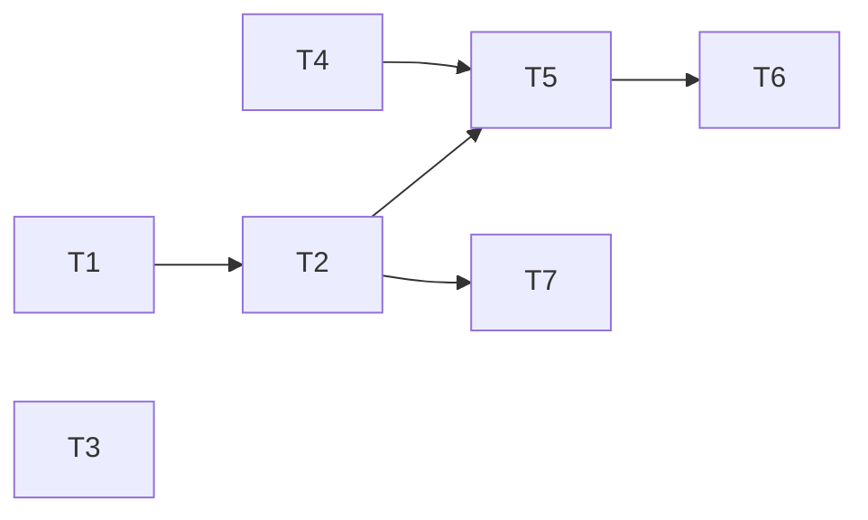

# Epic — model-picker-preferences

> **Spec:** [spec.md](../spec.md) · **Design:** [sad.md](../sad.md) · **Data model:** [data-model.md](../data-model.md) · **API:** [openapi.yaml](../contracts/openapi.yaml) · **Screens:** [screens.md](../screens.md) · **ADRs:** [adr/](../adr/)

## Goal

The Owner sees every model's price in the picker, marks favorites with ★ without selecting, finds favorites first, and keeps per-provider preferences (favorite, hidden) on the machine — the store the Models page (step 10) builds on (spec §2).

## Scope

- **In:** migration 0008 `model_preferences`; new `src/server/modules/models/`; price cache + catalog limits in `src/server/modules/providers/`; shared schemas + grouping rules in `src/shared/`; `ModelPicker` + Popover + generate panel wiring in `src/web/`.
- **Out:** a UI to hide models (step 10); sorting/filtering/search in the picker; manual favorite order; cross-provider preferences; changes to price sources or wording (spec §3).

## Task map

## Tasks

See [tracker.md](./tracker.md) for status. Machine contract: [tasks.json](../tasks.json).

| # | Task | Layer | Blocked by | DoD (short) |
|---|---|---|---|---|
| T1 | Promote the model_preferences migration | migration | — | 0008 applies/reverts; CHECK + PK tested |
| T2 | Read and set model preferences through a models module | ports | T1 | list/set routes with catalog check, int-tested |
| T3 | Share in-flight price lookups, cap them at 4 and cache failures for a minute | infra | — | dedupe + cap 4 + 60 s failure cache, unit-tested |
| T4 | Arrange models into favorites and others and pick models for automatic choices | domain | — | pure grouping + picking rules, unit-tested |
| T5 | Build the ModelPicker popover with prices and favorite toggles | ui | T2, T4 | SCR-07 popover with every state, component-tested |
| T6 | Use ModelPicker and pickModel in the generate panel | ui | T5 | panel uses ModelPicker + pickModel; tests migrated |
| T7 | Prove the preference timings in the nfr project | tests | T2 | nfr p95 timings pass |

## Risks / Hard rules

- Prices: ≤ 1 provider request per model per 10 minutes, ≤ 4 in flight in total, ≤ 1 retry per failing model per minute, 0 requests with an authorization header (spec §6, ADR-0027).
- A ★ never selects a model and never runs the model-switch carry-over (ADR-0028).
- Every automatic model choice goes through `pickModel` — never a hidden model (SAD §4 item 4).
- A write changes only the flags it names (SAD §8).
- Never $0 / «free» for an unknown price (step 7 invariant).
