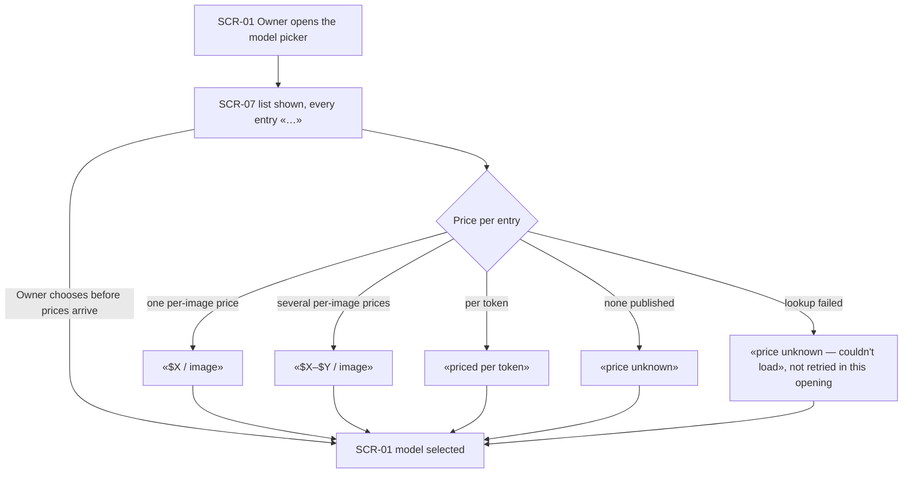
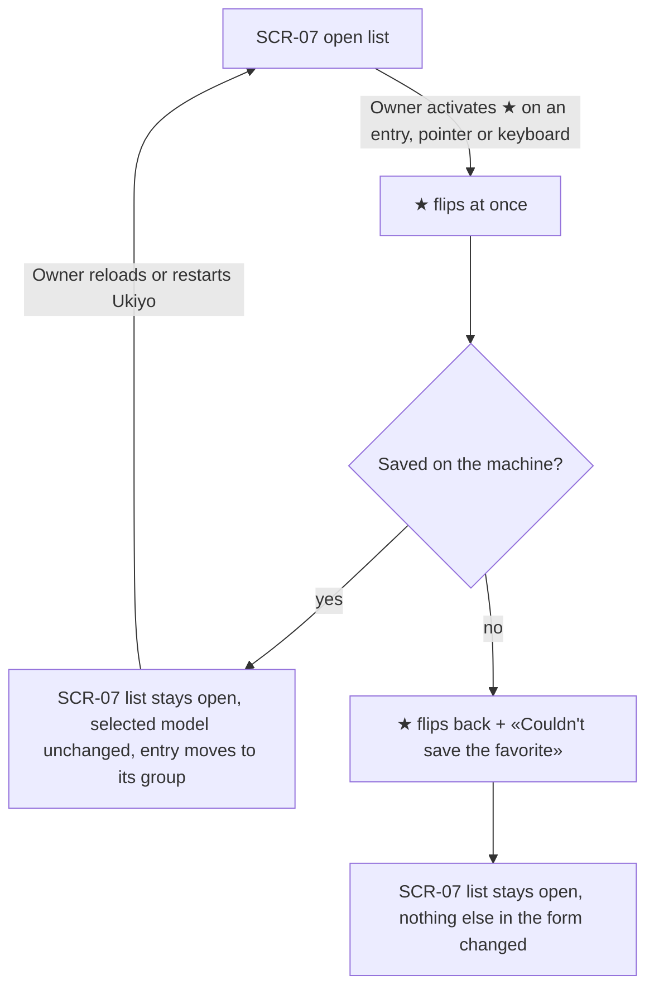
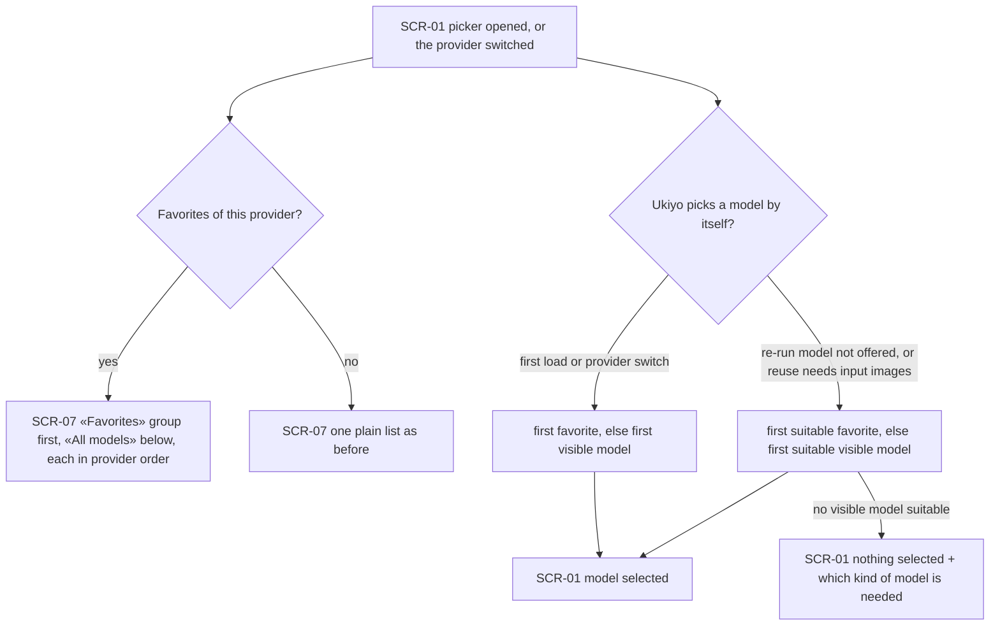
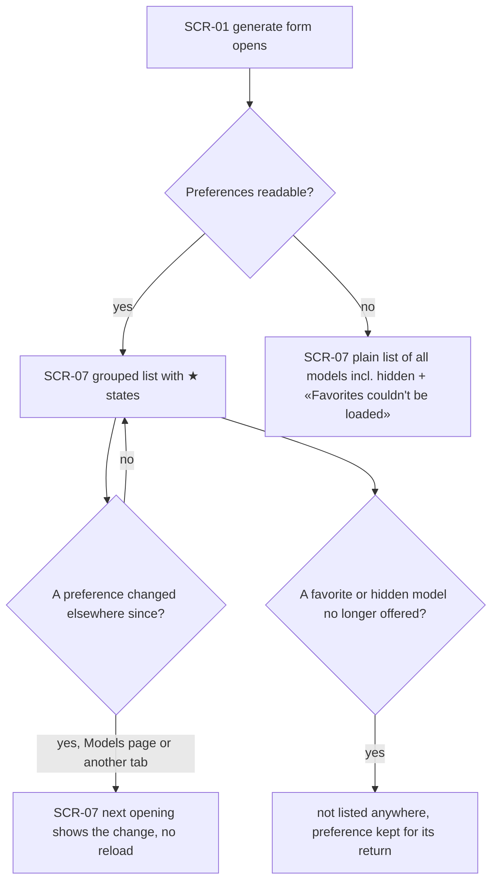
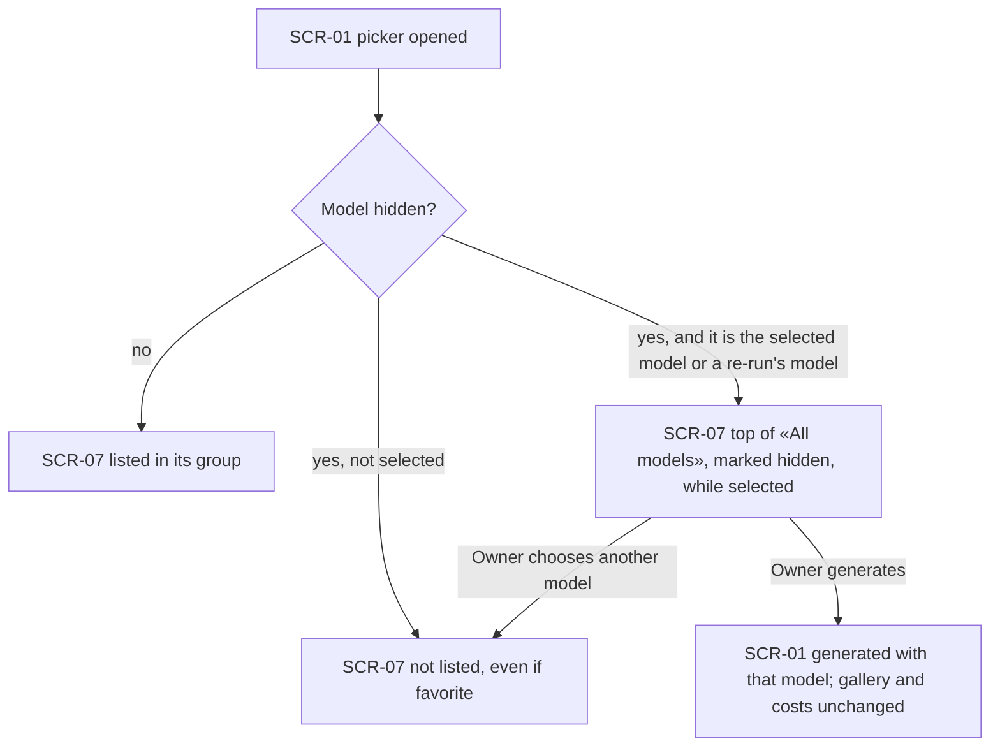

# UX flows — model-picker-preferences

> User flows for every UI-touching §4 user story, produced by `ux-flows` (after `clarify`, before
> `design`). **Always markdown + mermaid `flowchart`.** Screen ids continue the app-wide inventory
> (SCR-01 Generate panel … SCR-06 Recent generations); this feature adds SCR-07.

## Platform decisions

- **Posture:** desktop-first — per [`design-system.md`](../../design-system.md).
- **Where it happens:** inside the generate panel (SCR-01) only — the open model list (SCR-07) is part of the panel, not a page or a dialog. No new section; the Models page (step 10) is a separate feature that writes the same preferences.
- **★ is not a selection:** activating the ★ of an entry (pointer or keyboard) toggles the favorite and leaves the list open and the selected model as it was (design input: the toggle can't be an ordinary option of the list — it must be reachable by keyboard without choosing the entry).
- **Prices load when the list opens**, not when the panel mounts; the list is usable before any price arrives.
- **Never blocking:** a missing price, a failed favorite save or unreadable preferences never disable choosing a model or generating.

## Screen inventory

| ID | Screen | Purpose | Entry | Exit |
|---|---|---|---|---|
| SCR-01 | Generate panel | For this feature: the closed model picker and the price line under it; automatic model choices honour favorites and hidden models | Generate section, a re-run / reuse draft, a provider switch | generating, another section |
| SCR-07 | Model picker — open list (new) | Every model of the current provider with its short price and a ★ toggle, grouped «Favorites» / «All models» | opening the picker on SCR-01 | choosing a model or closing the list → SCR-01 |

## Flows

### Flow: US-01 — See every model's price in the picker

The Owner opens the picker on the generate panel; the list appears at once with «…» in place of each price, and the entries don't move as prices arrive. Each entry then shows one of five outcomes in step 7's wording — a single price per image, a range with both ends, «priced per token», «price unknown», or «price unknown — couldn't load» when the lookup failed (tried once per model per opening). The Owner can choose any model at any moment, including before its price arrived and when its price is unknown; choosing returns to the panel with that model selected.

### Flow: US-02 — Mark a model as a favorite

On the open list the Owner activates the ★ of any entry, with the pointer or the keyboard. The star flips at once; if Ukiyo stores the change, the list stays open, the selected model stays the same, and the entry moves to «Favorites» (or back to «All models»). If storing fails, the star flips back and the list says plainly that the favorite couldn't be saved; nothing else in the form changes. A stored favorite is still there after reloading the page or restarting Ukiyo.

### Flow: US-03 — Find favorites first

When the picker opens — or the Owner switches provider — the list shows that provider's favorites first in a «Favorites» group and every other model in «All models», both in the provider's order; with no favorites it's one plain list. Whenever Ukiyo chooses a model on its own (first load, provider switch, a re-run whose model isn't offered, a reuse that needs a model taking input images), it picks from what the Owner sees: the first suitable favorite, else the first suitable visible model, never a hidden one; if no visible model is suitable it selects nothing and says which kind of model is needed. The prompt, parameters and attachments are kept as step 6 defines.

### Flow: US-04 — Keep my preferences

When the generate form opens, the picker shows the stored favorites and hides hidden models. If preferences can't be read, it falls back to one plain list of all the provider's models (hidden ones included), says favorites couldn't be loaded, and generating stays possible. A preference changed elsewhere — on the Models page or in another tab — shows the next time the Owner opens the picker, without reloading. A favorite or hidden model the provider stopped offering is not listed anywhere, and its preference is kept so it returns if the provider offers it again.

### Flow: US-05 — Keep hidden models out of the picker

Hidden models are left out of the list, even when they are also favorites. The one exception is a hidden model that is the selected one — because a re-run brought it in or it was selected when it got hidden: it stays selected and appears at the top of «All models», marked as hidden, for as long as it stays selected, so the draft can be generated as is. Once the Owner chooses another model, it disappears from the list. Hiding never changes past generations, the gallery or recorded costs.

## AC coverage

| AC | Shown by | Notes |
|---|---|---|
| AC-01 | Flow US-01 → B, P branches | prices looked up on opening; «…» while loading; choose before prices |
| AC-02 | Flow US-01 → PU, PF | never $0; one attempt per model per opening |
| AC-03 | Flow US-02 → B → K | keyboard or pointer; list stays open; survives reload/restart |
| AC-04 | Flow US-03 → G, L | groups in provider order; plain list without favorites |
| AC-05 | Flow US-02 → R → K2 | ★ reverts + plain message |
| AC-06 | N/A | no UI path: the picker only offers the provider's own models; covered at the API level |
| AC-07 | Flow US-03 → A (provider switch) | favorites are per provider; toggling twice ends where it started (Flow US-02) |
| AC-08 | Flow US-04 → X → H | retired models not listed; preference kept |
| AC-09 | Flow US-05 → X | hidden even if favorite |
| AC-10 | Flow US-05 → S, G | hidden-but-selected shown marked; past generations unchanged |
| AC-11 | Flow US-03 → Q, P1, P2, N | automatic choices never pick a hidden model |
| AC-12 | N/A | no UI path: a foreign page is refused by the request guard |
| AC-13 | Flow US-04 → L | plain list incl. hidden, generating not blocked |
| AC-14 | Flow US-04 → O → U | change elsewhere shows on next opening |
