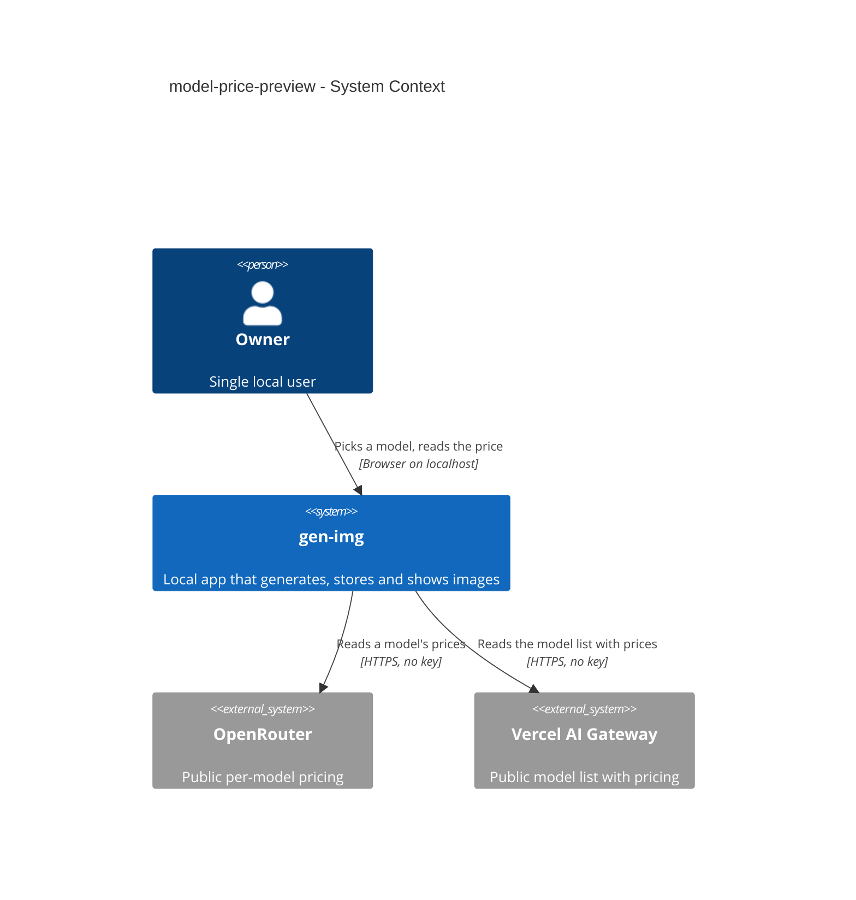
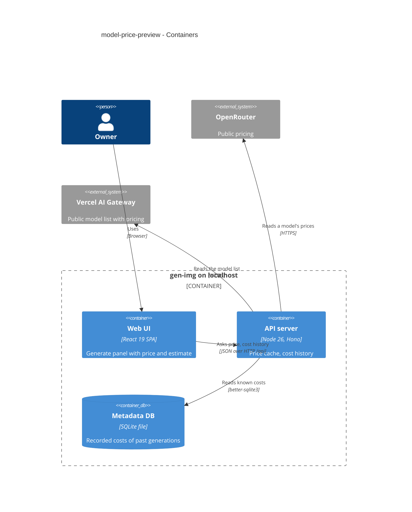

# Software Architecture Document — model-price-preview

## 1. Introduction and goals

**Intent.** Show the selected model's published price and a labelled estimate for the current request in the generate panel, for both providers, without ever presenting an unknown price as free or an estimate as the cost (spec §2).

**Top-3 quality goals (1-liners; full scenarios in §10):**
1. **Honesty** — unknown stays «price unknown», per-token stays «priced per token», estimates are labelled and never stored (AC-04, AC-05, AC-08).
2. **Frugality toward providers** — at most one provider request per model per 10 minutes (spec §6).
3. **Responsiveness** — cached price ≤ 50 ms p95; history estimate ≤ 50 ms p95 with 1 000 generations (spec §6).

**Stakeholders.**

| Role | Interest | Sign-off owner? |
|---|---|---|
| Owner | sees prices before generating | Yes (solo project: also Tech Lead) |
| Tech Lead | SAD approval | Yes |

## 2. Constraints

**Technical.** Same stack as steps 2–6 (TypeScript 5 / Node 26 / Hono 4 / React 19 / TanStack Query 5 / SQLite). Provider port + adapters (ADR-0002, ADR-0004); model catalog cached 10 min (step 2 SAD §8); request guard on every `/api` route (ADR-0007); plain `fetch`, no SDK.
**Organisational.** Solo maintainer; local gate only.
**Conventions.** CLAUDE.md; never branch on provider inside `generations`; shared zod schemas in `src/shared/`.
**Regulatory / external.** N/A — public list prices.

## 3. Context and scope

The panel asks the local server for the selected model's price; the server asks the provider's public pricing source (no key) and caches the answer. For per-token models the panel also asks the server for the Owner's past known costs with that model, which come from the local metadata DB only.

<!-- brownfield: steps 2–6 shipped; providers module has catalog + adapters, generations module has the repo of past costs -->

**External systems (in / out):**

| Actor or system | Type | Interaction |
|---|---|---|
| Owner | Person | selects a model, reads price + estimate |
| OpenRouter | System (external) | public per-model endpoints listing with `pricing[]` (no key) |
| Vercel AI Gateway | System (external) | public model list with inline `pricing` (no key) — already fetched for the catalog |

**C4 Context (L1):**



## 4. Solution strategy

**Target surface:** `[backend-service, web-frontend]` — a panel change backed by two read endpoints. No new UI-architecture decision (SPA and router per ADR-0009).

1. **Prices come through an optional port method, loaded lazily per selected model and cached 10 min** — OpenRouter publishes prices per model, so the picker never fetches all of them → [ADR-0020](./adr/0020-load-a-models-price-lazily-through-an-optional-port-method.md).
2. **One provider-neutral price shape** — `per-image` (USD range per output image, optional per-input-image range) · `per-token` · `unknown`; each adapter maps its provider's format to it (ADR-0004 spirit).
3. **Per-token estimates come from the Owner's own known costs** — the last ≤ 20 generations with the same provider and model whose cost is `known`, as an average per image → [ADR-0021](./adr/0021-estimate-per-token-models-from-the-owners-last-known-costs.md).
4. **The estimate is computed in the browser and never stored** — a pure shared function over the price, number of images, number of inputs and the history; the recorded cost stays the only cost (AC-08).

## 5. Building block view

```
src/shared/pricing.ts                     ModelPrice / PriceResponse / CostHistory schemas + estimate()
src/server/modules/providers/
├── port.ts                               + optional priceOf(modelId, signal)
├── openrouter.ts                         priceOf: GET /images/models/{id}/endpoints → ModelPrice
├── vercel.ts                             priceOf: pricing kept from the /models listing → ModelPrice
├── prices.ts                             per-(provider, model) cache, 10 min, catalog-checked ids
└── routes.ts                             + GET /providers/:providerId/price?model=
src/server/modules/generations/
├── repo.ts                               + costHistory(provider, model, limit 20)
└── routes.ts                             + GET /generations/cost-history?provider=&model=
src/web/features/generate/PricePreview.tsx price line + estimate line (SCR-01)
```

**C4 Container (L2):**



## 6. Runtime view

**Critical flow: price and estimate for the selected model**

```mermaid
sequenceDiagram
    actor Owner
    participant Web as Web UI
    participant Prices as providers (price cache)
    participant Prov as provider adapter
    participant Ext as provider (public)
    participant Gen as generations
    participant DB as Metadata DB
    Owner->>Web: selects a model
    Web->>Prices: get price (provider, model)
    alt model not in the provider's catalog
        Prices-->>Web: unknown model
    else cached and younger than 10 min
        Prices-->>Web: cached price
    else
        Prices->>Prov: priceOf(model)
        alt adapter has no priceOf
            Prov-->>Prices: unknown
        else
            Prov->>Ext: public pricing read (no key)
            alt provider unreachable or refuses
                Ext-->>Prov: failure
                Prov-->>Prices: provider error (not cached)
                Prices-->>Web: couldn't load
            else
                Ext-->>Prov: pricing
                Prov-->>Prices: per-image range / per-token / unknown
                Prices-->>Web: price (cached 10 min)
            end
        end
    end
    opt price is per token
        Web->>Gen: get cost history (provider, model)
        Gen->>DB: last ≤ 20 known costs of that provider + model
        DB-->>Gen: costs and image counts
        Gen-->>Web: count + average per image (or none)
    end
    Web-->>Owner: price line + labelled estimate; Generate stays enabled
```

The flow covers AC-01…AC-07 and AC-10; AC-08 is a non-runtime rule (the estimate is never sent to the server); AC-09 is the existing request guard in front of both reads.

## 7. Deployment view

<!-- N/A: same single local process; no new configuration. -->

## 8. Crosscutting concepts

| Concept | Convention | Where defined |
|---|---|---|
| Price shape | `per-image {output: {minUsd, maxUsd}, input: {minUsd, maxUsd} | null}` · `per-token` · `unknown` | `src/shared/pricing.ts` |
| Mapping rules | OpenRouter: `output_image` + `unit: image` prices (all endpoints, all variants) → range; `input_image` + `unit: image` → input range; output billed per token only → per-token; no output price → unknown. Vercel: `pricing.image` → exact; else the `image_dimension_quality_pricing` entry with `size: default` → exact (gen-img sends no size), else entries with a `size` → range (`operation` entries ignored); else `input`/`output` → per-token; else unknown | adapters |
| Caching | price per (provider, model) in memory, 10 min; failures not cached; unknown model answered from the model catalog without a price request | `providers/prices.ts` |
| Keys | price lookups are public reads — the adapters send no authorization header | adapters |
| Errors | unknown model → `NOT_FOUND`; provider failure → `PROVIDER_ERROR` (502); not configured → `PROVIDER_NOT_CONFIGURED` (409, like the model list) | `providers/routes.ts` |
| Money display | USD with at least 2 and at most 4 significant decimals for prices; estimates rounded up to the cent, prefixed «≈» | `src/web/lib/format.ts` |

## 9. Architecture decisions

| # | Title | Status | Section |
|---|---|---|---|
| 0020 | Load a model's price lazily through an optional port method | Accepted | §4 |
| 0021 | Estimate per-token models from the Owner's last known costs | Accepted | §4 |

## 10. Quality requirements

**QG-1. Honesty**
- **When:** the provider publishes no price, the lookup fails, or the model is billed per token.
- **Then:** «price unknown» / «couldn't load» / «priced per token» — never $0 (AC-04, AC-05); the estimate is never stored (AC-08).
- **How verify:** adapter mapping tests over recorded fixtures; component tests of every price state; route test that no generation field changes.

**QG-2. Frugality**
- **When:** the Owner switches back and forth between models.
- **Then:** «≤ 1 per model per 10 minutes (same as the model list cache)» (spec §6).
- **How verify:** «unit test over the price cache with an injected clock».

**QG-3. Responsiveness**
- **When:** a price is cached; the history estimate runs over 1 000 generations.
- **Then:** «≤ 50 ms p95 when cached»; «≤ 50 ms p95 with 1 000 generations»; gen-img's own work «≤ 100 ms p95 on top of one provider answer» (spec §6).
- **How verify:** integration tests in the serial `nfr` project.

## 11. Risks and technical debt

| Risk / debt | Severity | Mitigation | Owner |
|---|---|---|---|
| Pricing formats are undocumented shapes read from live responses (2026-10-18) | Medium | tolerant parsing, anything unrecognised → «price unknown»; recorded fixtures | dmytro.hopko |
| An OpenRouter model with both per-image and per-token endpoints shows only the per-image range | Low | accepted: the per-image endpoints are the common case; the recorded cost stays the truth | dmytro.hopko |
| Range estimates can be wide (resolution is not chosen by gen-img) | Low | shown as a range, labelled | dmytro.hopko |

**Accepted debt:** prices are not shown inside the picker's option list (one request per model would be needed for OpenRouter).

## 12. Glossary

| Term | Meaning |
|---|---|
| Price estimate | see CONTEXT.md |
| Per-image price | a published USD price per output (or input) image, possibly a range over resolutions / endpoints |
| Per-token price | a published price per token; the image count alone doesn't determine the cost |
