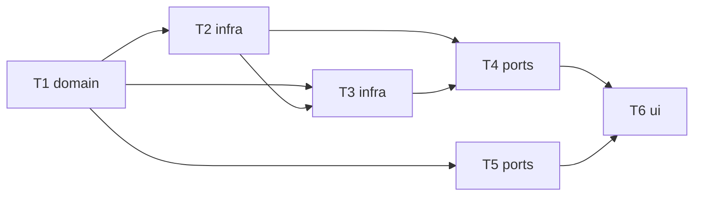

# Epic — model-price-preview

> **Spec:** [spec.md](../spec.md) · **Design:** [sad.md](../sad.md) · **API:** [openapi.yaml](../contracts/openapi.yaml) · **Screens:** [screens.md](../screens.md) · **ADRs:** [adr/](../adr/)

## Goal

Show the selected model's published price and a labelled estimate in the generate panel; never present an unknown price as free or an estimate as the cost (spec §2).

## Scope

- **In:** shared price shape + estimate; OpenRouter/Vercel `priceOf`; price cache + route; cost history route; `PricePreview` in SCR-01.
- **Out:** budgets, sorting/filtering by price, prices in the picker's option list, currency conversion (spec §3).

## Task map

## Tasks

See [tracker.md](./tracker.md). Machine contract: [tasks.json](../tasks.json).

| # | Task | Layer | Blocked by |
|---|---|---|---|
| T1 | [Define the shared price shape and the estimate function](./t1-price-shape-and-estimate.md) | domain | — |
| T2 | [Map OpenRouter's per-model endpoints pricing to the price shape](./t2-openrouter-price.md) | infra | T1 |
| T3 | [Map Vercel's inline model-list pricing to the price shape](./t3-vercel-price.md) | infra | T1, T2 |
| T4 | [Expose the model price with a per-model 10-minute cache](./t4-price-route-and-cache.md) | ports | T2, T3 |
| T5 | [Expose the Owner's known cost history per provider and model](./t5-cost-history.md) | ports | T1 |
| T6 | [Show the price and the estimate in the generate panel (SCR-01)](./t6-price-preview-ui.md) | ui | T4, T5 |

## Risks / Hard rules

- Never $0 for an unknown price; estimates labelled and never stored; no key on price lookups; no provider branching in `generations`.
