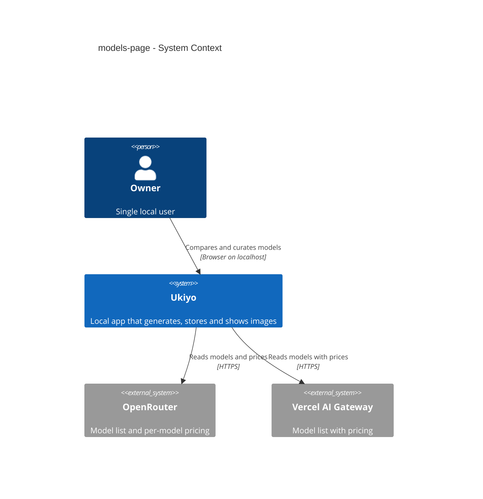
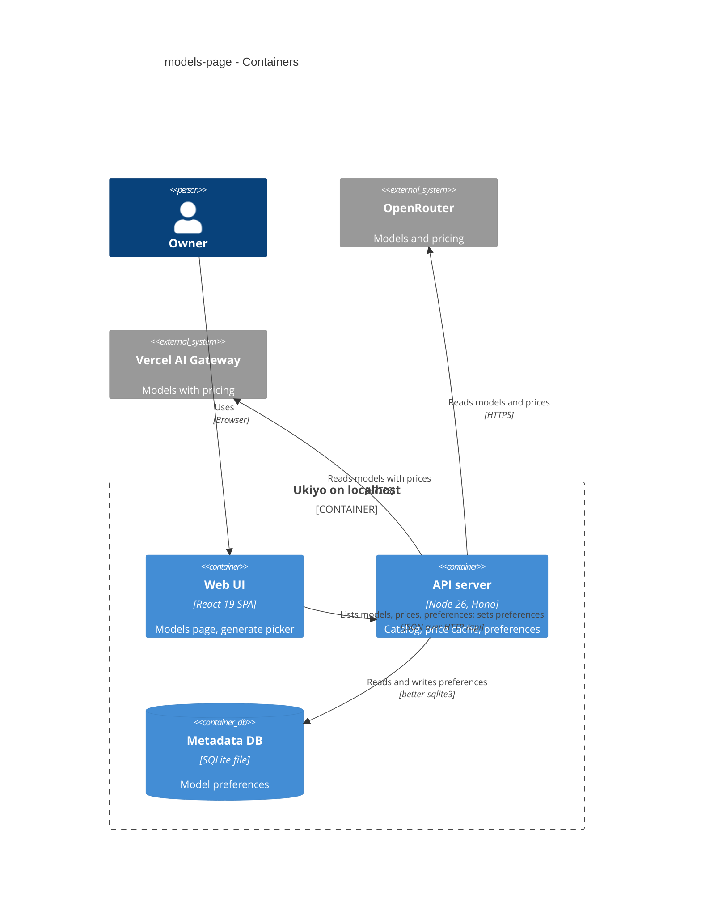
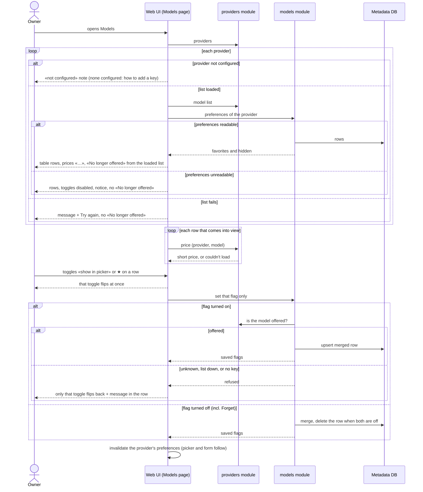

# Software Architecture Document — models-page

## 1. Introduction and goals

**Intent.** A «Models» section that lists every image model of both providers with its price and supported parameters, lets the Owner favorite and hide models for the Generate picker, and surfaces preferences of models a provider no longer offers (spec §1 ¶3, §2).

**Top-3 quality goals (1-liners; full scenarios in §10):**
1. **Every off-switch always works** — un-hide, un-favorite and «Forget» never depend on a provider (AC-08, AC-12).
2. **One truth for preferences** — the page and the Generate picker show the same state, and two toggles never clobber each other (AC-04, AC-05).
3. **Frugal, honest prices** — only rows in view are looked up, within step 9's limits; never $0 (AC-01, spec §6).

**Stakeholders.**

| Role | Interest | Sign-off owner? |
|---|---|---|
| Owner (also Tech Lead for SAD approval) | compares models, curates the picker | Yes |

## 2. Constraints

**Technical.** Same stack (TypeScript 5 / Node 26 / Hono 4 / React 19 / TanStack Query 5 / SQLite). Sections are one registry entry (ADR-0022); the Generate page stays mounted (ADR-0023); preferences per provider + model (ADR-0026, amended by ADR-0029); price lookups deduplicated, ≤ 4 in flight, failures cached 60 s (ADR-0027); the picker's hidden/selected and automatic-choice rules (step 9 SAD §4 items 4–5).
**Organisational.** Solo maintainer; local gate only.
**Conventions.** CLAUDE.md: shadcn/ui primitives only; shared zod schemas in `src/shared/`; errors through `AppError`. This step adds a fifth Vitest project, `nfr-web` (jsdom timing tests, run last and alone) — the CLAUDE.md test-projects row is updated with it. Contract change: an all-false preference write answers 200 for any id of a known provider; «not configured» / «list down» / «unknown model» answers only come from writes that turn a flag on (ADR-0029).
**Regulatory / external.** N/A.

## 3. Context and scope

The Models page reads each configured provider's model list and the Owner's preferences from the local server, and each visible row's price; toggles write one preference at a time. Nothing new talks to the providers: the model lists and prices come through the existing catalog and price cache.

<!-- brownfield: steps 2–9 shipped on this branch; architecture-map.md lists the providers and models modules. -->

**External systems (in / out):**

| Actor or system | Type | Interaction |
|---|---|---|
| Owner | Person | opens Models, toggles ★ / «show in picker», forgets retired preferences |
| OpenRouter | System (external) | model list + per-model pricing — unchanged sources |
| Vercel AI Gateway | System (external) | model list with pricing — unchanged source |

**C4 Context (L1):**



## 4. Solution strategy

**Target surface:** `[web-frontend, backend-service]` — a new SPA section; one rule change in the existing preference write. No new UI-architecture decision (SPA + section registry, ADR-0009 / ADR-0022).

1. **«Off» writes skip the provider** — the PATCH consults the catalog only when it turns a flag on; all-false writes are accepted for any id of a known provider (an unknown provider is still refused) → [ADR-0029](./adr/0029-turn-preference-flags-off-without-checking-the-provider-catalog.md).
2. **One shared, per-flag optimistic mutation** — `useSetModelPreference(provider)` for both the picker and the page: optimistic update, rollback and success write touch only the named flags; a settle invalidates `["model-preferences", provider]` only when no other preference change for that provider is still in flight → [ADR-0030](./adr/0030-change-preferences-through-one-shared-per-flag-optimistic-mutation.md).
3. **Prices only for rows in view** (inline — one component, reversible): each row's short price query (`useShortPrice`, key `["price", provider, model]`) is enabled once the row has intersected the viewport (an IntersectionObserver per table, rows tracked by id); on this page a failed price is retried on a later visit (server failure cache bounds it to ≤ 1/min).
4. **«No longer offered» = stored preferences minus a *loaded* model list** (inline): computed in the browser only when that provider's list query *and* its preferences query succeeded (AC-09, AC-14); «Forget» sends both flags off (works through rule 1). An unreadable preferences query leaves the rows listed with their toggles disabled and a notice (AC-14).
5. **The generate form names hidden suitable models** (inline): when `pickModel` finds nothing visible but a hidden model would have been suitable, the panel's notice becomes «The <provider> models that <kind> are hidden — show one on the Models page.» (AC-13); the form never changes a model the Owner chose because it was hidden (step 9 AC-10).

## 5. Building block view

```
src/server/modules/models/routes.ts        PATCH: catalog check only when a flag turns on (ADR-0029)
src/web/components/ui/{table,switch}.tsx   shadcn Table + Switch (vendored)
src/web/features/models/
├── preferences.ts                         useModelPreferences (moved from generate) + useSetModelPreference (ADR-0030)
├── ModelsPage.tsx                         SCR-08: a section per provider, table rows, «No longer offered»
├── ModelsPage.test.tsx
├── ModelsPage.nfr.test.tsx                p95 of rendering 100 rows (new serial `nfr-web` vitest project, jsdom)
└── params.ts                              describeParams(model) → aspect ratios / seed / max images / inputs, «—»
src/web/sections.tsx                       + Models section (/models, ADR-0022)
vitest.config.ts                           `web` excludes `**/*.nfr.test.tsx`; new serial `nfr-web` project (jsdom, setup-dom, fileParallelism false, groupOrder 1)
src/web/features/generate/
├── PricePreview.tsx                       useShortPrice gains a `retryOnMount` option; `retry` stays false
├── ModelPicker.tsx                        uses useSetModelPreference
└── GeneratePanel.tsx                      hidden-suitable notice (AC-13)
```

**C4 Container (L2):**



## 6. Runtime view

**Critical flow: open Models, see rows and prices, toggle, forget**



The flow covers AC-01…AC-09, AC-12 and AC-14; AC-04 and AC-13 are the generate form reading the same invalidated preferences; AC-10 is unchanged step 9 behaviour; AC-11 is the request guard in front of every call.

## 7. Deployment view

<!-- N/A: same single local process; no migration, no new configuration. -->

## 8. Crosscutting concepts

| Concept | Convention | Where defined |
|---|---|---|
| Write check | provider must be known (404 otherwise); the catalog check (offered / list down / no key) runs only when the request sets a flag to `true` | `models/routes.ts`, ADR-0029 |
| Optimistic preference change | per named flag: optimistic set, rollback of that flag only, success writes that flag only; shared `mutationKey: ["set-model-preference", provider]`; `onSettled` invalidates `["model-preferences", provider]` only when `isMutating({ mutationKey }) === 1` (no sibling still in flight) | `features/models/preferences.ts`, ADR-0030 |
| Price lookups on the page | `useShortPrice` enabled after the row intersects the viewport; `retry: false` always; `retryOnMount: true` on this page (a failed price is asked again on a later visit — the server failure cache bounds it), `false` in the picker; key shared with the picker | `ModelsPage.tsx`, `PricePreview.tsx` |
| Parameters wording | aspect ratios «1:1, 16:9, …» (all values), seed «yes», max images «up to N», inputs «0–N» / «1–N»; unsupported «—» | `features/models/params.ts` |
| Retired preferences | `prefs.filter(p => !list.has(p.model))`, only from a successful list query | `ModelsPage.tsx` |
| Errors in rows | «Couldn't save — try again.» in the row; list failure «Couldn't load the <provider> models.» + Try again; not configured «<provider> isn't configured — add its key to `.env.local`.» | `ModelsPage.tsx` |

## 9. Architecture decisions

| # | Title | Status | Section |
|---|---|---|---|
| 0029 | Turn preference flags off without checking the provider catalog | Accepted | §4 |
| 0030 | Change preferences through one shared, per-flag optimistic mutation | Accepted | §4 |

## 10. Quality requirements

**QG-1. Every off-switch always works**
- **When:** the provider's list is down, the provider has no key, or the model is no longer offered.
- **Then:** un-hide, un-favorite and «Forget» succeed; turning a flag on still needs an offered model (AC-08, AC-12).
- **How verify:** integration tests on the preference write with a failing catalog, an unconfigured provider and a retired id; saving stays «≤ 50 ms p95 of Ukiyo's own work (step 9)» — «existing nfr test», extended with the off-write path.

**QG-2. One truth for preferences**
- **When:** the Owner toggles ★ and «show in picker» quickly on one row, one of them fails, and then opens the Generate picker.
- **Then:** only the failed toggle reverts; the picker shows the saved state without a reload (AC-04, AC-05).
- **How verify:** hook tests with deferred responses asserting the order: ★ settles while «show in picker» is in flight → no refetch overwrites it; a component test across the page and the picker.

**QG-3. Frugal, honest prices**
- **When:** the page opens with 100 models.
- **Then:** «≤ 300 ms p95 after the model lists are cached, with 100 models and 100 stored preferences» for the rows; prices only for rows in view; «the step 9 limits hold: ≤ 1 per model per 10 minutes, ≤ 4 in flight in total, a failed lookup ≤ 1 retry per model per minute» (spec §6).
- **How verify:** «serial timing run like the `nfr` project — a jsdom `*.nfr.test.tsx` over a seeded list, 20 renders»; «existing price-cache unit tests + a test that the page asks each price once per visit»; a test that rows out of view are not looked up.

## 11. Risks and technical debt

| Risk / debt | Severity | Mitigation | Owner |
|---|---|---|---|
| A long OpenRouter table still queues lookups as the Owner scrolls fast | Low | in-view only; 4 in flight; 10-minute cache | dmytro.hopko |
| jsdom has no IntersectionObserver | Low | a tiny test double in `tests/helpers/setup-dom.ts` | dmytro.hopko |

**Accepted debt:** none new; step 9's «retired rows invisible» debt is resolved here (AC-08).

## 12. Glossary

| Term | Meaning |
|---|---|
| Favorite model · Hidden model · Model preference · Section | see CONTEXT.md |
| No longer offered | a model with a kept preference that its provider's (loaded) model list doesn't contain |
