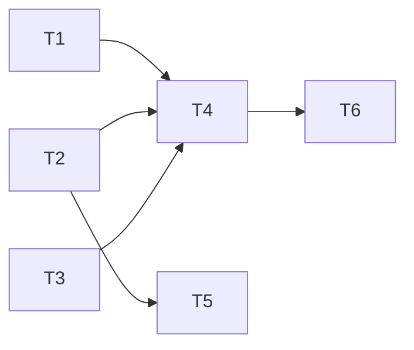

# Epic — models-page

> **Spec:** [spec.md](../spec.md) · **Design:** [sad.md](../sad.md) · **Data model:** [data-model.md](../data-model.md) · **API:** [openapi.yaml](../contracts/openapi.yaml) · **Screens:** [screens.md](../screens.md) · **ADRs:** [adr/](../adr/)

## Goal

The Owner sees every model of both providers with price and supported parameters on a Models page, hides or shows models in the Generate picker, marks favorites, and forgets preferences of models a provider no longer offers (spec §2).

## Scope

- **In:** PATCH off-write rule in `src/server/modules/models/`; shared preference hooks + Models page in `src/web/features/models/`; Models section in `src/web/sections.tsx`; shadcn Table + Switch; picker mutation + «hidden» notice in `src/web/features/generate/`; `nfr-web` Vitest project.
- **Out:** search / sort / filter; generating from the page; editing model data; usage statistics (spec §3).

## Task map

## Tasks

See [tracker.md](./tracker.md) for status. Machine contract: [tasks.json](../tasks.json).

| # | Task | Layer | Blocked by | DoD (short) |
|---|---|---|---|---|
| T1 | Accept preference writes that only turn flags off without checking the provider | ports | — | off-writes skip the catalog, int-tested |
| T2 | Share preference reads and a per-flag optimistic mutation between the picker and the Models page | app | — | shared per-flag mutation, hook-tested |
| T3 | Describe a model's supported parameters for the table | domain | — | parameter wording, unit-tested |
| T4 | Build the Models page section | ui | T1, T2, T3 | SCR-08 page with every state, component-tested |
| T5 | Say in the generate form when the suitable models are hidden | ui | T2 | hidden-suitable notice + cross-checks |
| T6 | Measure the Models page rendering in a serial web timing project | tests | T4 | serial web timing test passes |

## Risks / Hard rules

- Turning a flag off never needs the provider; turning one on still does; an unknown provider is always refused (ADR-0029).
- A failed toggle reverts only its own flag; no refetch overwrites a sibling toggle still in flight (ADR-0030).
- Prices only for rows in view; `retry: false`; step 9 server limits hold (spec §6).
- «No longer offered» only from a loaded list and readable preferences (AC-09, AC-14).
- Never $0 for an unknown price.
