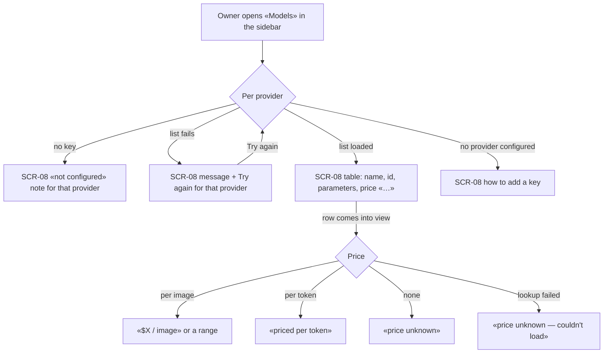
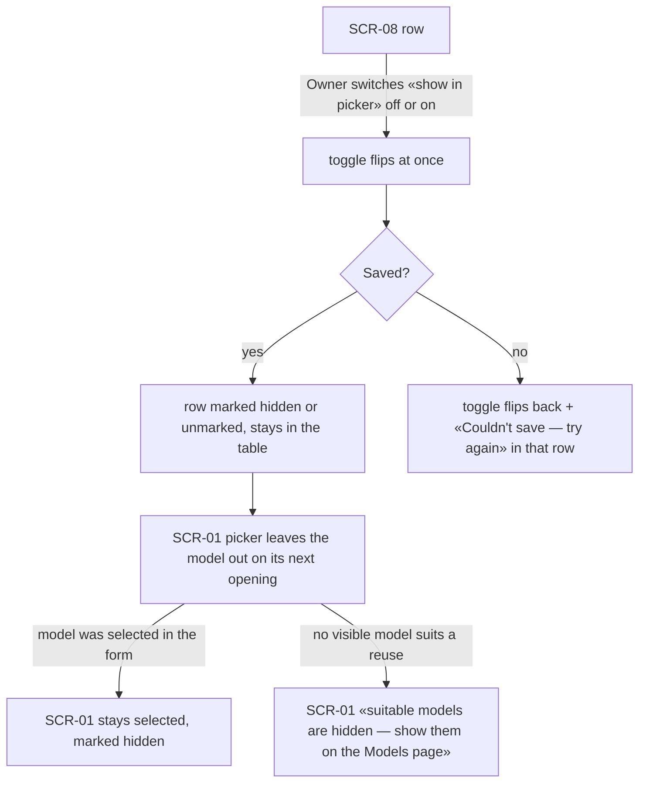
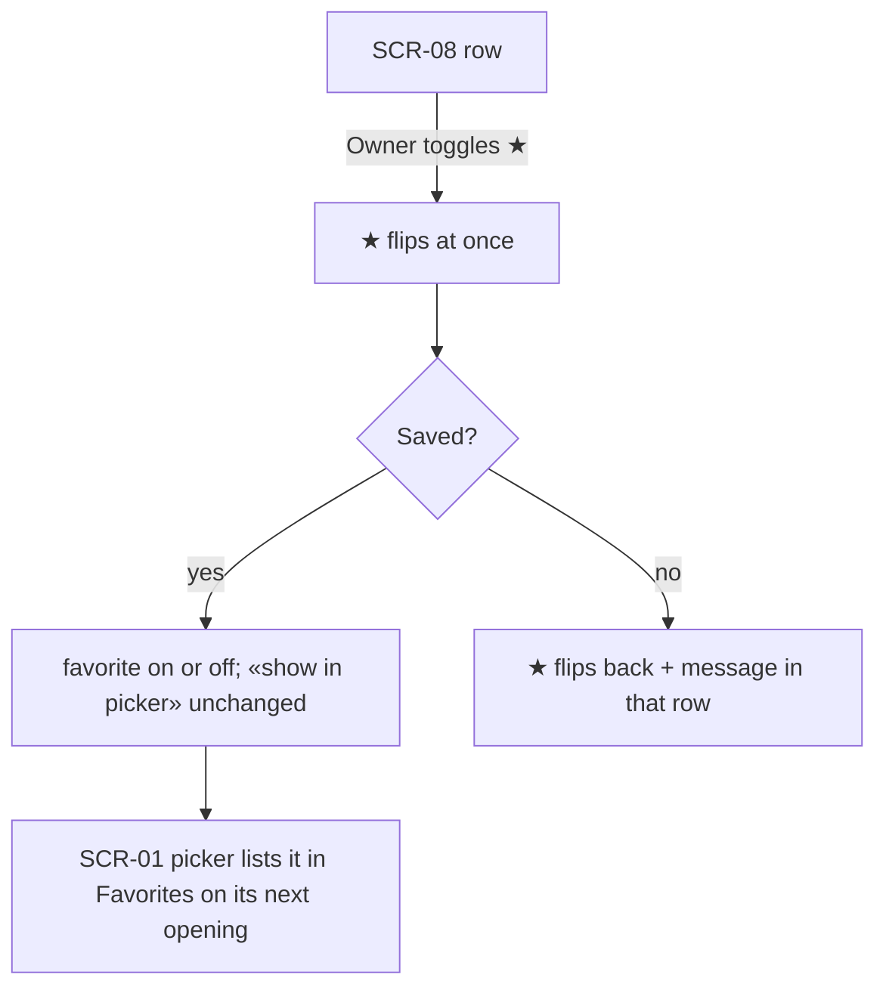
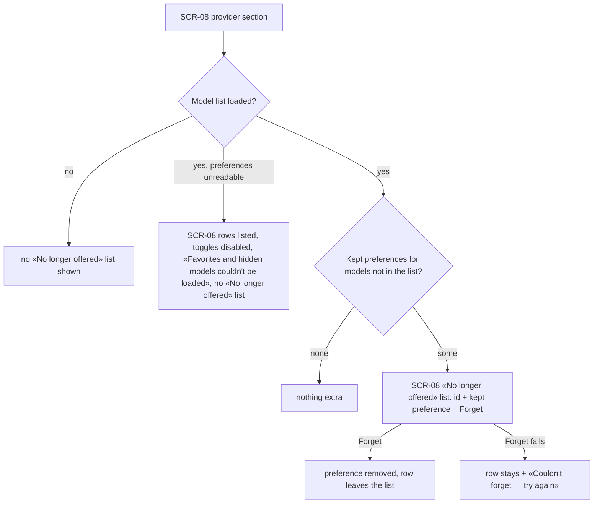

# UX flows — models-page

> User flows for every UI-touching §4 user story, produced by `ux-flows` (after `clarify`, before
> `design`). **Always markdown + mermaid `flowchart`.** Screen ids continue the app-wide inventory
> (… SCR-07 Model picker); this feature adds SCR-08.

## Platform decisions

- **Posture:** desktop-first — per [`design-system.md`](../../design-system.md); the table scrolls horizontally inside its card below `md` rather than reflowing.
- **Navigation:** «Models» is a new section in the sidebar (step 8 registry), its own page and address; it is not kept mounted (unlike Generate).
- **One page, one table per provider:** OpenRouter first, then Vercel AI Gateway (the provider order of the Generate form); a «No longer offered» list under a provider's table when it has any.
- **Toggles act at once:** ★ and «show in picker» save immediately — no Save button, no confirmation (both are reversible).
- **Generate follows:** the generate form (SCR-01) and its picker (SCR-07) reflect changes without a reload; this page never changes the selected model there.

## Screen inventory

| ID | Screen | Purpose | Entry | Exit |
|---|---|---|---|---|
| SCR-01 | Generate panel | For this feature: shows changes made on the Models page; names hidden models when no visible model is suitable | sidebar «Generate» | another section |
| SCR-08 | Models page (new) | One table per provider: name, id, short price, supported parameters, ★, «show in picker»; «No longer offered» list with «Forget» | sidebar «Models», the address | another section |

## Flows

### Flow: US-01 — See every model with price and parameters

The Owner opens «Models». For each provider, the page shows either a «not configured» note, a message with «Try again» when its model list can't be loaded (the other provider is unaffected), or its table: one row per model with name, id and the parameters it supports, prices showing «…» until they arrive. A row's price is asked for only once it comes into view, and reads in step 7's wording, never $0. With no provider configured, the page explains how to add a key.

### Flow: US-02 — Hide or show a model in the picker

On a row the Owner switches «show in picker». The switch moves at once; when saved, the row is marked hidden (or unmarked) and stays in the table so it can be switched back. If saving fails, the switch returns and the row says the change couldn't be saved; the row's ★ keeps its own state. The Generate picker leaves the model out from then on; if it is the model currently selected in the form, it stays selected and marked hidden. If hiding left no visible model suitable for a generation, the form says the suitable models are hidden and points to the Models page.

### Flow: US-03 — Mark favorites from the table

The Owner toggles ★ on a row. It flips at once and, when saved, the model is a favorite (or not) with its «show in picker» state untouched; the Generate picker shows it in «Favorites» on its next opening. A failed save flips the ★ back with a message in that row.

### Flow: US-04 — Clean up preferences of retired models

Under a provider's table, and only when its model list loaded, the page lists kept preferences of models the provider no longer offers — the model id and whether it was a favorite or hidden — each with «Forget». Forgetting removes the preference everywhere; if it fails, the row stays with a message. When the list couldn't be loaded, no model is presented as no longer offered; when the preferences couldn't be read, the rows are still listed with their toggles disabled and a notice, and no «No longer offered» list is built.

## AC coverage

| AC | Shown by | Notes |
|---|---|---|
| AC-01 | Flow US-01 → T, P | rows before prices; lookup on view |
| AC-02 | Flow US-02 → B → H | stays listed, marked |
| AC-03 | Flow US-03 → F | other toggle unchanged |
| AC-04 | Flow US-02 → G, K; Flow US-03 → G | generate form follows without reload |
| AC-05 | Flow US-02 → R; Flow US-03 → R | per-toggle rollback |
| AC-06 | Flow US-01 → E | other provider unaffected |
| AC-07 | Flow US-01 → N, Z | not configured / none configured |
| AC-08 | Flow US-04 → R → D | forget |
| AC-09 | Flow US-04 → X | never from a failed list |
| AC-10 | N/A | gallery and re-run unchanged — no flow change (step 9 rule) |
| AC-11 | N/A | no UI path: a foreign page is refused by the request guard |
| AC-12 | Flow US-04 → D | forget works while the list is down or without a key (server rule) |
| AC-13 | Flow US-02 → M | hidden-suitable-models notice |
| AC-14 | Flow US-04 → U | preferences unreadable |
