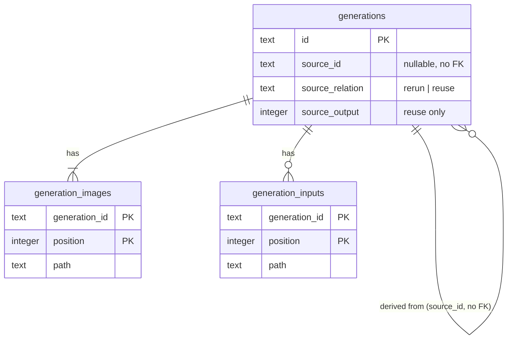

# Data model — rerun-and-reuse

## ER diagram

## Entities

Aggregate: **Generation** (unchanged root). This feature adds lineage columns to `generations` and reads existing `generation_images` / `generation_inputs` rows to resolve stored-image references (ADR-0017). A derived generation's input copies are ordinary `generation_inputs` rows of the derived generation (step 3 / ADR-0011) — nothing points at the source's files.

### `generations` (added columns)

| Column | Type | Constraints | Notes |
|---|---|---|---|
| `source_id` | TEXT | NULL; **no FK** | id of the source generation at the moment generating started; may later point at nothing → «source deleted» (ADR-0018, AC-07) |
| `source_relation` | TEXT | NULL, CHECK IN (`rerun`, `reuse`) | set together with `source_id` (enforced by the app + repo zod parse) |
| `source_output` | INTEGER | NULL, CHECK ≥ 1 | output position for `reuse`; NULL for `rerun` |

**Access patterns:** derived list of one source, newest first, ≤ 50 + total (`WHERE source_id = ? ORDER BY id DESC LIMIT 50`, `count(*) WHERE source_id = ?`) → `generations_source`; «does the source still exist?» → PK.
**Constraints:** CHECKs above (the repo uses CHECKs, e.g. 0002/0006); no FK by design.

### `generation_images` / `generation_inputs` (read only)

Stored-image references resolve by PK `(generation_id, position)` — kind `output` → `generation_images`, kind `input` → `generation_inputs`.

## Indexes

| Index | Columns | Query it serves |
|---|---|---|
| `generations_source` (partial, `source_id IS NOT NULL`) | `source_id, id` | derived list newest first + count on the detail view (sad §6 «Lineage on the detail view») |
| PK `generation_images` / `generation_inputs` | `generation_id, position` | resolve a stored-image reference (sad §6 «Generate from stored images») |

## Test fixtures

- `seedGeneration(db, dataDir, { source: { id, relation, output? } })` — extends the existing helper with lineage columns; no PII.
