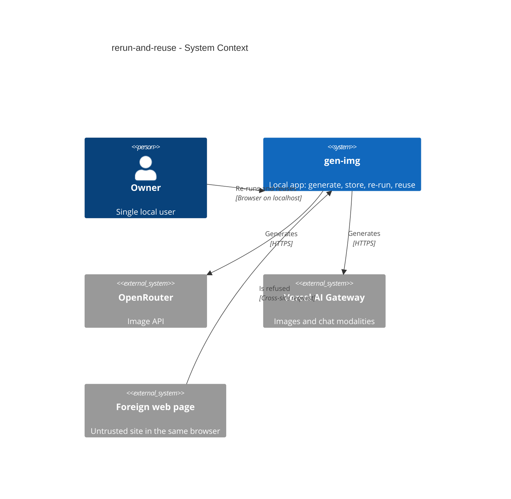
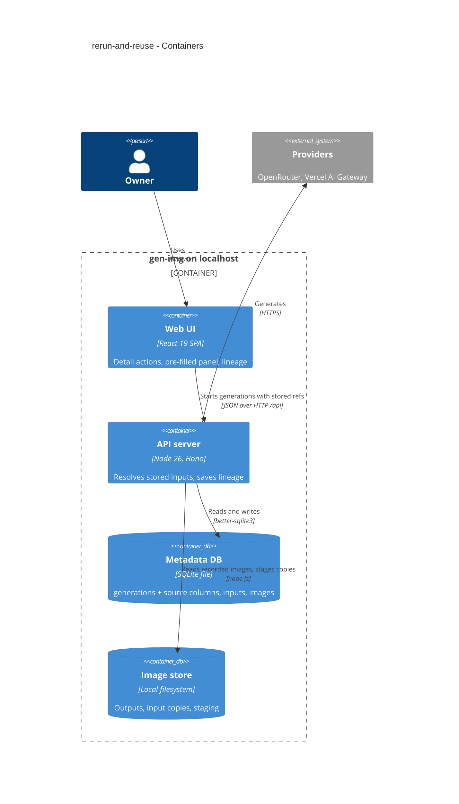
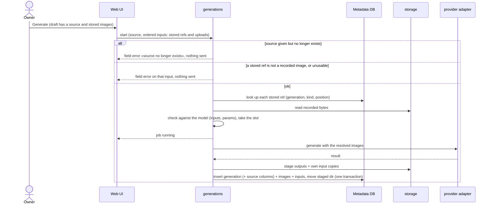
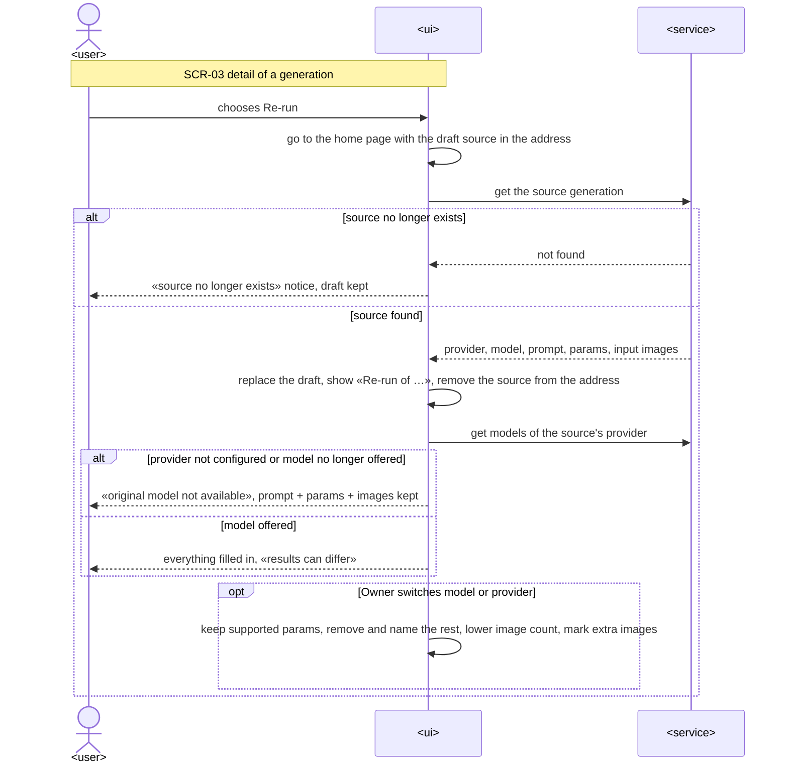
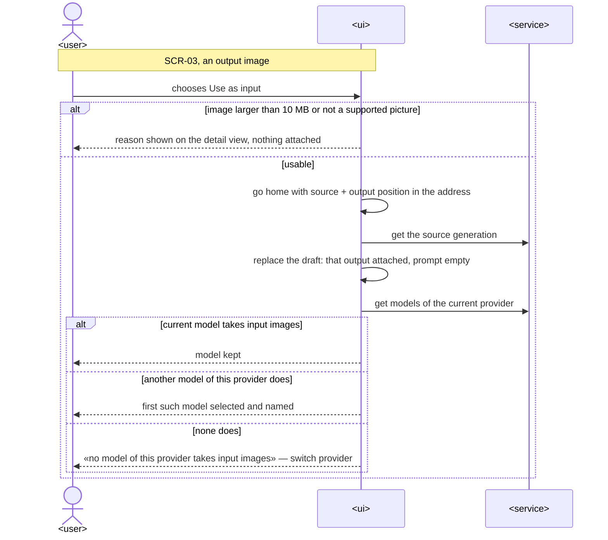
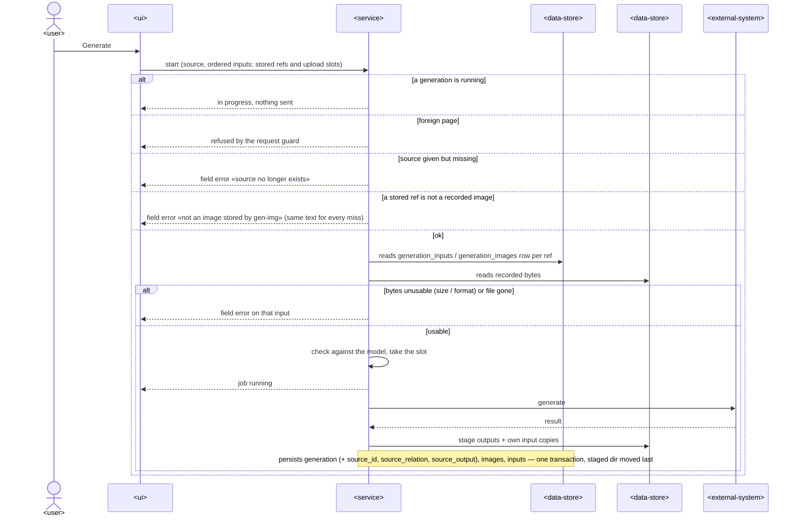

# Software Architecture Document — rerun-and-reuse

## 1. Introduction and goals

**Intent.** Let the Owner re-run any saved generation (same or another model/provider) from a pre-filled form and turn any output image into the next input in one action, with a one-level lineage between a derived generation and its source (spec §2). Builds on the shipped generation flow (ADR-0004…0013) and curation (ADR-0014…0016).

**Top-3 quality goals (1-liners; full scenarios in §10):**
1. **Safe re-validation** — nothing a newly chosen model can't take is ever sent (spec AC-05).
2. **Independence from the source** — a derived generation owns copies of its inputs; deleting the source never breaks or blocks it (AC-07, CONTEXT invariant).
3. **No arbitrary file reads** — a request may only refer to images gen-img recorded (AC-13).

**Stakeholders.**

| Role | Interest | Sign-off owner? |
|---|---|---|
| Owner | re-runs, reuses, follows lineage | Yes (solo project: also Tech Lead) |
| Tech Lead | SAD approval | Yes |

<!-- Decision overrides (¶4) — none. -->

## 2. Constraints

**Technical.**
- TypeScript 5 strict, Node 26, Hono 4, React 19 + Vite + TanStack Query 5, SQLite via `better-sqlite3` (hand-written SQL), zod — ADR-0001…0003.
- Binding feature ADRs: normalized provider port (0004), single-slot job (0005), atomic staging save + boot sweep (0006), request guard (0007), redacted raw exchange (0008), two-route SPA router (0009), multipart inputs (0010), `generation_inputs` copies (0011), Vercel per-model path (0012), cost sync (0013), atomic deletion (0014), tag rows (0015), whole-comment replace (0016).

**Organisational.** Solo maintainer; no CI — local gate `pnpm typecheck && pnpm lint && pnpm test`.

**Conventions.** [`CLAUDE.md`](../../../CLAUDE.md): `register<Module>Routes`, `AppError` envelope, ULIDs, zod-parsed repo rows, paired migrations, shared zod schemas in `src/shared/`, never branch on provider inside `generations`.

**Regulatory / external.** N/A — personal local tool.

## 3. Context and scope

Unchanged system boundary: the Owner's browser talks to the local server, which talks to OpenRouter and Vercel AI Gateway. New inside the boundary: requests can name stored images (by generation and position) that the server reads from the data dir itself.

<!-- brownfield: steps 2–5 shipped; read from the shipped SADs + code (no architecture-map refresh needed: module layout unchanged) -->

**External systems (in / out):**

| Actor or system | Type | Interaction |
|---|---|---|
| Owner | Person | re-runs, reuses outputs, follows lineage |
| OpenRouter / Vercel AI Gateway | System (external) | receive the re-sent inputs like any generation |
| Foreign web page | System (external, untrusted) | refused by the request guard |

**C4 Context (L1):**



## 4. Solution strategy

**Target surface:** `[backend-service, web-frontend]` — unchanged from earlier steps (ux-flows SCR-01/SCR-03). UI architecture stays the Vite SPA with the two-route router (ADR-0009); the draft source travels in the home address (ADR-0019).

**Top strategic choices (the seeds for ADRs):**
1. **Stored images are named, not re-uploaded** — the start request may list inputs as `stored` references (generation, kind, position) and/or uploaded files in one ordered list; the server resolves references against recorded images only and reads the bytes itself, then saves its own copies exactly as for uploads → [ADR-0017](./adr/0017-refer-to-stored-images-by-generation-and-position-and-read-them-server-side.md).
2. **Lineage as columns without a foreign key** — `source_id`, `source_relation`, `source_output` on `generations`; a deleted source simply no longer resolves («source deleted»), and deletion never cascades or blocks → [ADR-0018](./adr/0018-record-lineage-as-source-columns-without-a-foreign-key.md).
3. **Draft source in the home address, applied once** — Re-run / Use as input navigate to `/?rerun=<id>` / `/?reuse=<id>&output=<n>`; the panel loads the source, fills the draft and removes the query → [ADR-0019](./adr/0019-carry-the-draft-source-in-the-home-address-and-apply-it-once.md).
4. **One re-validation rule for every model switch** (inline, below the gate: one module, cheap to change) — when the model changes, the panel keeps each parameter the new model supports, removes the rest and names them, and lowers `n` to the model's maximum; the server's existing `checkAgainstModel` stays the final guard.

## 5. Building block view

Unchanged module layout (ADR-0002). Changes per module:

```
src/shared/generations.ts            StartGenerationRequest: + source, + inputs (stored refs / upload slots);
                                     Generation DTO: + source, + derived; carryParams() for model switches
src/server/modules/generations/
├── domain.ts                        source/inputs shape checks (relation ⇔ output, upload slots exactly once)
├── repo.ts                          source columns on insert/get; storedImage(); derivedOf(); exists()
├── service.ts                       resolveInputs(): stored refs → bytes (via files), uploads → order; source check
└── routes.ts                        unchanged paths; JSON start may carry stored refs without multipart
src/server/modules/storage/file-store.ts   readRecorded(relPath) (bytes of a recorded file)
migrations/0007_add_generation_source.{up,down}.sql
src/web/
├── features/generate/GeneratePanel.tsx    draft source line, apply ?rerun / ?reuse, carry-over on model switch
├── features/generate/InputImages.tsx      attachments: uploaded files and stored images alike
└── features/gallery/GenerationDetail.tsx  Re-run, Use as input per output, Lineage section
```

**C4 Container (L2):**



## 6. Runtime view

**Critical flow 1: start a generation from stored images (re-run or reuse)**



**Critical flow 2: lineage on the detail view** — see «Lineage on the detail view» below.

### Re-run: open the pre-filled panel (US-01, US-02)



Re-run moves to the home page with the source in the address. If the source is gone, the panel says so and keeps its draft. Otherwise the draft is replaced with the source's provider, model, prompt, parameters and stored input images, the panel says «Re-run of …» and that results can differ, and the address is cleaned. If the source's provider isn't configured or its model is no longer offered, the panel keeps everything and says so. Switching model or provider keeps only what the new model supports and names what was removed.

### Use as input: attach one output (US-03)



«Use as input» is refused on the detail view when the output can't be an input (size or format). Otherwise the panel opens with only that output attached and an empty prompt, keeping the current model if it takes input images, else picking the first one that does, else telling the Owner to switch provider.

### Generate from stored images (US-01, US-03) — server side



The server refuses while another generation runs, refuses foreign pages, and refuses a missing source or a reference that isn't a recorded image with one generic message. It reads each referenced image from its recorded row and file, checks it like an upload, checks the model, takes the slot and generates. The new generation is saved with its own input copies and the lineage columns in one transaction, staged files moved last (ADR-0006).

### Lineage on the detail view (US-04, US-05)

```mermaid
sequenceDiagram
    actor Owner as <user>
    participant UI as <ui>
    participant Svc as <service>
    participant DB as <data-store>
    Owner->>UI: opens a generation
    UI->>Svc: get generation
    Svc->>DB: reads the generation (with source columns)
    alt has a source
        Svc->>DB: does the source still exist?
        Note over Svc,DB: exists → link; missing → «source deleted»
    end
    Svc->>DB: reads up to 50 newest generations derived from it + total
    Note over Svc,DB: reads generations by source_id (indexed)
    Svc-->>UI: detail + source + derived list
    UI-->>Owner: lineage section (one level each way)
    opt Owner deletes this generation
        UI->>Svc: delete (usual confirmation)
        Note over Svc,DB: derived rows untouched; their source now reads as deleted
    end
```

The detail read adds the source (a link, or «source deleted» when it no longer exists) and the 50 newest derived generations with the total. Deleting a generation goes through the usual confirmation; derived generations are untouched and afterwards show «source deleted».

### AC coverage (runtime view)

| US / AC | Shown by |
|---|---|
| US-01 | Re-run: open the pre-filled panel; Generate from stored images |
| US-02 | Re-run: open the pre-filled panel (switch branch) |
| US-03 | Use as input; Generate from stored images |
| US-04 | Lineage on the detail view |
| US-05 | Lineage on the detail view (delete branch) |
| AC-01 | Re-run → model offered |
| AC-02 | Generate from stored images → persists source; Lineage |
| AC-03 | Use as input → usable; Generate from stored images |
| AC-04 | Lineage → derived list |
| AC-05 | Re-run → switch branch; server model check in Generate |
| AC-06 | Re-run → «results can differ» |
| AC-07 | Lineage → delete branch / «source deleted» |
| AC-08 | Re-run → source no longer exists; Generate → source missing |
| AC-09 | Use as input → refused; Generate → bytes unusable |
| AC-10 | Re-run → model not available |
| AC-11 | Use as input → none does |
| AC-12 | Generate → foreign page |
| AC-13 | Generate → not a recorded image |
| AC-14 | Generate → a generation is running |
| AC-15 | Lineage → one level each way |

## 7. Deployment view

<!-- N/A: same single local process; one new migration applied on boot. -->

## 8. Crosscutting concepts

| Concept | Convention | Where defined |
|---|---|---|
| Stored-image reference | `{ stored: { generationId, kind: "input" \| "output", position } }`; resolved only through `generation_inputs` / `generation_images` rows, never as a path; any miss → one generic field error «not an image stored by gen-img» (no existence leak) | ADR-0017 |
| Input order | `inputs` lists stored refs and `{ upload: n }` slots in the order sent to the provider; without `inputs`, uploads go in order (unchanged clients) | ADR-0017 |
| Lineage | `source_id` + `source_relation` (`rerun` / `reuse`) + `source_output` (reuse only); recorded only if the source exists at start; no FK — a deleted source reads as «deleted» | ADR-0018 |
| Draft source | `/?rerun=<id>` or `/?reuse=<id>&output=<n>`, applied once then removed from the address; starting one replaces the draft | ADR-0019 |
| Model switch | keep supported params, remove + name the rest, clamp `n`; server re-checks | §4 choice 4 |
| Error handling | existing `AppError`; source/input problems are `VALIDATION_ERROR` with `details.fields.source` / `inputs.N` | `src/server/lib/errors.ts` |
| Logging / observability / i18n | unchanged | — |

## 9. Architecture decisions

| # | Title | Status | Section |
|---|---|---|---|
| 0017 | Refer to stored images by generation and position and read them server-side | Accepted | §4 |
| 0018 | Record lineage as source columns without a foreign key | Accepted | §4 |
| 0019 | Carry the draft source in the home address and apply it once | Accepted | §4 |

ADR files live under `docs/features/rerun-and-reuse/adr/NNNN-<title>.md` (numbering continues 0016).

## 10. Quality requirements

**QG-1. Safe re-validation**
- **When:** the Owner switches the model of a pre-filled draft to one that lacks seed / aspect ratio / input images or has a lower image maximum.
- **Then:** unsupported parameters are removed and named, `n` is lowered and named, extra images are marked; the server refuses anything the model can't take (AC-05).
- **How verify:** component tests on the panel; integration test that the server refuses an unsupported parameter on a stored-ref request.

**QG-2. Independence from the source**
- **When:** a source is deleted after a derived generation was saved; or the save of a derived generation fails part-way.
- **Then:** the derived generation keeps its images and input copies and shows «source deleted» (AC-07); «0 generations whose stored input copies are missing after a crash mid-save» (spec §6 Durability).
- **How verify:** integration tests: delete source → derived detail intact, file route serves its copies; failing commit + restart → no half-saved derived generation.

**QG-3. No arbitrary file reads, and speed**
- **When:** a request names stored images (valid, unknown, out of range, wrong kind, crafted ids).
- **Then:** only recorded images are read; every miss is one generic field error (AC-13). Server work before the provider call «≤ 300 ms p95 for 8 stored input images of ≤ 10 MB each»; detail with lineage «≤ 150 ms p95 with 1 000 generations and 50 derived from the opened one» (spec §6).
- **How verify:** integration tests on the reference matrix; NFR tests in the serial `nfr` project.

## 11. Risks and technical debt

| Risk / debt | Severity | Mitigation | Owner |
|---|---|---|---|
| Re-run of an 8-input generation reads up to 80 MB into memory per start | Low | same bound as uploads (SAD §8 of image-inputs); single slot | dmytro.hopko |
| Output images over 10 MB (e.g. 4K PNG) can't be reused | Low | refused with the reason before navigating (AC-09); downscaling is a later idea | dmytro.hopko |
| A source deleted between the lookup and the read (deletion in flight) | Low | read failure → same field error as a missing source; nothing sent | dmytro.hopko |

**Accepted debt:** lineage is one level each way; no tree view (spec §3).

## 12. Glossary

| Term | Meaning |
|---|---|
| Source generation | the generation a re-run or reuse started from (CONTEXT.md) |
| Derived generation | a generation made from a source; owns its input copies (CONTEXT.md) |
| Stored-image reference | `(generation, input/output, position)` naming a recorded image in a start request |
| Draft source | the source a panel draft was filled from, shown as «Started from …», removable |
