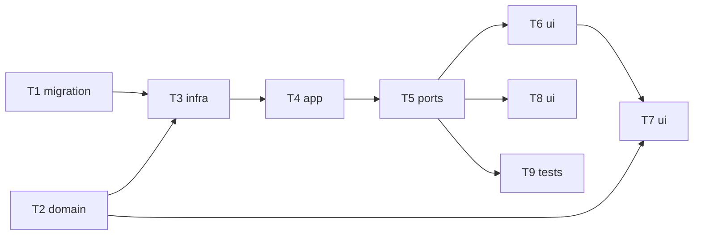

# Epic — rerun-and-reuse

> **Spec:** [spec.md](../spec.md) · **Design:** [sad.md](../sad.md) · **Data model:** [data-model.md](../data-model.md) · **API:** [openapi.yaml](../contracts/openapi.yaml) · **Screens:** [screens.md](../screens.md) · **ADRs:** [adr/](../adr/)

## Goal

Re-run any saved generation (same or another model/provider) from a pre-filled form and reuse any output as the next input in one action, with one-level lineage that never ties lifetimes together (spec §2).

## Scope

- **In:** migration `0007_add_generation_source`; shared schemas + carry-over rule; repo lineage + stored-image lookup; service resolving stored references; routes/DTO; panel draft from a source; detail actions + lineage card; integrity + NFR tests.
- **Out:** pixel identity, batch re-runs, lineage tree view, multi-generation combine, editing a source (spec §3).

## Task map

## Tasks

See [tracker.md](./tracker.md) for status. Machine contract: [tasks.json](../tasks.json).

| # | Task | Layer | Blocked by | DoD (short) |
|---|---|---|---|---|
| T1 | [Promote the lineage migration](./t1-promote-lineage-migration.md) | migration | — | migration 0007_add_generation_source applies and reverts cleanly; CHECKs reject a bad rela… |
| T2 | [Extend the shared start and detail schemas and add the parameter carry-over rule](./t2-shared-rerun-schemas.md) | domain | — | unit tests: StartGenerationRequest accepts source + ordered inputs (stored refs, upload sl… |
| T3 | [Store lineage and look up stored images and derived generations in the repo](./t3-repo-lineage-and-stored-images.md) | infra | T1, T2 | integration tests: insert + get round-trip the source columns; storedImage(generationId, k… |
| T4 | [Resolve stored-image references and record lineage when starting a generation](./t4-service-stored-inputs-and-lineage.md) | app | T3 | integration tests with a fake provider: re-run from stored inputs sends the same bytes in … |
| T5 | [Expose stored-image inputs and lineage through the routes](./t5-routes-lineage-dto.md) | ports | T4 | integration tests via app.request(): JSON start with stored refs only → 202; multipart wit… |
| T6 | [Fill the generate panel from a re-run or reuse source](./t6-panel-draft-from-source.md) | ui | T5 | web tests (mocked api): ?rerun fills provider/model/prompt/params/stored inputs and shows … |
| T7 | [Keep supported parameters and name removed ones when the model changes](./t7-panel-carry-over.md) | ui | T6, T2 | web tests: switching a pre-filled draft to a model without seed / aspect ratio / with a lo… |
| T8 | [Add Re-run, Use as input and the lineage card to the detail view](./t8-detail-actions-and-lineage.md) | ui | T5 | web tests: Re-run links to /?rerun=<id>; Use as input links to /?reuse=<id>&output=N and i… |
| T9 | [Verify derived generations survive source deletion and the NFRs](./t9-lineage-integrity-and-nfr.md) | tests | T5 | tests pass: deleting a source leaves the derived generation's images and input copies serv… |

## Risks / Hard rules

- Never branch on provider inside `generations`; request guard on every route (ADR-0007); single slot (ADR-0005); all-or-nothing save with own input copies (ADR-0006/0011).
- Stored references resolve only through recorded rows — never a path (ADR-0017).
