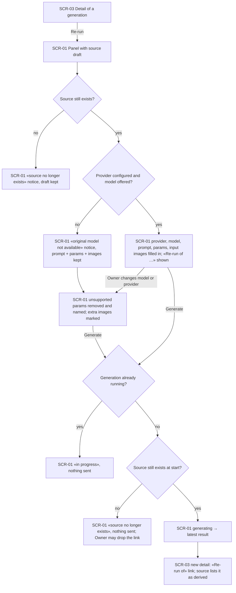
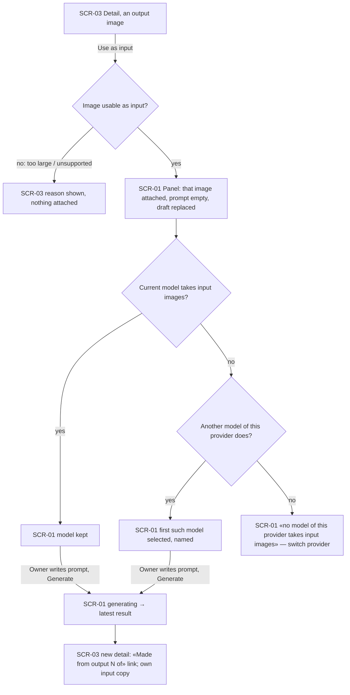
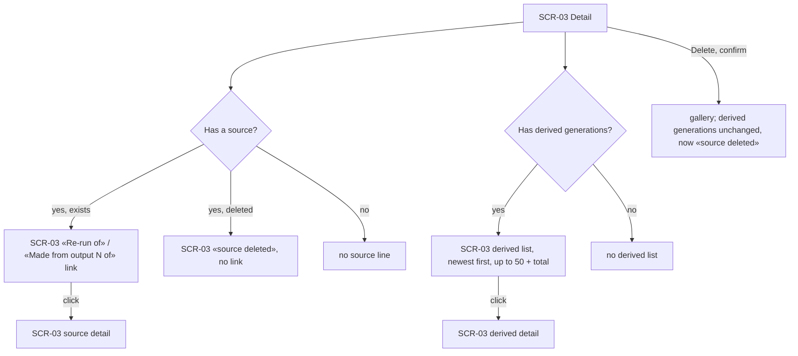

# UX flows — rerun-and-reuse

> User flows for every UI-touching §4 user story, produced by `ux-flows` (after `clarify`, before
> `design`). **Always markdown + mermaid `flowchart`.** Screen ids continue the app-wide inventory
> started in [`text-to-image-openrouter/ux-flows.md`](../text-to-image-openrouter/ux-flows.md).

## Platform decisions

- **Posture:** desktop-first — per [`design-system.md`](../../design-system.md).
- **Navigation shape:** re-run and «use as input» start on the detail view (SCR-03) and land on the home page's generate panel (SCR-01) with the draft filled in; the detail view is left, the gallery stays beside the panel.
- **Draft source survives a reload:** the source of the draft is carried in the home page's address until the panel has applied it, then removed — a reload after that keeps the Owner's edits in place of re-applying the source.
- **One source per draft:** starting a re-run or a reuse replaces the current draft; the panel shows a removable «Started from …» line while the draft has a source.

## Screen inventory

| ID | Screen | Purpose | Entry | Exit |
|---|---|---|---|---|
| SCR-01 | Generate panel | Holds the draft; for this feature: the «Started from …» line, notices about unavailable model/provider and removed parameters, stored images shown like attachments | home; from SCR-03 «Re-run» / «Use as input» | generating; SCR-03 via the latest result or the source link |
| SCR-03 | Generation detail | For this feature: «Re-run» action, «Use as input» per output image, lineage section (source + derived list) | gallery tile, latest result, lineage links | SCR-01 via re-run / reuse; another SCR-03 via a lineage link |

SCR-02 (gallery) is unchanged.

## Flows

### Flow: US-01 / US-02 — Re-run (same or another model)

From a generation's detail view the Owner chooses Re-run and lands on the generate panel. If the source was deleted meanwhile, the panel says so and keeps what it has. If the source's provider is not configured or its model is no longer offered, the panel says so, keeps the prompt, parameters and images, and lets the Owner choose another model. Otherwise everything is filled in and the panel shows «Re-run of …» and that results can differ. Switching model or provider removes parameters the new model can't take and names them, and marks input images over the new model's limit. Generating while another generation runs is blocked as usual. If the source disappears between opening and generating, nothing is sent and the Owner can drop the link. Success shows the latest result; its detail says «Re-run of» and the source lists it as derived.

### Flow: US-03 — Use an output as the next input

On a detail view each output image offers «Use as input». An image that can't be an input (over 10 MB or not a supported picture) is refused right there with the reason. Otherwise the panel opens with just that image attached and an empty prompt, replacing the old draft. The current model is kept when it takes input images, otherwise the first model of the provider that does is chosen and named; if none does, the panel says so and the Owner can switch provider. After generating, the new detail says «Made from output N of» and keeps its own copy of the image.

### Flow: US-04 / US-05 — Lineage and deleting a source

The detail view shows one level each way: its own source (a link, or «source deleted»), and up to 50 newest generations made from it with the total. Links move along the chain one step at a time. Deleting a generation uses the usual confirmation only; its derived generations stay complete and show «source deleted».

## AC coverage

| AC | Shown by | Notes |
|---|---|---|
| AC-01 | Flow US-01 → F | draft replaced; «Re-run of» removable |
| AC-02 | Flow US-01 → J | |
| AC-03 | Flow US-03 → C, F/F2, H | |
| AC-04 | Flow US-04 → G | |
| AC-05 | Flow US-01 → E | |
| AC-06 | Flow US-01 → F | «results can differ» copy |
| AC-07 | Flow US-04 → I, D | |
| AC-08 | Flow US-01 → CX, HX | |
| AC-09 | Flow US-03 → BX | |
| AC-10 | Flow US-01 → DX | |
| AC-11 | Flow US-03 → EX | |
| AC-12 | N/A | no UI: a foreign page is refused without any screen |
| AC-13 | N/A | no UI: a crafted reference is refused server-side |
| AC-14 | Flow US-01 → GX | |
| AC-15 | Flow US-04 → C/G (one level each way) | |
