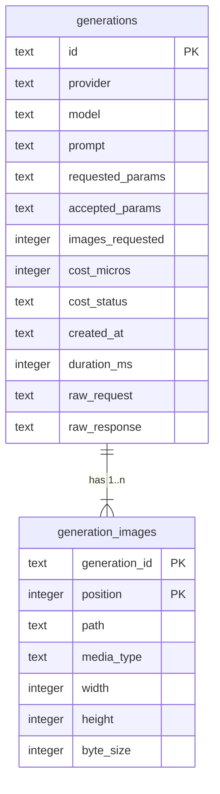

# Data model — text-to-image-openrouter

## ER diagram

## Entities

Aggregate: **Generation** (root `generations`, child `generation_images`). Both rows of a generation are written in one transaction together with the staging-dir rename (ADR-0006); a generation always has ≥ 1 image (enforced by the service — SQLite can't express «at least one child»).

### `generations`

| Column | Type | Constraints | Notes |
|---|---|---|---|
| `id` | TEXT | PK | ULID minted at submit (`newId()`); id order = created-at order (spec AC-02, AC-04) |
| `provider` | TEXT | NOT NULL | provider id (`openrouter`); shown everywhere (AC-18) |
| `model` | TEXT | NOT NULL | provider model id |
| `prompt` | TEXT | NOT NULL, CHECK non-blank | AC-05 |
| `requested_params` | TEXT (JSON) | NOT NULL | `{ aspectRatio?, seed?, n }` exactly as sent (AC-09) |
| `accepted_params` | TEXT (JSON) | NULL | NULL = «not reported» (AC-09; OpenRouter reports none) |
| `images_requested` | INTEGER | NOT NULL, ≥ 1 | «N of M received» (AC-16); received = count of `generation_images` |
| `cost_micros` | INTEGER | NULL, ≥ 0 | micro-USD (convention) |
| `cost_status` | TEXT | NOT NULL, IN known/pending/unavailable; known ⇔ cost_micros NOT NULL | AC-07; this slice writes known/unavailable |
| `created_at` | TEXT | NOT NULL | ISO-8601 UTC, submit moment |
| `duration_ms` | INTEGER | NOT NULL, ≥ 0 | provider round-trip |
| `raw_request` | TEXT (JSON) | NOT NULL | redacted — no key (AC-10, ADR-0008) |
| `raw_response` | TEXT (JSON) | NOT NULL | image payloads → `{"$file": path}` (spec §6, ADR-0008) |

**Aggregate root:** root.
**Access patterns:** gallery page newest first with cursor (`WHERE id < ? ORDER BY id DESC LIMIT 24`) → PK; detail by id → PK.
**Constraints:** CHECKs above; no UNIQUE beyond PK.

### `generation_images`

| Column | Type | Constraints | Notes |
|---|---|---|---|
| `generation_id` | TEXT | NOT NULL, FK → `generations(id)` ON DELETE CASCADE, part of PK | cascade prepares step 5 (delete) |
| `position` | INTEGER | NOT NULL, ≥ 1, part of PK | provider order |
| `path` | TEXT | NOT NULL | relative to the data dir: `generations/<id>/output-<position>.<ext>` |
| `media_type` | TEXT | NOT NULL, IN png/jpeg/webp/gif | «usable image» formats (AC-06) |
| `width` / `height` | INTEGER | NOT NULL, > 0 | real dimensions (AC-09) |
| `byte_size` | INTEGER | NOT NULL, > 0 | |

**Aggregate root:** `generations`.
**Access patterns:** images of one generation / of a page of generations (`WHERE generation_id IN (…) ORDER BY generation_id, position`) → PK prefix; file route lookup by exact path (`WHERE path = ?`) → `generation_images_path`.
**Constraints:** `path` is UNIQUE (one file per row).

## Indexes

| Index | Columns | Query it serves |
|---|---|---|
| PK `generations` | `id` | gallery page (cursor + `ORDER BY id DESC`), detail by id — flows «browse» / «inspect» |
| PK `generation_images` | `generation_id, position` | images for a generation / a page; also covers the FK column |
| `generation_images_path` (UNIQUE) | `path` | file route: «is this exact path a recorded image?» (AC-12) — added after review F4, staged `02_index_generation_images_path` |

## Test fixtures

- `tests/helpers/generations.ts` → `seedGeneration(db, dataDir, overrides?)` — inserts a generation with N tiny PNG files on disk (prompt «A test prompt», provider `openrouter`, model `test/model`); used by gallery/detail tests and the 1 000-row NFR test. No PII.
