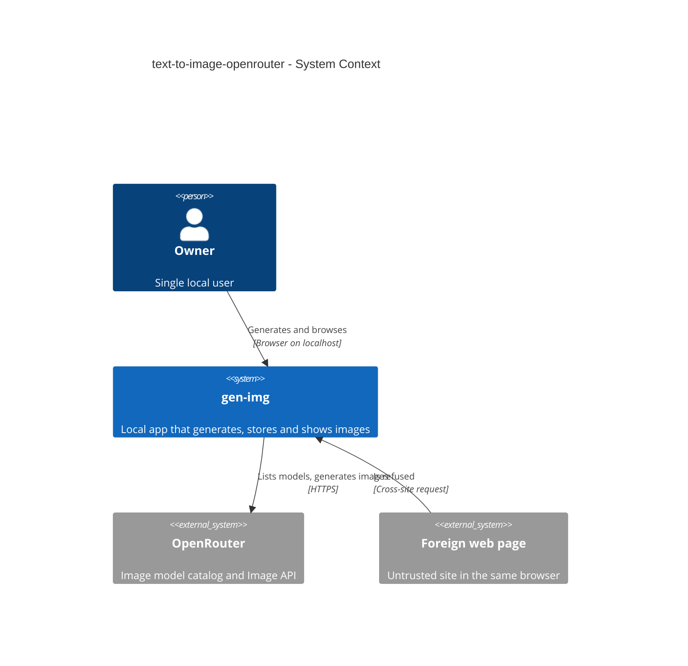
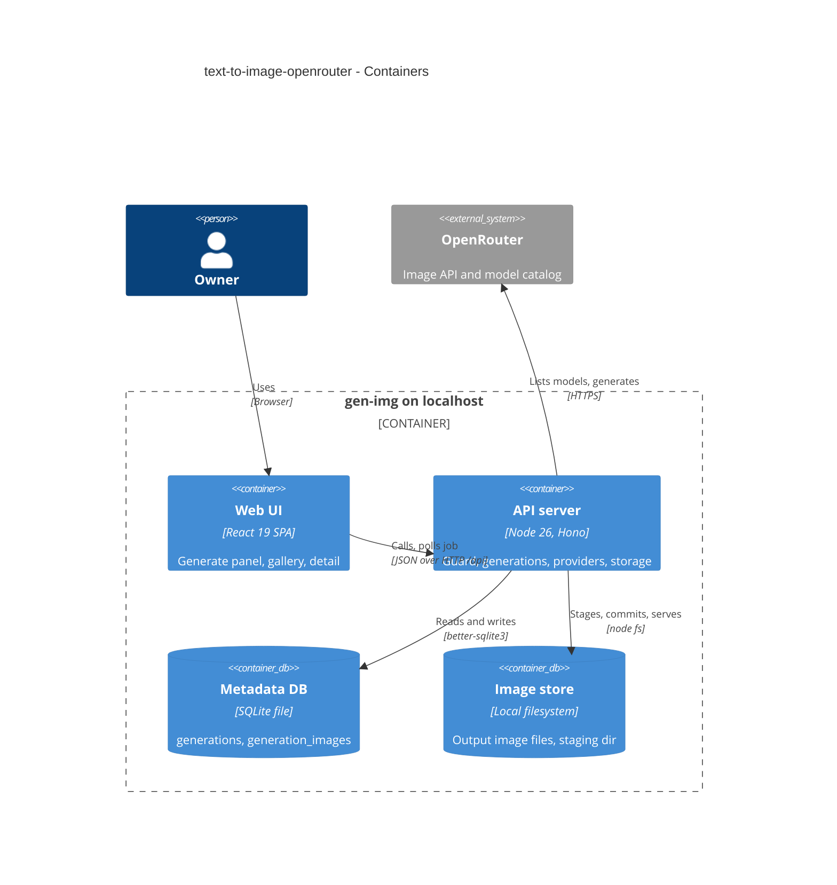
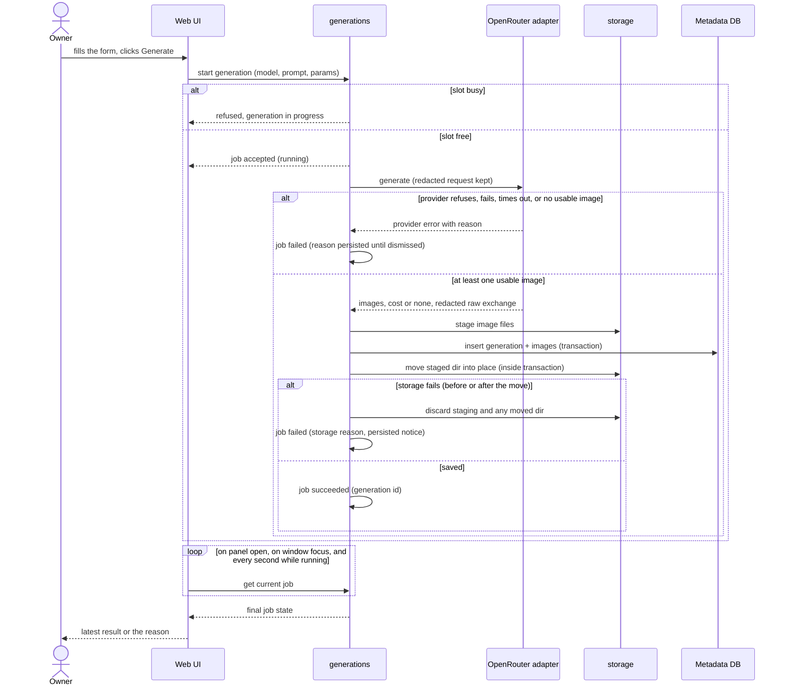

# Software Architecture Document — text-to-image-openrouter

## 1. Introduction and goals

**Intent.** The first vertical slice of gen-img: the Owner generates images from a text prompt through OpenRouter, every successful generation is kept on the Owner's machine (output image files + full metadata), and a local gallery with a detail view replaces the provider playground (spec §2). The provider sits behind the `ImageProvider` port from [ADR-0002](../../adr/0002-organize-as-modular-monolith-with-provider-port.md), so roadmap step 4 (Vercel AI Gateway) only adds an adapter.

**Top-3 quality goals (1-liners; full scenarios in §10):**
1. **Integrity** — a generation is all-or-nothing: never a record without its files, never files without a record (spec AC-08, §6 Durability).
2. **Secret containment** — the provider key and the spending path are reachable only by gen-img's own pages on the Owner's machine (spec AC-10, AC-11, AC-19).
3. **Responsiveness at history scale** — the gallery's first page stays ≤ 300 ms p95 with 1 000 generations (spec §6).

**Stakeholders.**

| Role | Interest | Sign-off owner? |
|---|---|---|
| Owner | generates, browses and inspects generations | Yes (solo project: also Tech Lead) |
| Tech Lead | SAD approval | Yes |

## 2. Constraints

**Technical.**
- TypeScript 5 (strict) on Node 26 — [ADR-0001](../../adr/0001-use-typescript-node-hono-react-stack.md)
- Hono 4 + `@hono/node-server` 2 on the server; React 19 + Vite 8 + Tailwind CSS v4 + shadcn/ui + TanStack Query 5 in the web UI
- SQLite via `better-sqlite3` 13 (hand-written SQL, WAL) for metadata; image files on the local filesystem under `GEN_IMG_DATA_DIR` — [ADR-0003](../../adr/0003-store-metadata-in-sqlite-and-images-on-disk.md)
- Modular monolith; providers behind one `ImageProvider` port — [ADR-0002](../../adr/0002-organize-as-modular-monolith-with-provider-port.md)
- Provider HTTP with plain `fetch`, no vendor SDK; OpenRouter dedicated Image API (`/api/v1/images`, `/api/v1/images/models`), verified by fact-check 2026-10-18 (spec §8)

**Organisational.**
- Solo maintainer, no deadline; no CI — local gate `pnpm typecheck && pnpm lint && pnpm test`.

**Conventions.**
- [`CLAUDE.md`](../../../CLAUDE.md) + [`architecture-map.md` Conventions](../../architecture-map.md): `register<Module>Routes(app, deps)`, `AppError` envelope, ULID ids, zod-parsed repo rows, ISO-8601 UTC text timestamps, `cost_micros` + `cost_status`, paired migrations, shared zod schemas in `src/shared/`.

**Regulatory / external.**
- N/A — personal local tool; no third-party personal data. Server binds `127.0.0.1` only (hard rule).

## 3. Context and scope

gen-img runs on the Owner's machine: a browser UI talks to a local server, which calls OpenRouter with the Owner's key and stores results in the local data directory. The trust zone is the server process on `127.0.0.1`; the Owner's browser is trusted only for pages gen-img itself served — any other page in the same browser is outside the boundary (spec AC-19).

<!-- brownfield: scaffold only (system module, db runner, empty SPA shell) — read from docs/architecture-map.md (reflects_commit 96e6530 + scaffold c488e34) -->

**External systems (in / out):**

| Actor or system | Type | Interaction |
|---|---|---|
| Owner | Person | generates images, browses and inspects the gallery in a browser on the same machine |
| OpenRouter | System (external) | image-model catalog + image generation, authenticated with the Owner's key |
| Foreign web page | System (external, untrusted) | another site open in the Owner's browser — must get nothing from gen-img |

**C4 Context (L1):**



## 4. Solution strategy

**Target surface:** `[backend-service, web-frontend]` — spec §4 has a human Owner using a browser UI (ux-flows SCR-01..03) backed by the local API server. **UI architecture:** keep the existing Vite SPA (ADR-0001) with a hand-rolled two-route History API router → [ADR-0009](./adr/0009-use-a-two-route-history-api-router-in-the-spa.md).

**Top strategic choices (the seeds for ADRs):**
1. **One provider-neutral `generate` port call returning a normalized result** — the generation flow never knows it talks to OpenRouter; the adapter returns decoded images, cost or `null`, accepted params or `null`, and an already-redacted raw exchange → [ADR-0004](./adr/0004-return-a-normalized-generation-result-from-the-image-provider-port.md), [ADR-0008](./adr/0008-redact-secrets-and-image-payloads-from-the-stored-raw-exchange.md).
2. **Generation runs as a server-side job in a single in-flight slot** — the browser starts it and polls; closing the page cannot cancel or double-spend → [ADR-0005](./adr/0005-run-generations-as-a-single-slot-server-job-polled-by-the-ui.md).
3. **All-or-nothing save via a staging directory + one DB transaction + boot sweep** — integrity goal → [ADR-0006](./adr/0006-commit-generations-atomically-via-staging-dir-and-boot-sweep.md).
4. **One request guard in front of every `/api` route** — Host + Origin + Fetch-Metadata checks keep foreign pages and DNS rebinding out → [ADR-0007](./adr/0007-guard-every-api-request-by-host-origin-and-fetch-metadata.md).

## 5. Building block view

Modular monolith (ADR-0002): each server module has `routes` / `service` / `repo` / `domain` as needed and receives dependencies through `createApp(deps)`. `generations` depends on the `ImageProvider` port (via a registry) and on `storage`; it never imports an adapter.

**Internal decomposition:**

```
src/server/
├── app.ts                         createApp(deps): request guard + module routes
├── lib/request-guard.ts           Host / Origin / Sec-Fetch-Site check (ADR-0007)
├── lib/errors.ts                  + GENERATION_IN_PROGRESS, PROVIDER_NOT_CONFIGURED, STORAGE_ERROR, FORBIDDEN
├── modules/providers/
│   ├── port.ts                    ImageProvider, GenerateInput, GenerationResult, ImageModel, ProviderError
│   ├── registry.ts                id → provider (configured or not)
│   ├── image-sniff.ts             decode check + media type + width/height (PNG/JPEG/WebP/GIF)
│   ├── openrouter.ts              OpenRouter adapter (catalog + /images) with redaction (ADR-0008)
│   └── routes.ts                  provider list + model catalog (10-min cache)
├── modules/storage/
│   └── file-store.ts              stage / commit (sync rename) / discard / sweep; reads only paths recorded in the DB
├── modules/generations/
│   ├── domain.ts                  validation, cost conversion, params
│   ├── jobs.ts                    single-slot job runner + persisted last-failure notice (ADR-0005)
│   ├── service.ts                 start, get job, dismiss, list, get
│   ├── repo.ts                    SQL for generations + generation_images
│   └── routes.ts                  generations + job + files
src/shared/generations.ts, providers.ts   zod request/response schemas
src/web/
├── lib/router.tsx                 two-route History API router (ADR-0009)
├── features/generate/             SCR-01 generate panel
└── features/gallery/              SCR-02 gallery, SCR-03 detail
```

**C4 Container (L2):**



## 6. Runtime view

**Critical flow 1: generate and save (happy path + failure branches)**



**Critical flow 2: browse and inspect** — the gallery asks for a page of generations (newest first, cursor = last id), the detail view asks for one generation, and images load through the file route. All three are guarded reads (flow details in `sequences`).

## 7. Deployment view

<!-- N/A: reuses the existing single local process (pnpm start / pnpm dev on 127.0.0.1); no infra change. Adds `<data dir>/generations/` and `<data dir>/.staging/` directories. -->

## 8. Crosscutting concepts

| Concept | Convention | Where defined |
|---|---|---|
| Logging | `console` lines prefixed by module; never log the key, prompt bodies only at debug | here |
| Authentication | none (single owner); replaced by the request guard: Host ∈ {`127.0.0.1`, `localhost`} × {`PORT`, dev UI port 5173}, Origin (if sent) one of those origins, `Sec-Fetch-Site` (if sent) ∈ {same-origin, none} | ADR-0007 |
| File serving | the file route resolves a requested path only if it equals a `generation_images.path` row; anything else is 404 — no filesystem lookup by user input | ADR-0006 |
| Error handling | `AppError` envelope; new codes `GENERATION_IN_PROGRESS` (409), `PROVIDER_NOT_CONFIGURED` (409), `STORAGE_ERROR` (500), `FORBIDDEN` (403); provider failures → `PROVIDER_ERROR` with `details.provider`, `details.upstreamStatus` (502) | `src/server/lib/errors.ts` |
| ID strategy | ULID generated at submit → created-at order = id order | architecture-map |
| Money | `usage.cost` USD → `Math.round(cost × 1e6)` micro-USD; absent → `cost_micros NULL`, `cost_status 'unavailable'`; this slice never writes `pending` | `generations/domain.ts` |
| Raw exchange | stored redacted: no `Authorization` header, `b64_json` replaced by `{"$file": "<relative path>"}` | ADR-0008 |
| Caching | provider model catalog cached in memory 10 min per provider | `providers/routes.ts` |
| Internationalisation | N/A — English UI | — |
| Observability | N/A — local tool; durations stored per generation | — |
| Events | none — in-process calls (architecture-map) | — |

## 9. Architecture decisions

| # | Title | Status | Section |
|---|---|---|---|
| 0004 | Return a normalized generation result from the ImageProvider port | Accepted | §4 |
| 0005 | Run generations as a single-slot server job polled by the UI | Accepted | §4 |
| 0006 | Commit generations atomically via a staging dir and a boot sweep | Accepted | §4 |
| 0007 | Guard every API request by Host, Origin and Fetch Metadata | Accepted | §8 |
| 0008 | Redact secrets and image payloads from the stored raw exchange | Accepted | §8 |
| 0009 | Use a two-route History API router in the SPA | Accepted | §4 |

ADR files live under `docs/features/text-to-image-openrouter/adr/NNNN-<title>.md` (numbering continues the repo-level `docs/adr/0001–0003`).

## 10. Quality requirements

**QG-1. Integrity**
- **When:** saving the output images fails part-way, or the process is killed mid-save.
- **Then:** «0 half-saved generations after a crash/kill mid-save — after restart the data dir holds only complete generations (leftover partial files are cleaned up on start)» (spec §6 Durability); the Owner is told the result could not be stored (AC-08).
- **How verify:** integration test with a file store that fails on the 2nd image; restart test that seeds a staging dir + orphan dir and asserts the boot sweep removes them.

**QG-2. Secret containment**
- **When:** any request reaches `/api` with a foreign Host, a foreign Origin, or `Sec-Fetch-Site: cross-site`; or a raw exchange is stored.
- **Then:** the request is refused with no provider call (AC-19); stored raw request contains no key and the stored raw response has «0 bytes of embedded image payload» (spec §6).
- **How verify:** integration tests on the guard matrix; assertion over the stored row that neither the key string nor any base64 image remains.

**QG-2b. Bounded generation time**
- **When:** the provider does not answer.
- **Then:** «180 s, then the request is cancelled and the AC-06 failure path runs; nothing is recorded» (spec §6) — the job's abort signal reaches the adapter (ADR-0004).
- **How verify:** «integration test with a hanging stub» (spec §6), with the timeout injected short.

**QG-3. Responsiveness at history scale**
- **When:** the gallery's first page (24 items) is requested with 1 000 saved generations; a detail view is requested.
- **Then:** «≤ 300 ms p95 server time» for the page and «≤ 150 ms p95 server time» for the detail (spec §6); local overhead per generation «≤ 500 ms p95 for up to 4 output images of ≤ 5 MB each».
- **How verify:** «integration test over a seeded data dir» for page and detail (20 runs, assert p95); «integration test with a stubbed provider» for the local overhead (spec §6).

## 11. Risks and technical debt

| Risk / debt | Severity | Mitigation | Owner |
|---|---|---|---|
| OpenRouter Image API shape drifts (new fields, renamed params) | Medium | adapter parses with tolerant zod (unknown keys ignored); recorded fixtures in `tests/fixtures/openrouter/`; first real call confirms (spec §8) | dmytro.hopko |
| Auth header for `/api/v1/images` not explicitly documented (fact-check UNKNOWN) | Low | use `Authorization: Bearer` as on all OpenRouter APIs; a 401 surfaces via AC-06 | dmytro.hopko |
| In-flight generation lost on process death after the provider billed it | Low | accepted in spec §6 Durability; provider bills only finished generations | dmytro.hopko |
| Gallery serves full-size images as thumbnails | Low | `loading="lazy"` + fixed tile size; generate thumbnails later if scrolling lags | dmytro.hopko |

**Accepted debt (acceptable in v1, plan to fix later):**
- A *running* job lives in memory only — lost if the process dies mid-generation (spec §6 Durability accepts it). The *last failed job's notice* is persisted to `<data dir>/last-job-failure.json` so AC-17's «shown until dismissed» survives a restart.
- Image dimension sniffing is hand-written for PNG/JPEG/WebP/GIF headers; SVG and other formats count as «not usable».

## 12. Glossary

| Term | Meaning |
|---|---|
| Generation | one Owner request + everything it produced and cost (CONTEXT.md) |
| Generation job | the server-side run of one generation; at most one is running; its final state is kept until the next start or a dismiss |
| Usable image | a provider image that decodes to a non-empty PNG, JPEG, WebP or GIF picture (spec AC-06) |
| Staging dir | `<data dir>/.staging/<id>/` — where files wait until the DB transaction commits |
| Cost status | `known` / `pending` / `unavailable` (CONTEXT.md); this slice writes only `known` / `unavailable` |
| Request guard | the check every `/api` request passes: local Host, own Origin, not cross-site |
