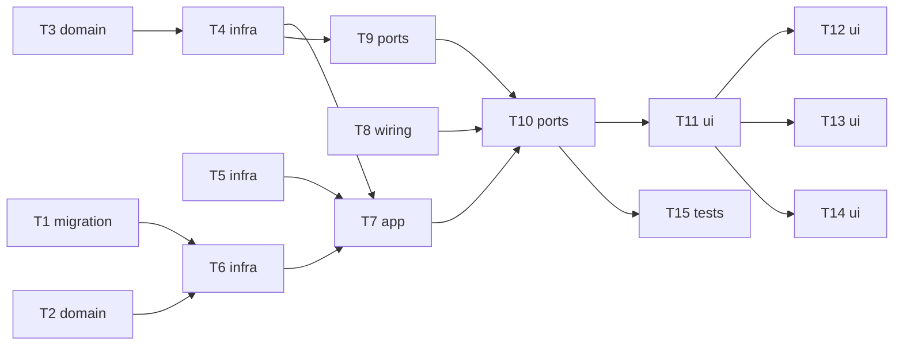

# Epic — text-to-image-openrouter

> **Spec:** [spec.md](../spec.md) · **Design:** [sad.md](../sad.md) · **Data model:** [data-model.md](../data-model.md) · **API:** [openapi.yaml](../contracts/openapi.yaml) · **Screens:** [screens.md](../screens.md) · **ADRs:** [adr/](../adr/)

## Goal

Ship the first vertical slice: text→image through OpenRouter, every successful generation saved locally all-or-nothing with full metadata, and a gallery + detail view to browse it (spec §2). The provider sits behind the `ImageProvider` port so roadmap step 4 is an addition.

## Scope

- **In:** migration `0002_create_generations`; `providers` (port, OpenRouter adapter, image sniffing, routes), `storage` (file store), `generations` (domain, repo, jobs, service, routes), request guard; web client, router, SCR-01..03.
- **Out:** input images (step 3), Vercel (step 4), comment/tag/delete (step 5), re-run/reuse (step 6), failed-generation history, search/filters (spec §3).

## Task map

## Tasks

See [tracker.md](./tracker.md) for status. Machine contract: [tasks.json](../tasks.json).

| # | Task | Layer | Blocked by | DoD (short) |
|---|---|---|---|---|
| T1 | [Promote the generations migration into the live tree](./t1-promote-generations-migration.md) | migration | — | migration 0002_create_generations applies and reverts cleanly in an integration test |
| T2 | [Implement generation domain rules: validation, params, cost conversion](./t2-generation-domain-rules.md) | domain | — | unit tests cover prompt/model/n validation against model support and USD→micro-USD convers… |
| T3 | [Detect usable images: media type and dimensions from bytes](./t3-image-sniffing.md) | domain | — | unit tests: PNG/JPEG/WebP(VP8/VP8L/VP8X)/GIF bytes return media type + width/height; empty… |
| T4 | [Define the ImageProvider port and build the OpenRouter adapter](./t4-openrouter-adapter.md) | infra | T3 | adapter unit tests against recorded fixtures: catalog mapping, success with 1..n images, m… |
| T5 | [Build the file store: stage, commit, discard, sweep, recorded reads](./t5-file-store.md) | infra | — | integration tests on a temp data dir: staged files invisible until commit; commit is a syn… |
| T6 | [Write the generations repo: atomic insert, gallery page, detail, recorded path lookup](./t6-generations-repo.md) | infra | T1, T2 | integration tests: insert + read back round-trips every field through zod; page of 24 newe… |
| T7 | [Run generations as a single-slot job and save results atomically](./t7-generation-jobs-service.md) | app | T4, T5, T6 | integration tests with a fake provider: start → running → succeeded with saved generation;… |
| T8 | [Guard every API request by Host, Origin and Fetch Metadata](./t8-request-guard.md) | wiring | — | unit tests over the header matrix + an integration test that a cross-site request to /api/… |
| T9 | [Expose providers and the cached model catalog](./t9-providers-routes.md) | ports | T4 | integration tests via app.request(): providers list shows configured flag; models list map… |
| T10 | [Expose generations, job and file routes and wire the app](./t10-generations-routes-wiring.md) | ports | T7, T8, T9 | integration tests via app.request() with a fixture-backed provider: start 202 → job pollin… |
| T11 | [Add the typed web API client and the two-route router](./t11-web-client-router.md) | ui | T10 | web tests: router renders home at / and detail at /generations/:id, navigate() pushes hist… |
| T12 | [Build the generate panel (SCR-01) in all its states](./t12-generate-panel-ui.md) | ui | T11 | web tests (mocked api): not-configured state; models loading/error+retry; only supported p… |
| T13 | [Build the gallery (SCR-02) with paging and empty state](./t13-gallery-ui.md) | ui | T11 | web tests (mocked api): empty state CTA; tiles show prompt excerpt, provider · model badge… |
| T14 | [Build the generation detail page (SCR-03)](./t14-detail-ui.md) | ui | T11 | web tests (mocked api): all metadata rows; cost «unavailable» never $0; requested vs «2 of… |
| T15 | [Verify the performance and durability NFRs](./t15-nfr-integration-tests.md) | tests | T10 | NFR integration tests pass: gallery page p95 ≤ 300 ms with 1 000 seeded generations; detai… |

## Risks / Hard rules

- The server binds `127.0.0.1` only; API keys never reach the browser, the DB or logs (CLAUDE.md, spec AC-10/AC-11).
- All-or-nothing generation save (CONTEXT.md invariant, ADR-0006); 180 s provider timeout (spec §6).
- Never branch on provider inside `generations` (CLAUDE.md, ADR-0002/0004).
