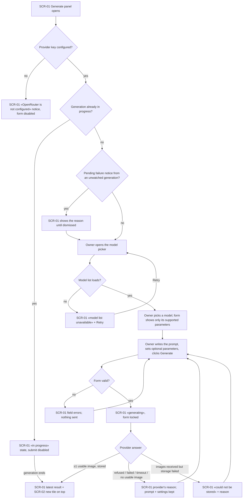
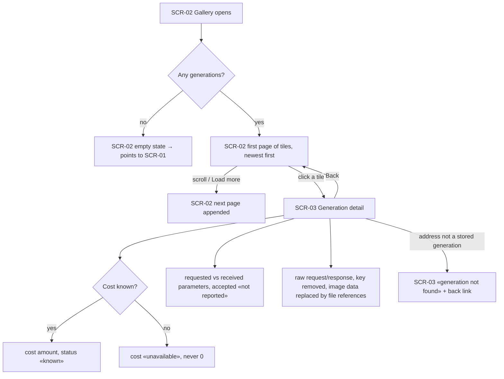

# UX flows — text-to-image-openrouter

> User flows for every UI-touching §4 user story, produced by `ux-flows` (after `clarify`, before
> `design`) and read by `design` (evidence for the target-surface + UI-architecture decisions),
> `sequences` (UI-driven flows align on SCR ids), `screens` (details every inventory row) and
> `plan-tests` (the e2e-through-UI paths). **Always markdown + mermaid `flowchart`**, whatever the
> design tool — this artifact is flow-altitude, not visual design.

## Platform decisions

- **Posture:** desktop-first — per [`design-system.md`](../../design-system.md).
- **Navigation shape:** one page with two areas: the generate panel on the left, the gallery on the right. The detail view is its own page with an address (it can be bookmarked and reloaded), plus a back link to the gallery.
- **Modality:** the generate form is a single inline form, not a wizard or a dialog. The result of the latest generation shows inside the generate panel.
- **In-progress state is app-wide:** any open generate panel reflects the one generation in progress (AC-17), including after a reload.

## Screen inventory

| ID | Screen | Purpose | Entry | Exit |
|---|---|---|---|---|
| SCR-01 | Generate panel | Pick a model, write a prompt, set optional parameters, generate; shows in-progress, the latest result, validation and failure notices | app home (left area) | SCR-02 gets the new item; SCR-03 via the latest result's thumbnail |
| SCR-02 | Gallery | Newest-first thumbnails with prompt excerpt, provider + model, created-at; load more; empty state | app home (right area) | SCR-03 on a tile click; SCR-01 from the empty state's call to action |
| SCR-03 | Generation detail | All output images and the full metadata of one generation, incl. cost + status, requested vs received parameters, raw request/response | a gallery tile or the latest result; a direct address | back to SCR-02 |

## Flows

### Flow: US-01 / US-05 — Generate an image from text (and understand a failure)

The Owner opens the app. Without a configured key, the generate panel says OpenRouter is not configured and how to fix it, and only the gallery stays usable. If another generation is already in progress (for example, started before a reload), the panel shows «in progress» and blocks submitting until it finishes. A failure from a generation nobody was watching is shown until the Owner dismisses it. Otherwise the Owner opens the model picker. If the list can't load, the panel says so and offers Retry. Picking a model limits the optional parameters to those the model supports. On Generate, invalid fields are flagged in place and nothing is sent. A valid submit locks the form in «generating». Success shows the latest result and puts a new tile at the top of the gallery. A provider refusal, failure, timeout or answer without a usable image shows the provider's reason and keeps the prompt and settings. A storage failure says the result could not be stored and why.

### Flow: US-03 / US-04 — Browse the gallery and inspect a generation

The gallery opens newest first. With no generations it shows an empty state that points to the generate panel. Otherwise it shows the first page of tiles and appends older pages on demand. Each tile shows the prompt excerpt, provider + model and created-at. A tile opens the detail page: all output images, provider and model, prompt, created-at, duration, and cost with its status («unavailable» when the provider stated no price). It also shows the requested parameters next to what came back (image count, dimensions; accepted parameters «not reported») and the raw exchange with the key removed and image data replaced by references. A detail address that is not a stored generation shows «not found».

## AC coverage

| AC | Shown by | Notes |
|---|---|---|
| AC-01 | Flow US-01 → G → OK | |
| AC-02 | Flow US-04 → D (+ CK/CU, PR, RW) | |
| AC-03 | Flow US-01 → M → S | parameters limited to the model's supported ones |
| AC-04 | Flow US-03 → T → T2 | |
| AC-05 | Flow US-01 → V → VE | |
| AC-06 | Flow US-01 → R → ER | |
| AC-07 | Flow US-04 → C → CU | |
| AC-08 | Flow US-01 → R → SE | |
| AC-09 | Flow US-04 → PR | |
| AC-10 | Flow US-04 → RW | key removed; also invisible everywhere else (no UI node; verified by tests) |
| AC-11 | N/A | no UI: another device can't reach the app at all |
| AC-12 | Flow US-04 → NF (for detail addresses) | file-level refusal has no UI; verified by tests |
| AC-13 | Flow US-01 → K → NK | |
| AC-14 | Flow US-01 → L → LE | |
| AC-15 | Flow US-03 → E → EM | |
| AC-16 | Flow US-04 → PR | «2 of 4 received» |
| AC-17 | Flow US-01 → P → IP; N → FN | |
| AC-18 | Flow US-03 → T (tile), Flow US-04 → D | provider shown everywhere |
| AC-19 | N/A | no UI: a foreign page is refused without any screen |
