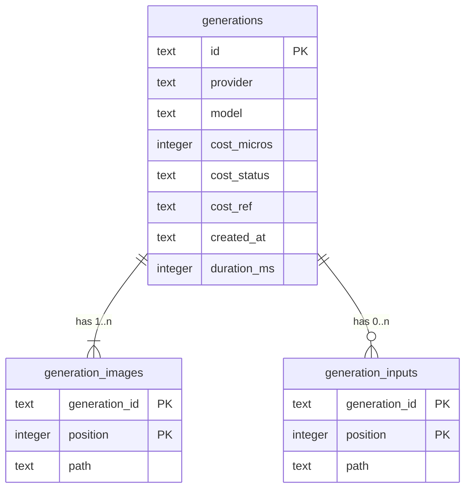

# Data model — vercel-ai-gateway

## ER diagram

## Entities

Aggregate: **Generation** (unchanged root). One new column; `cost_status` now also takes `pending` (the CHECK from `0002` already allows it, with `cost_micros` NULL).

### `generations` (delta)

| Column | Type | Constraints | Notes |
|---|---|---|---|
| `provider` | TEXT | NOT NULL | now `openrouter` or `vercel` (zod `ProviderId`) |
| `cost_status` | TEXT | existing CHECK known/pending/unavailable; known ⇔ `cost_micros` NOT NULL | `pending` written when the answer has no price but a cost reference (ADR-0013) |
| `cost_ref` | TEXT | NULL | **new** — provider's generation reference for the later price lookup; kept after resolution for audit |

**Access patterns:**
- boot resume: `SELECT … WHERE cost_status = 'pending'` → partial index `generations_cost_pending`;
- resolve: `UPDATE generations SET cost_status = ?, cost_micros = ? WHERE id = ? AND cost_status = 'pending'` → PK. The guard on `pending` makes a late or duplicate lookup a no-op.

The answer time for the 10-minute deadline is derived: `created_at + duration_ms` (no new column).

## Indexes

| Index | Columns | Query it serves |
|---|---|---|
| `generations_cost_pending` (partial, `WHERE cost_status = 'pending'`) | `id` | resolver boot resume (sad §6 «Resolve a pending cost») |
| PK `generations` | `id` | resolve update by id |

## Test fixtures

- `seedGeneration(db, dataDir, { costStatus: "pending", costMicros: null, costRef: "gen_…" , provider: "vercel" })` — extended helper; no PII.
