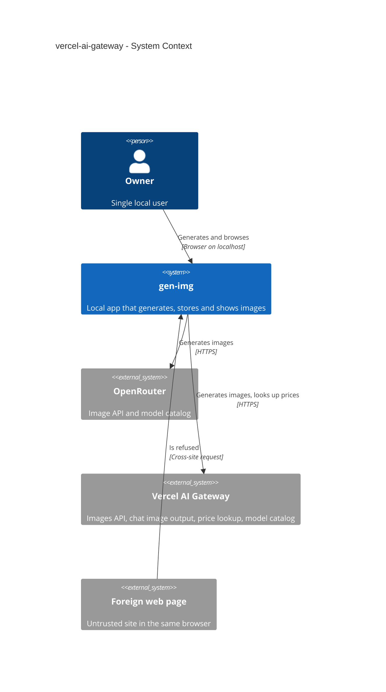
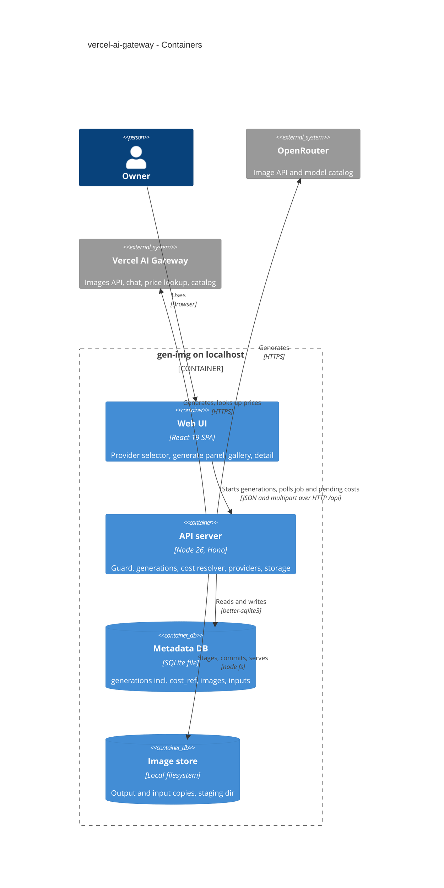
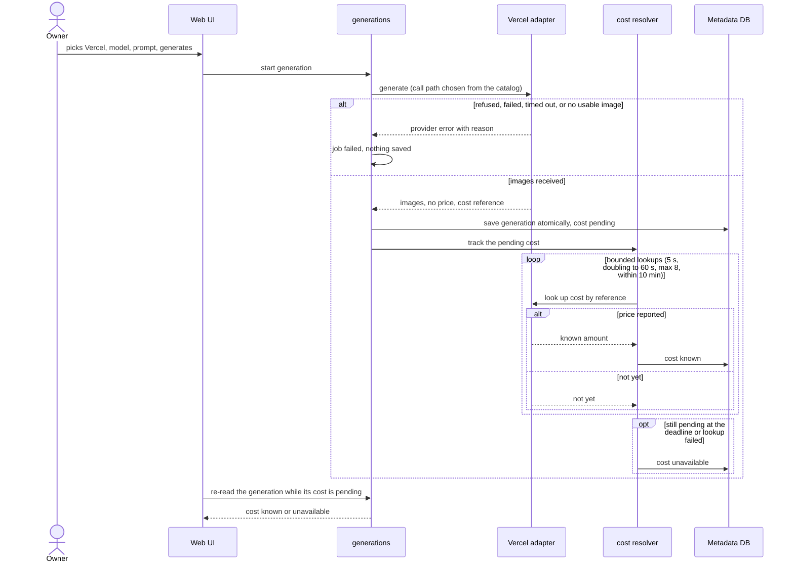
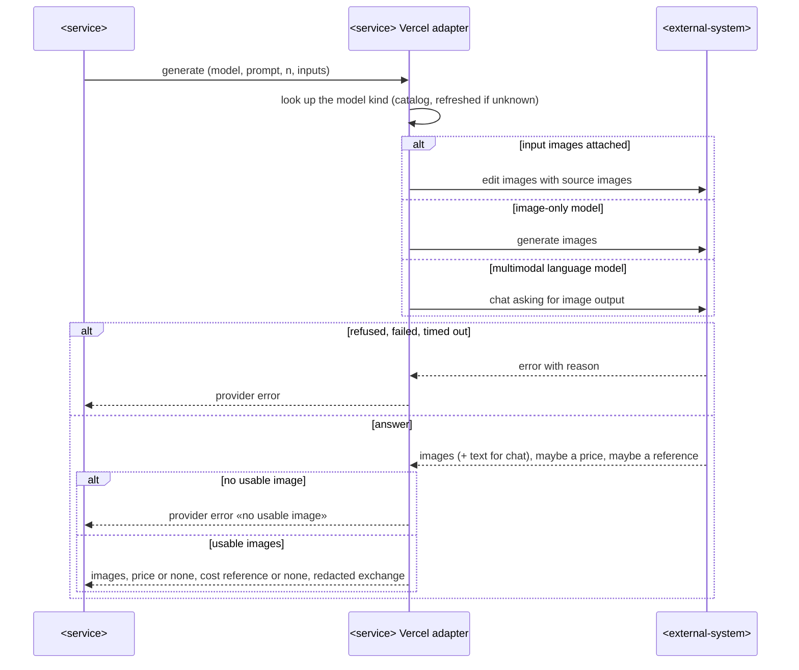
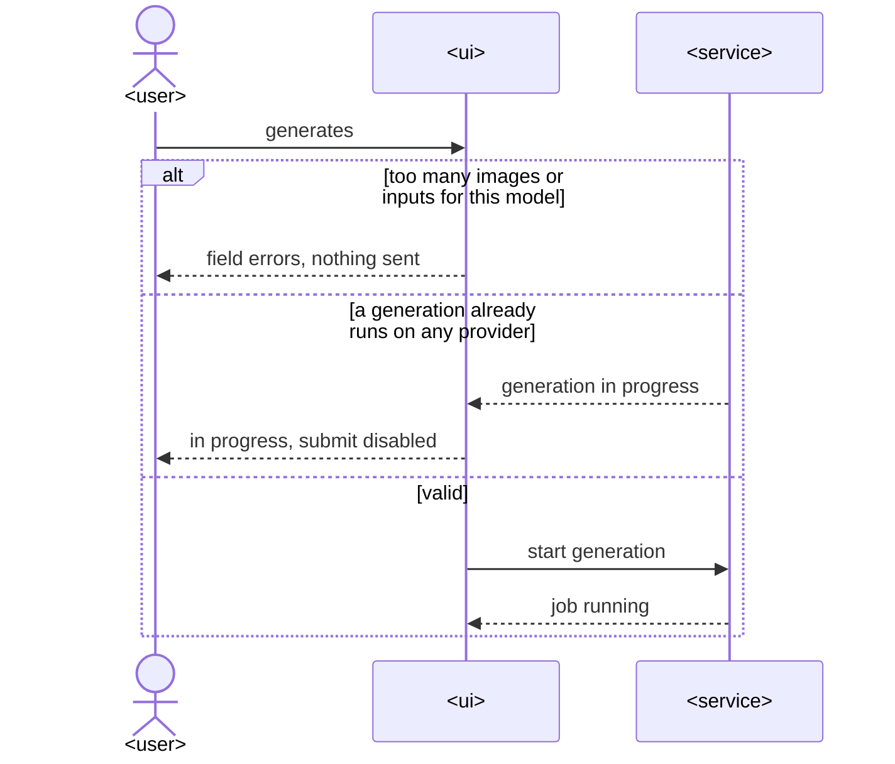
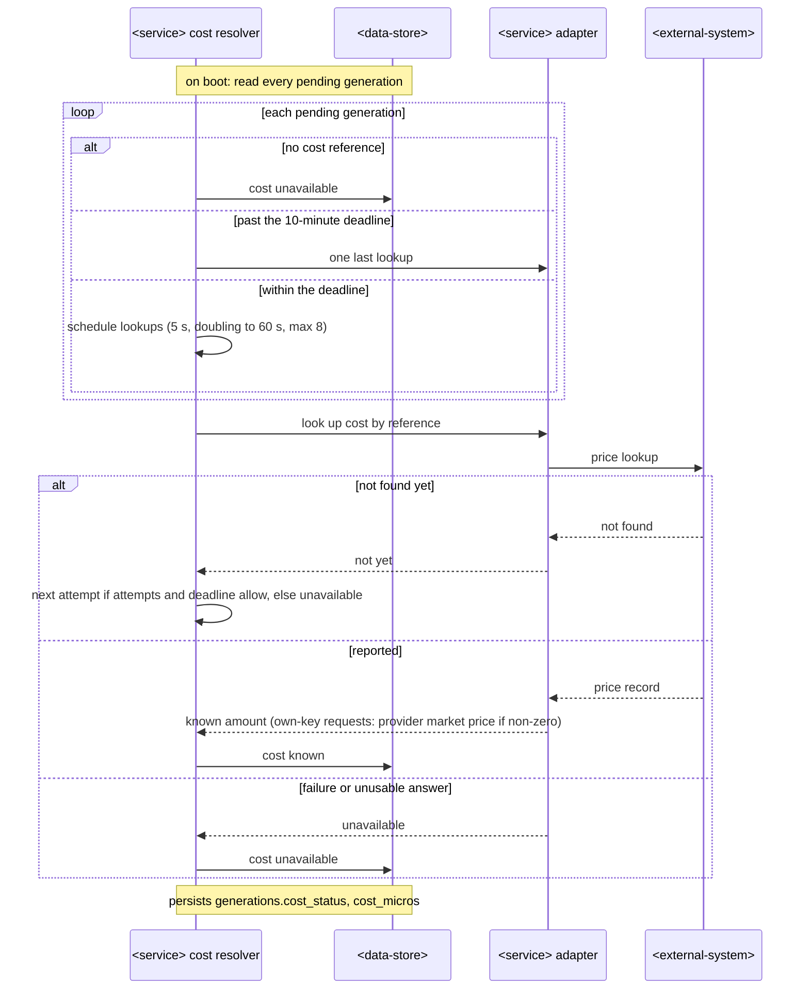

# Software Architecture Document — vercel-ai-gateway

## 1. Introduction and goals

**Intent.** Add Vercel AI Gateway as the second provider (spec §2): the Owner picks it in the generate panel, any of its image-producing models works through the same form, and its generations land in the same gallery with the same guarantees. Its price usually arrives after the answer, so a generation can be saved with cost `pending` and is resolved later by gen-img itself.

**Top-3 quality goals (1-liners; full scenarios in §10):**
1. **Honest cost** — no generation shows $0 for an unknown price, and none stays `pending` forever (spec AC-05…AC-07, §6).
2. **Provider isolation** — every Vercel difference lives in its adapter; `generations`, the gallery and OpenRouter behaviour are unchanged (spec AC-15; ADR-0002/0004).
3. **Secret containment** — the second key is as contained as the first, including the new background lookups (spec AC-13/AC-14).

**Stakeholders.**

| Role | Interest | Sign-off owner? |
|---|---|---|
| Owner | generates through both accounts, tracks spend | Yes (solo project: also Tech Lead) |
| Tech Lead | SAD approval | Yes |

**Decision overrides (¶4).**
- Decision override: no independent critic could run in this session (pipeline executed by a forked agent without subagents) — the design critic pass was done in-thread; the owner runs the independent review after ship.

## 2. Constraints

**Technical.**
- TypeScript 5 / Node 26, Hono 4, React 19 + Vite 8, Tailwind v4 + shadcn/ui, TanStack Query 5, SQLite via `better-sqlite3` 13 — [ADR-0001](../../adr/0001-use-typescript-node-hono-react-stack.md), [ADR-0003](../../adr/0003-store-metadata-in-sqlite-and-images-on-disk.md).
- Provider behind the `ImageProvider` port, plain `fetch`, no vendor SDK — [ADR-0002](../../adr/0002-organize-as-modular-monolith-with-provider-port.md), [ADR-0004](../text-to-image-openrouter/adr/0004-return-a-normalized-generation-result-from-the-image-provider-port.md).
- Single-slot job, atomic save, request guard, redacted exchange, multipart inputs — ADR-0005…0011 still bind.
- Vercel AI Gateway REST (`https://ai-gateway.vercel.sh/v1`, Bearer key): `POST /images/generations`, `POST /images/edits` (JSON `images[].image_url` data URLs), `POST /chat/completions` with `modalities`, `GET /generation?id=` (asynchronous, «Usage event not found» for a few seconds), public `GET /models` (`type`, `tags`, `modalities`, `pricing`) — Vercel docs, accessed 2026-10-18.
- No real Vercel call is possible in this step (no key; owner rule) — D3–D6 stay open (spec §8).

**Organisational.** Solo maintainer; local gate `pnpm typecheck && pnpm lint && pnpm test`; no CI.

**Conventions.** [`CLAUDE.md`](../../../CLAUDE.md) + [architecture-map](../../architecture-map.md): module routes, `AppError` envelope, zod-parsed rows, `cost_micros` + `cost_status`, paired migrations, shared zod schemas.

**Regulatory / external.** N/A — personal local tool.

## 3. Context and scope

gen-img now talks to two external providers with two server-only keys. The trust boundary is unchanged: the server on `127.0.0.1`, reachable only by gen-img's own pages. New outbound traffic: generation calls and background price lookups to Vercel.

<!-- brownfield: steps 2–3 shipped — providers (port, OpenRouter adapter, catalog cache), generations (single-slot job, atomic save, inputs), storage, request guard; read from the shipped SADs + code at 4c6eb29 -->

**External systems (in / out):**

| Actor or system | Type | Interaction |
|---|---|---|
| Owner | Person | picks provider + model, generates, browses |
| OpenRouter | System (external) | unchanged |
| Vercel AI Gateway | System (external) | model catalog, image generation/editing, chat with image output, price lookup |
| Foreign web page | System (external, untrusted) | refused by the request guard |

**C4 Context (L1):**



## 4. Solution strategy

**Target surface:** `[backend-service, web-frontend]` — unchanged surfaces; the web UI gains a provider selector and self-refreshing pending costs (ux-flows SCR-01..03). UI architecture unchanged (SPA + ADR-0009 router).

**Top strategic choices (the seeds for ADRs):**
1. **One Vercel adapter that picks the call path per model from the gateway catalog** — image-only models → images API (generations, or edits when inputs are attached); multimodal language models → chat with image output, or edits when inputs are attached (D5 default). The Owner sees one provider → [ADR-0012](./adr/0012-pick-the-vercel-call-path-per-model-inside-one-adapter.md).
2. **Deferred cost as an optional port capability + a DB-driven background resolver** — an adapter may return a provider cost reference instead of a price; `generations` saves with `pending` and a `cost-sync` resolver asks the adapter later, bounded in time and attempts, resumed on boot → [ADR-0013](./adr/0013-resolve-deferred-costs-with-a-bounded-db-driven-background-lookup.md).
3. **Offer only documented parameters** — Vercel models get no seed/aspect-ratio controls (D4); images per request and input images follow the catalog; everything else stays behind the existing domain checks (inline, no ADR: reversible, one module).

## 5. Building block view

Same modular monolith; the new provider is a new adapter; `generations` gains a provider-agnostic cost resolver.

```
src/shared/
├── providers.ts             ProviderId += "vercel"
└── generations.ts           (unchanged schemas; costStatus "pending" now written)
src/server/modules/providers/
├── port.ts                  GenerationResult.costRef?; ImageProvider.lookupCost?(ref, signal) → CostLookup
├── vercel.ts                Vercel adapter: catalog (type/tags/modalities), 3 call paths, redaction, lookupCost
├── registry.ts              + Vercel adapter (AI_GATEWAY_API_KEY)
└── catalog.ts               unchanged (per-provider cache)
src/server/modules/generations/
├── domain.ts                costFromResult(costUsd, costRef) → known | pending | unavailable
├── cost-sync.ts             bounded lookup schedule per pending generation; resume on boot (ADR-0013)
├── repo.ts                  cost_ref insert; listPendingCosts(); resolveCost(id, micros|null)
└── service.ts               tracks pending generations after save
migrations/0005_add_generation_cost_ref.{up,down}.sql
src/web/
├── features/generate/       provider selector; model list + form per provider; job slot shared
└── features/gallery/        «cost pending» tile badge; detail + gallery refetch while pending; provider names
```

**C4 Container (L2):**



## 6. Runtime view

**Critical flow 1: generate through Vercel with a deferred cost** — seeded here; `sequences` adds the remaining flows.



### Choose the provider and load its models (US-01)

```mermaid
sequenceDiagram
    actor Owner as <user>
    participant UI as <ui>
    participant Svc as <service>
    participant Ext as <external-system>
    UI->>Svc: get providers with configured state
    Svc-->>UI: OpenRouter, Vercel AI Gateway (configured or not)
    Owner->>UI: selects a provider
    alt provider not configured
        UI-->>Owner: how to configure it; other provider and gallery still usable
    else configured
        UI->>Svc: get image models of the provider
        alt cached within 10 min
            Svc-->>UI: models
        else fetch catalog
            Svc->>Ext: list models
            alt catalog unavailable
                Ext-->>Svc: failure
                Svc-->>UI: provider error
                UI-->>Owner: model list unavailable + Retry
            else ok
                Ext-->>Svc: catalog
                Svc-->>UI: image-producing models with what each accepts
                UI-->>Owner: form offers only accepted parameters and inputs
            end
        end
    end
```

Covers AC-03, AC-10. The selector lists both providers. An unconfigured one explains itself. The model list is per provider, cached for 10 minutes, and the form follows the model.

### Vercel call path per model (US-02, US-03)



Covers AC-01, AC-02, AC-04, AC-08. With inputs attached, every model kind goes through the edit path (D5 default). Otherwise the catalog decides between the images API and chat. All answers normalize to the same result. Chat text is kept only in the stored exchange.

### Validate a Vercel request (US-02)



Covers AC-09, AC-11. The domain checks are the same as for OpenRouter and run against the Vercel model's limits. There is one job slot across both providers.

### Resolve a pending cost, incl. restart (US-04)



Covers AC-05, AC-06, AC-07. The resolver is driven by DB state. A restart resumes young pending costs and finalizes overdue ones. Every exit is `known` or `unavailable`.

### Browse mixed providers with pending costs (US-04, US-05)

```mermaid
sequenceDiagram
    actor Owner as <user>
    participant UI as <ui>
    participant Svc as <service>
    participant DB as <data-store>
    Owner->>UI: opens the gallery or a detail view
    UI->>Svc: get page or generation
    Svc->>DB: read generations of both providers, newest first
    Svc-->>UI: items with provider and cost status
    loop while a visible cost is pending (detail 5 s, gallery 10 s)
        UI->>Svc: re-read
        Svc-->>UI: cost known or unavailable or still pending
    end
    UI-->>Owner: provider named everywhere; pending shown as pending, never $0
```

Covers AC-05, AC-12.

### AC coverage (runtime view)

| US / AC | Shown by |
|---|---|
| US-01 | Choose the provider; Validate |
| US-02 | Critical flow 1; Vercel call path; Validate |
| US-03 | Vercel call path (inputs → edit) |
| US-04 | Critical flow 1; Resolve a pending cost; Browse |
| US-05 | Browse |
| US-06 | AC-13/14 notes below |
| AC-01 | Vercel call path → image-only |
| AC-02 | Vercel call path → multimodal language model |
| AC-03 | Choose the provider → ok |
| AC-04 | Vercel call path → inputs attached |
| AC-05 | Critical flow 1 loop; Browse loop |
| AC-06 | Resolve a pending cost → on boot |
| AC-07 | Resolve a pending cost → failure / not yet past limits |
| AC-08 | Vercel call path → refused / no usable image; Critical flow 1 failure branch |
| AC-09 | Validate → too many images or inputs |
| AC-10 | Choose the provider → not configured |
| AC-11 | Validate → generation already runs |
| AC-12 | Browse |
| AC-13 | Non-runtime: the key is only in the adapter's outgoing headers; redaction before storing (ADR-0008); lookups are server-side only |
| AC-14 | Non-runtime: the existing request guard (ADR-0007) runs before every route |
| AC-15 | Non-runtime: OpenRouter adapter and its flows unchanged (text-to-image-openrouter sad §6) |

## 7. Deployment view

<!-- N/A: same single local process; adds AI_GATEWAY_API_KEY (already in .env.example) and an in-process background resolver. -->

## 8. Crosscutting concepts

| Concept | Convention | Where defined |
|---|---|---|
| Provider selection | the Owner picks the provider explicitly; no automatic fallback | spec §3 |
| Call-path choice | adapter-internal, from the gateway catalog: `type: image` → images API; `type: language` + tag `image-generation` → chat (`modalities: ["text","image"]`); any inputs → `/images/edits` with `images[].image_url` data URLs | ADR-0012 |
| Parameters offered | Vercel: `n` ≤ 4 for image-only, 1 for chat models; inputs where catalog input modalities include image (≤ 8); never seed / aspect ratio | spec AC-03, D4 |
| Money | `costStatus`: answer states a price → `known`; else cost reference present → `pending`; else `unavailable`. Lookup: non-BYOK → `total_cost`; BYOK → `upstream_inference_cost` if > 0 (D3), else `unavailable` | ADR-0013 |
| Pending lifecycle | lookups at +5 s, doubling to 60 s, ≤ 8 attempts — the 8th at the deadline answer + 10 min; boot resumes, overdue rows get one last lookup | ADR-0013 |
| Raw exchange | Vercel: `data[].b64_json` and chat `message.images[].image_url.url` → `{"$image": N}`; edit inputs → `{"$input": N}`; no `Authorization` | ADR-0008 |
| Error handling | gateway errors `{error:{message,type}}` → `PROVIDER_ERROR` with `details.provider: "vercel"`, `upstreamStatus` | `lib/errors.ts` |
| UI polling | detail view refetches every 5 s while its cost is `pending`; gallery every 10 s while any visible tile is `pending` | spec §6 |
| Logging | lookups never log the key; failures logged with generation id only | here |

## 9. Architecture decisions

| # | Title | Status | Section |
|---|---|---|---|
| 0012 | Pick the Vercel call path per model inside one adapter | Accepted | §4 |
| 0013 | Resolve deferred costs with a bounded, DB-driven background lookup | Accepted | §4 |

ADR files live under `docs/features/vercel-ai-gateway/adr/NNNN-<title>.md` (numbering continues the repo series).

## 10. Quality requirements

**QG-1. Honest cost**
- **When:** a Vercel answer carries no price.
- **Then:** saved `pending`; «≥ 95 % of pending costs reach «known» or «unavailable» within 10 min 30 s of the generation»; «≤ 8 lookups, first one ≥ 5 s after the answer, backoff doubling to at most 60 s» (spec §6); boot resumes (AC-06).
- **How verify:** unit tests of the schedule with a fake clock; integration tests of resolver + repo; boot-resume test.

**QG-2. Provider isolation**
- **When:** OpenRouter generations run after this change.
- **Then:** same request, parameters and cost handling (AC-15); `generations` has no provider branch.
- **How verify:** the existing OpenRouter suites stay green unchanged; a grep-level check in review that `generations/` never mentions a provider id.

**QG-3. Secret containment**
- **When:** a Vercel generation or price lookup runs.
- **Then:** the key is in no stored row, response or log; «0 bytes of embedded image payload (outputs and inputs) in the stored provider exchange, for every Vercel call path» (spec §6).
- **How verify:** integration tests scanning stored rows for the key and base64 for all three call paths.

## 11. Risks and technical debt

| Risk / debt | Severity | Mitigation | Owner |
|---|---|---|---|
| Undocumented response details (generation reference on the images API, cost fields) differ in reality (D6) | Medium | tolerant parsing; no reference → `unavailable`, never stuck; fixtures replaced after the first real call | dmytro.hopko |
| BYOK price semantics (D3) | Low | default = upstream inference cost; single function to change | dmytro.hopko |
| Seed / aspect ratio unsupported in gen-img for Vercel (D4) | Low | documented non-goal; enabling is a catalog-mapping change in the adapter | dmytro.hopko |
| Chat-path models receive inputs via edits (D5) | Low | one routing rule in the adapter | dmytro.hopko |
| Open question: D3–D6 | Open question | resolve on the first real Vercel call | dmytro.hopko |

**Accepted debt (acceptable in v1, plan to fix later):**
- Cost resolver timers are in-process; a restart reschedules from DB state (accepted: AC-06).
- Vercel catalog has no per-model parameter metadata for images, so gen-img offers a conservative subset.

## 12. Glossary

| Term | Meaning |
|---|---|
| Cost lookup | asking the provider later for a price its answer did not state (CONTEXT.md) |
| Cost reference | the provider's id for a generation, stored to look up its price later |
| Call path | one of the gateway's ways to produce images: images API (generate/edit) or chat with image output |
| Pending cost | cost status `pending`: a cost reference exists and the deadline has not passed |
