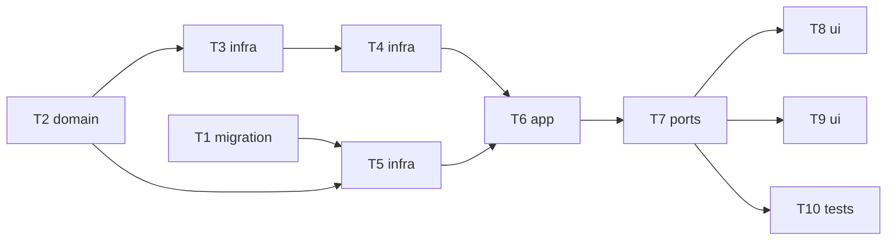

# Epic — vercel-ai-gateway

> **Spec:** [spec.md](../spec.md) · **Design:** [sad.md](../sad.md) · **Data model:** [data-model.md](../data-model.md) · **API:** [openapi.yaml](../contracts/openapi.yaml) · **Screens:** [screens.md](../screens.md) · **ADRs:** [adr/](../adr/)

## Goal

Add Vercel AI Gateway as a second provider the Owner picks in the generate panel — image-only models, multimodal language models and input images through one adapter — with honest deferred costs (`pending` → `known`/`unavailable`) resolved by a bounded background lookup (spec §2).

## Scope

- **In:** migration `0005_add_generation_cost_ref`; port cost reference + lookup capability; Vercel adapter (catalog, 3 call paths, redaction, price lookup); repo pending-cost queries; cost resolver + boot resume; provider selector; pending-cost UI; regression + NFR tests.
- **Out:** seed / aspect ratio for Vercel (D4), price estimate before generating (step 7), streaming, automatic provider fallback (spec §3).

## Task map

## Tasks

See [tracker.md](./tracker.md) for status. Machine contract: [tasks.json](../tasks.json).

| # | Task | Layer | Blocked by | DoD (short) |
|---|---|---|---|---|
| T1 | [Promote the cost_ref migration](./t1-promote-cost-ref-migration.md) | migration | — | migration 0005_add_generation_cost_ref applies and reverts cleanly; the pending lookup use… |
| T2 | [Add the provider id, the port's cost reference and the pending-cost rule](./t2-port-and-domain-cost.md) | domain | — | unit tests: costFromResult → known for a stated price, pending with a reference and no pri… |
| T3 | [Build the Vercel adapter: catalog and the three call paths](./t3-vercel-adapter-generate.md) | infra | T2 | adapter unit tests on fixtures: catalog → image-producing models only with n/inputs per ki… |
| T4 | [Look up Vercel prices and register the adapter](./t4-vercel-adapter-lookup.md) | infra | T3 | unit tests: lookup → known (total_cost), BYOK → upstream cost or unavailable, «not found» … |
| T5 | [Store cost references and resolve pending costs in the repo](./t5-repo-pending-costs.md) | infra | T1, T2 | integration tests: insert keeps cost_ref; listPendingCosts returns provider, ref and answe… |
| T6 | [Resolve pending costs in the background and resume them on boot](./t6-cost-resolver.md) | app | T4, T5 | tests with a fake clock/timers: schedule 5 s doubling to 60 s, ≤ 8 attempts, deadline answ… |
| T7 | [Run the Vercel flow end to end through the API](./t7-vercel-routes-flow.md) | ports | T6 | integration tests via app.request(): providers list shows both; Vercel models list; start … |
| T8 | [Add the provider selector to the generate panel](./t8-provider-selector-ui.md) | ui | T7 | web tests (mocked api): first configured provider preselected; switching loads that provid… |
| T9 | [Show pending costs that update themselves, and provider names](./t9-pending-cost-ui.md) | ui | T7 | web tests: detail shows «pending» (never $) and refetches every 5 s until resolved; galler… |
| T10 | [Prove OpenRouter is unchanged and the NFRs hold with two providers](./t10-regression-and-nfr.md) | tests | T7 | tests: OpenRouter request body and cost handling identical to before (fixture comparison);… |

## Risks / Hard rules

- No authenticated provider calls during development; the Vercel adapter is tested on fixtures built from the public docs (D3–D6 open).
- Never branch on provider inside `generations` (ADR-0002/0004/0012); the cost resolver only calls the optional port capability.
- A cost is never shown as $0 when unknown and never stays `pending` past its deadline (spec AC-05…AC-07).
