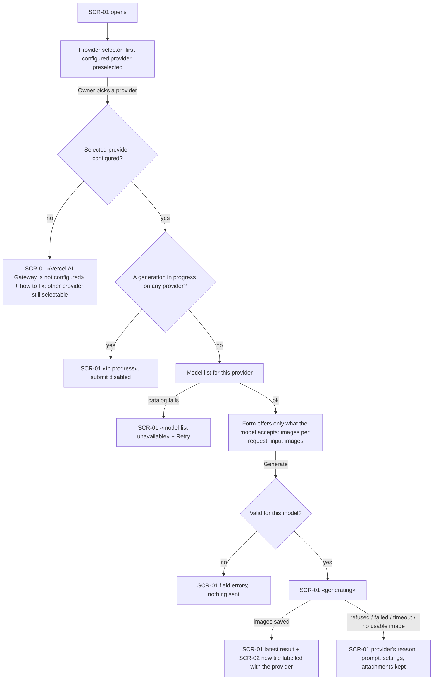
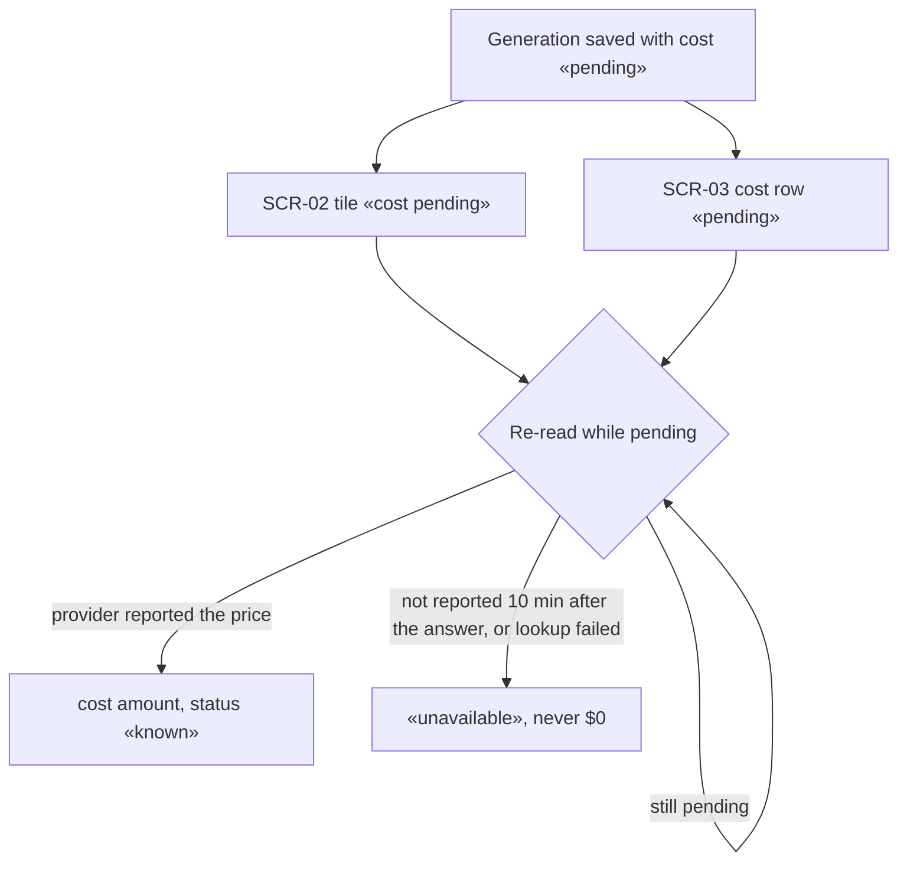

# UX flows — vercel-ai-gateway

> User flows for every UI-touching §4 user story, produced by `ux-flows` (after `clarify`, before
> `design`) and read by `design`, `sequences`, `screens` and `plan-tests`. Always markdown + mermaid
> `flowchart`, whatever the design tool — this artifact is flow-altitude, not visual design.

## Platform decisions

- **Posture:** desktop-first — per [`design-system.md`](../../design-system.md).
- **Navigation shape:** unchanged — home (generate panel + gallery) and the detail page ([text-to-image-openrouter ux-flows](../text-to-image-openrouter/ux-flows.md)).
- **Provider choice is the first field of the generate panel.** It defaults to the first configured provider (OpenRouter when both are), and is remembered for the browser session only.
- **Pending cost refreshes itself:** any visible «pending» cost (tile or detail) is re-read periodically until it resolves.

## Screen inventory

| ID | Screen | Purpose | Entry | Exit |
|---|---|---|---|---|
| SCR-01 | Generate panel (extended) | + provider selector; model list, parameters and input area follow the selected provider | app home | SCR-02 new tile; SCR-03 via the latest result |
| SCR-02 | Gallery (extended) | tiles from both providers; a tile shows «cost pending» while the cost is pending | app home | SCR-03 |
| SCR-03 | Generation detail (extended) | provider name; cost row shows «pending» and updates in place | gallery tile / latest result / address | SCR-02 |

## Flows

### Flow: US-01 / US-02 / US-03 — Choose the provider and generate

The panel opens with the first configured provider selected. Picking an unconfigured provider shows how to configure it, and the other provider stays usable. While any generation runs, whichever provider it uses, the panel shows «in progress» and cannot submit. Otherwise the model list for the chosen provider loads; switching provider reloads it, and the existing step-3 behaviour marks attachments the new model can't take. The form offers only what the model accepts: no seed or aspect ratio for Vercel models, 1 image for multimodal language models, up to 4 for image-only models, and input images only where accepted. Invalid fields are flagged and nothing is sent. Success adds a tile labelled with the provider. Failure shows the provider's reason and keeps everything.

### Flow: US-04 / US-05 — See a cost that arrives later

A saved Vercel generation whose price isn't in the answer shows «pending» on its tile and detail view. Both re-read it on their own: the cost becomes the amount with status «known» when the provider reports it. It becomes «unavailable» when the provider hasn't reported it 10 minutes after the answer, or when the lookup fails — never $0 and never an error. Tiles and the detail view always name the provider.

## AC coverage

| AC | Shown by | Notes |
|---|---|---|
| AC-01 | Flow US-01 → G → OK | |
| AC-02 | Flow US-01 → G → OK | multimodal LLM model, same flow |
| AC-03 | Flow US-01 → M → F | |
| AC-04 | Flow US-01 → F (input images) → OK | |
| AC-05 | Flow US-04 → W → K / U | |
| AC-06 | N/A | no UI: boot-time resume; result visible through Flow US-04 |
| AC-07 | Flow US-04 → W → U | |
| AC-08 | Flow US-01 → G → ER | |
| AC-09 | Flow US-01 → V → VE | |
| AC-10 | Flow US-01 → C → NC | |
| AC-11 | Flow US-01 → R → IP | |
| AC-12 | Flow US-04 → T / D (provider shown) | |
| AC-13 | N/A | no UI: key never sent to the browser; verified by tests |
| AC-14 | N/A | no UI: a foreign page is refused without a screen |
| AC-15 | Flow US-01 with OpenRouter selected | regression — unchanged behaviour |
