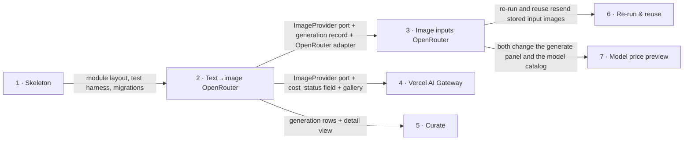

# Roadmap — gen-img

> **A decomposition, not a promise.** The overall idea broken into incremental steps: what each
> step is, where it comes from, how big it is — or that nobody has looked at it yet — and in which
> order, and parallel lanes, we walk them. **No dates** (except shipped history), **no scores** —
> order is the prioritization. The *solution* for any step lives in its `docs/features/<slug>/`
> spec, not here.

## Destination

The single owner, on one machine, generates images from text and/or input images through both OpenRouter and Vercel AI Gateway, and every result lives in a local gallery with enough metadata to re-run it, switch its model, or feed it into the next generation.

## Steps

| # | Step | Source | Size | Status |
|---|---|---|:---:|---|
| 1 | Project skeleton — modules, test harness, SQLite + migration runner, conventions doc (`/sdd:scaffold`) | architecture-map.md §Module inventory | S | idea |
| 2 | Text→image via OpenRouter, saved locally and browsable — generate form, `ImageProvider` port + OpenRouter adapter, image files + full metadata (prompt, model, params, cost with status, created at, duration, raw request/response), gallery + detail view | idea-brief.md §7 Recommendation | M | shipped → [`features/text-to-image-openrouter`](./features/text-to-image-openrouter/spec.md) |
| 3 | Image inputs via OpenRouter — img→img and img+text→img: attach input images, store their copies, show them on the generation's detail view | idea-brief.md §2 Problem | S | spec'd → [`features/image-inputs-openrouter`](./features/image-inputs-openrouter/spec.md) |
| 4 | Vercel AI Gateway — image-only models (`/v1/images/generations`, `/v1/images/edits`) and multimodal LLMs (chat `modalities`), with async cost lookup (`pending → known / unavailable`) | idea-brief.md §6 Risks | M | idea |
| 5 | Curate the gallery — add a comment, tag, delete a generation | idea-brief.md §7 Recommendation | S | idea |
| 6 | Re-run & reuse — re-run with the same inputs (same or another model) via a pre-filled form, and use an output as the next input in one click with parent→child lineage | idea-brief.md §7 Recommendation | S | idea |
| 7 | Model price preview — show each model's price in the model picker and a pre-run estimate («≈ $0.04 for 2 images»); exact for per-image pricing, approximate for per-token. Source: public `GET /api/v1/images/models/{author}/{slug}/endpoints` → `pricing[]` (`billable`, `unit`, `cost_usd`, `variant`), no key needed (checked 2026-10-18) | owner request 2026-10-18 | S | idea |

## Not yet specified

Nothing is in fog right now: every step's question can be stated precisely. The remaining
unknowns are lookups or prototypes, listed under [Open decisions](#open-decisions).

| Area | What we'd have to learn | Blocks | How it gets sharpened |
|---|---|:---:|---|
| — | — | — | — |

## Out of scope

- Multiple users, accounts, cross-device sync — the product is «me, one machine» (idea-brief §3, §5).
- Native desktop wrapper in v1 — local web app first (server on localhost + browser UI).
- Gallery search and filters — not chosen for v1; bringing them back is an explicit owner scope change.
- Guaranteed pixel-identical reproduction — «reproduce» means resending the same inputs.

## Open decisions

| # | Question | Type | Owner | Blocks |
|---|---|:---:|:---:|:---:|
| D1 | Does OpenRouter `POST /api/v1/images` return a generation id? Docs say no (fact-check 2026-10-18); confirm on the first real call — the raw response is stored as received. | prototype | human | — |
| D2 | ~~Which design canon does the UI follow?~~ Resolved 2026-10-18 → [`design-system.md`](./design-system.md) (code mode, desktop-first). | task | human | — |
| D3 | How is cost obtained for Vercel BYOK requests, where `GET /v1/generation?id=` excludes the request cost? | prototype | human | 4 |
| D4 | Does Vercel `/v1/images/generations` accept or forward `seed`? The AI SDK `generateImage` has a top-level `seed` ([ai-sdk.dev](https://ai-sdk.dev/docs/reference/ai-sdk-core/generate-image)), but the gateway REST docs never mention it. | prototype | human | 4 |
| D5 | Does Vercel's chat `modalities` path accept input images? Its docs only show editing through `/v1/images/edits` (`images: [{image_url}]`, Gemini image models included) ([vercel.com](https://vercel.com/docs/ai-gateway/modalities/image-generation/openai)). Should img→img go through the edits endpoint only? | prototype | human | 4 |

## Decisions so far

- Stack: TypeScript / Node 26 / Hono / React 19 + Vite → [`ADR-0001`](./adr/0001-use-typescript-node-hono-react-stack.md)
- Modular monolith; providers sit behind one `ImageProvider` port → [`ADR-0002`](./adr/0002-organize-as-modular-monolith-with-provider-port.md)
- Metadata in SQLite, images on disk under the data dir → [`ADR-0003`](./adr/0003-store-metadata-in-sqlite-and-images-on-disk.md)
- Both providers in v1 and all three modes; «reproduce» means resending the same inputs → [`idea-brief.md §7`](./idea-brief.md)
- API keys live server-only in `.env.local`; the server binds `127.0.0.1` → [`architecture-map.md` Conventions](./architecture-map.md)
- Vercel image-only and chat-modalities paths are one step; re-run and use-as-input are one step → this roadmap (owner review)

## Dependency graph

## Execution path

| Wave | Steps | Zone per step (why parallel-safe) | Unlocks |
|:---:|---|---|---|
| 1 | 1 | repo root — `src/`, `migrations/`, `scripts/` (new) | 2 |
| 2 | 2 | `src/server/modules/generations/` (new) · `src/server/modules/providers/` (new) · `src/server/modules/storage/` (new) · `src/web/features/` (new) | 3, 4, 5 |
| 3 | 3 ∥ 4 | 3: `src/server/modules/providers/` OpenRouter adapter + `src/web/features/generate/` (new) · 4: `src/server/modules/providers/` Vercel adapter (new). Disjoint adapter files: the port and `cost_status` are fixed in step 2 | 6 |
| 4 | 5 | `src/server/modules/generations/` + `src/web/features/gallery/` (new). Can start while step 4 is still running, since 4 stays inside its Vercel adapter | — |
| 5 | 6 | `src/web/features/generate/` + `src/web/features/gallery/` + `src/server/modules/generations/` lineage (new). It shares the gallery and generations with step 5, so it runs after it | — |
| 6 | 7 | `src/server/modules/providers/` catalog + `src/web/features/generate/`. Runs after step 3 (both edit the generate panel and catalog); independent of 4–6 otherwise, so it can move earlier once 3 ships | — |

## Shipped

| Step | Shipped | Link |
|---|---|---|
| 2 · Text→image via OpenRouter | 2026-10-18 | [changelog](./features/text-to-image-openrouter/CHANGELOG.md) · branch `feature/text-to-image-openrouter` (PR pending — no remote yet) |
